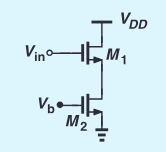

# 연습문제 11.23 — λ = 0일 때 소스 폴로어의 입력 커패시턴스 (예제 11.23 변형)

## 원문
$\lambda = 0$일 때, 위의 예제를 반복하라.

## 조건
- 예제 11.23의 회로: Fig 11.45 소스 폴로어 ($M_1$, 전류원 $M_2$)
- 변경: $\lambda = 0$ (예제는 $\lambda \neq 0$)

## 구할 것
- 예제 11.23 반복: 폴로어의 입력 커패시턴스

## 상속·참조
- 예제 11.23 (E11.23): 저주파수 이득 $A_v = \dfrac{r_{O1} \parallel r_{O2}}{r_{O1} \parallel r_{O2} + \dfrac{1}{g_{m1}}}$ (식 11.125), 입출력 사이 커패시턴스는 $C_{GS1}$ → $C_{in} = C_{GD1} + (1 - A_v)C_{GS1}$ (식 11.126)
- 폴로어 입력 커패시턴스 (밀러 이론): 저주파수 이득 $A_v = \dfrac{R_L}{R_L + \dfrac{1}{g_m}}$ (식 11.122), $C_\pi$ 또는 $C_{GS}$의 '입력' 성분 $C_X = (1 - A_v)C_{XY}$ (식 11.123) $= \dfrac{1}{1 + g_m R_L}C_{XY}$ (식 11.124). $C_\mu$ 또는 $C_{GD}$는 이 값에 직접 더해짐

## 회로 — Fig 11.45
```spice
* M1 소스–M2 드레인 노드는 라벨도 출력 원도 없음 (원문에 없음)
M1  VDD  Vin  n1  nmos
M2  n1   Vb   0   nmos
```
- 단자: VDD = 전원, 값 미지정 (T 전원 기호) / Vin = 입력 (개방 원) / Vb = 이상적 DC 바이어스 (점 단자)
- 표시: 노드 라벨 V_DD (T 기호 오른쪽), V_in (입력 원 왼쪽), V_b (점 단자 왼쪽) / 소자 라벨 M1 (트랜지스터 오른쪽, 소스 옆), M2 (트랜지스터 왼쪽 아래, V_b 점 단자 아래) / 부호 없음 / 화살표 없음 / 수치·면적 라벨 없음
- 배치: 한 세로줄 위→아래 V_DD T 기호, M1, M2, 접지 / M1, M2 모두 NMOS 보통 방향(게이트 왼쪽, 드레인 위, 소스 아래) / V_in 원 → 가로선 → M1 게이트 / M2 게이트 → 가로선 → 왼쪽 V_b 점 단자 / M1 소스에서 세로선이 바로 M2 드레인으로 이어짐 (가지 없음) / 접속점: 없음 / 교차: 없음



## 풀이
### 저주파수 이득
- $M_1$ 소스에서 접지로 가는 저항은 $r_{O1} \parallel r_{O2}$이고, $\lambda = 0$이면 $r_{O1} = r_{O2} = \infty$
- $A_v = \dfrac{r_{O1} \parallel r_{O2}}{r_{O1} \parallel r_{O2} + 1/g_{m1}} = 1$ ($g_{m1}$: $M_1$의 트랜스컨덕턴스)
### 입력 커패시턴스
- $C_{GS1}$은 입력(게이트)과 출력(소스) 사이에 있으므로 밀러로 입력 쪽 성분은 $(1 - A_v)C_{GS1} = 0$
- $C_{GD1}$은 게이트와 AC 접지($V_{DD}$) 사이라 그대로 더해진다: $C_{in} = C_{GD1} + (1 - A_v)C_{GS1} = C_{GD1}$
- 소스가 게이트를 똑같이 따라가 $C_{GS1}$ 양 끝 전압이 변하지 않으므로 $C_{GS1}$로는 전류가 흐르지 않는다
### 답
- $C_{in} = C_{GD1}$ ($C_{GS1}$은 입력에서 보이지 않는다)
