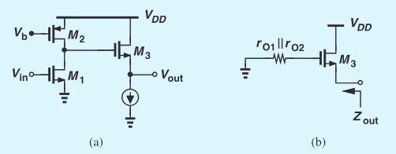

# 연습문제 11.24 — M1–M3 모두 λ ≠ 0일 때 이단 증폭기의 Z_out (예제 11.24 변형)

## 조건
- 예제 11.24의 회로: Fig 11.49(a) 이단 증폭기 (CS 단 $M_1$, $M_2$ + 소스 폴로어 $M_3$)
- 변경: $M_1$–$M_3$ 모두 $\lambda \neq 0$ (예제는 $M_3$의 $\lambda = 0$)
- 그 밖의 가정 ($C_{GS3}$를 제외한 모든 커패시턴스 무시)은 예제와 같다고 봄 (원문에 없음)

## 구할 것
- 예제 11.24의 회로에서 $Z_{out}$

## 상속·참조
- 예제 11.24 (E11.24): 폴로어에서 바라본 소스 임피던스는 CS 단의 출력 저항 $r_{O1} \parallel r_{O2}$ (풀이 그림 11.49(b): 접지–$r_{O1} \parallel r_{O2}$–$M_3$ 게이트, $M_3$ 드레인 $V_{DD}$, 소스가 $Z_{out}$ 측정 단자). $M_3$의 $\lambda = 0$일 때 $\dfrac{V_X}{I_X} = \dfrac{(r_{O1} \parallel r_{O2})C_{GS3}s + 1}{C_{GS3}s + g_{m3}}$ (식 11.133)
- 소스 폴로어 출력 임피던스 (교재 617쪽): $\dfrac{V_X}{I_X} = \dfrac{R_S C_{GS}s + 1}{C_{GS}s + g_m}$ (식 11.132)

## 회로 — Fig 11.49(a)
```spice
M2  n1    Vb   VDD   pmos
M1  n1    Vin  0     nmos
M3  VDD   n1   Vout  nmos
* 라벨 없는 바이어스 전류원, 화살표 아래 방향
I1  Vout  0
```
- 단자: VDD = 전원, 값 미지정 (가로 레일) / Vb = 이상적 DC 바이어스 (점 단자) / Vin = 입력 (개방 원) / Vout = 출력 (개방 원)
- 표시: 노드 라벨 V_DD (레일 오른쪽 끝), V_b (점 단자 왼쪽), V_in (입력 원 왼쪽), V_out (출력 원 오른쪽) / 소자 라벨 M2 (트랜지스터 오른쪽), M3 (트랜지스터 오른쪽), M1 (트랜지스터 오른쪽), I1 (라벨 없음) / 부호 없음 / 화살표 없음 / 수치·면적 라벨 없음
- 배치: 맨 위 V_DD 가로 레일 / 왼쪽 세로줄 위→아래 레일, M2, 가운데 접속점, M1, 접지 / M2 PMOS(게이트 왼쪽, 소스 위 레일, 드레인 아래, 소스 화살표는 게이트 쪽을 향함), 게이트 → 왼쪽 V_b 점 단자 / M1 NMOS 보통 방향, 게이트 → 가로선 → 왼쪽 V_in 원 / 가운데 접속점에서 가로선이 오른쪽으로 M3 게이트 / 오른쪽 세로줄 위→아래 레일(오른쪽 끝 근처에서 내려옴), M3, 출력 접속점, 전류원, 접지 / M3 NMOS 보통 방향(게이트 왼쪽, 드레인 위, 소스 아래) / 출력 접속점에서 가로선이 오른쪽 V_out 원에서 끝남 / 접속점 (세 갈래 이상, 2곳): ① M2 드레인 = 위 M2 드레인 + 아래 M1 드레인 + 오른쪽 M3 게이트 선 (점) ② 출력 = 위 M3 소스 + 아래 전류원 + 오른쪽 V_out 선 (점) / 교차: 없음


> 참고: 크롭 이미지 오른쪽 (b)는 예제 11.24의 풀이 그림
