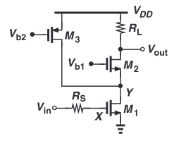

# 연습문제 11.26 — 예제 11.18 파라미터로 M3가 붙은 캐스코드의 극점 계산 (예제 11.26 이어서)

## 원문
예제 11.18에서 $M_1 \sim M_3$에 대해 주어진 트랜지스터 파라미터들을 이용하여 위의 예제에서의 극점 주파수를 계산하라.

## 조건
- 예제 11.26의 회로: Fig 11.54 캐스코드 ($M_1$, $M_2$, 전류원 $M_3$, $R_S$, $R_L$), $\lambda = 0$
- $M_1$–$M_3$의 트랜지스터 파라미터는 예제 11.18에서 주어진 값: $C_{GS} = 250\ \text{fF}$, $C_{GD} = 80\ \text{fF}$, $C_{DB} = 100\ \text{fF}$, $g_m = (150\ \Omega)^{-1}$, $\lambda = 0$ (원문에 없음)
- 예제 11.18은 트랜지스터 하나의 값만 주므로 세 트랜지스터에 같은 값을 쓰는 것으로 봄. $C_{SB}$ 값과 $R_S$, $R_L$ 값은 문제에 없음 (원문에 없음)
- $R_S = 200\ \Omega$, $R_L = 2\ \text{k}\Omega$ (예제 11.18), $C_{SB} = C_{DB} = 100\ \text{fF}$ (예제 11.25) (원문에 없음)

## 구할 것
- 예제 11.26 회로의 극점 주파수

## 상속·참조
- 예제 11.18 (E11.18)의 트랜지스터 파라미터: $C_{GS} = 250\ \text{fF}$, $C_{GD} = 80\ \text{fF}$, $C_{DB} = 100\ \text{fF}$, $g_m = (150\ \Omega)^{-1}$, $\lambda = 0$ (예제 11.18의 $R_S = 200\ \Omega$, $R_L = 2\ \text{k}\Omega$는 CS 단의 회로 값)
- 예제 11.26 (E11.26): $M_3$는 $Y$ 노드에 $C_{GD3}$와 $C_{DB3}$를 더함. $|\omega_{p,X}| = \dfrac{1}{R_S\left[C_{GS1} + \left(1 + \dfrac{g_{m1}}{g_{m2}}\right)C_{GD1}\right]}$ (식 11.147), $|\omega_{p,Y}| = \dfrac{1}{\dfrac{1}{g_{m2}}\left[C_{DB1} + C_{GS2} + \left(1 + \dfrac{g_{m2}}{g_{m1}}\right)C_{GD1} + C_{GD3} + C_{DB3} + C_{SB2}\right]}$ (식 11.148), $|\omega_{p,out}| = \dfrac{1}{R_L(C_{DB2} + C_{GD2})}$ (식 11.149). $M_3$의 추가는 $I_{D2}$와 $g_{m2}$를 감소시킴

## 회로 — Fig 11.54
```spice
M3  Y     Vb2  VDD   pmos
RL  VDD   Vout {R_L}
M2  Vout  Vb1  Y     nmos
M1  Y     X    0     nmos
RS  Vin   X    {R_S}
```
- 단자: VDD = 전원, 값 미지정 (가로 레일) / Vb2, Vb1 = 이상적 DC 바이어스 (점 단자) / Vin = 입력 (개방 원) / Vout = 출력 (개방 원)
- 표시: 노드 라벨 V_DD (레일 오른쪽 끝), V_b2 (점 단자 왼쪽), V_out (출력 원 오른쪽), V_b1 (점 단자 왼쪽), Y (Y 접속점 오른쪽 아래), V_in (입력 원 왼쪽), X (M1 게이트 선 아래, 게이트 바로 왼쪽) / 소자 라벨 M3 (트랜지스터 오른쪽), R_L (저항 오른쪽), M2 (트랜지스터 오른쪽), R_S (저항 위), M1 (트랜지스터 오른쪽) / 부호 없음 / 화살표 없음 / 수치·면적 라벨 없음
- 배치: 맨 위 V_DD 가로 레일 / 왼쪽: 레일 왼쪽 끝에 M3 소스, M3 PMOS(게이트 왼쪽 → V_b2 점 단자, 소스 위, 드레인 아래, 소스 화살표는 게이트 쪽을 향함) / M3 드레인에서 긴 세로선이 Y 높이까지 내려가 모서리에서 오른쪽으로 꺾여 Y 접속점 / 오른쪽 세로줄 위→아래 레일, R_L, 출력 접속점, M2, Y 접속점, M1, 접지 / M2, M1 NMOS 보통 방향(게이트 왼쪽, 드레인 위, 소스 아래) / M2 게이트 → 가로선 → 왼쪽 V_b1 점 단자 / V_in 원 → 가로 R_S → M1 게이트 / 출력 접속점에서 가로선이 오른쪽 V_out 원에서 끝남 / 접속점 (세 갈래 이상, 2곳): ① 출력 = 위 R_L + 아래 M2 드레인 + 오른쪽 V_out 선 (점) ② Y = 위 M2 소스 + 아래 M1 드레인 + 왼쪽 M3 드레인 선 (점) / 교차: 없음


> 참고: 그림 11.54는 예제 11.26의 풀이 상자 끝(교재 622쪽 아래)에 인쇄됨

## 풀이
### 쓰는 값
- 세 트랜지스터 모두 $C_{GS} = 250$, $C_{GD} = 80$, $C_{DB} = 100\ \text{fF}$, $g_m = (150\ \Omega)^{-1}$
- $X$에서 $Y$까지 이득 $-g_{m1}/g_{m2} = -1$이라 $C_{GD1}$의 밀러 배수는 양쪽 모두 2
### $X$ 노드 극점
- $|\omega_{p,X}| = \dfrac{1}{R_S(C_{GS1} + 2C_{GD1})} = \dfrac{1}{(200\ \Omega)(410\ \text{fF})} = 2\pi \times 1.94\ \text{GHz}$
### $Y$ 노드 극점
- $M_3$ 드레인이 $Y$에 붙어 $C_{GD3}$(게이트 $V_{b2}$는 AC 접지)와 $C_{DB3}$가 $Y$에 더해진다. $\lambda = 0$이라 $Y$에서 본 저항은 $1/g_{m2}$
- $C_Y = C_{DB1} + C_{GS2} + 2C_{GD1} + C_{GD3} + C_{DB3} + C_{SB2} = 100 + 250 + 160 + 80 + 100 + 100 = 790\ \text{fF}$
- $|\omega_{p,Y}| = \dfrac{g_{m2}}{C_Y} = \dfrac{1}{(150\ \Omega)(790\ \text{fF})} = 2\pi \times 1.34\ \text{GHz}$
### 출력 노드 극점
- $|\omega_{p,out}| = \dfrac{1}{R_L(C_{DB2} + C_{GD2})} = \dfrac{1}{(2\ \text{k}\Omega)(180\ \text{fF})} = 2\pi \times 442\ \text{MHz}$
### 답
- $|\omega_{p,X}| = 2\pi \times 1.94\ \text{GHz}$, $|\omega_{p,Y}| = 2\pi \times 1.34\ \text{GHz}$, $|\omega_{p,out}| = 2\pi \times 442\ \text{MHz}$
