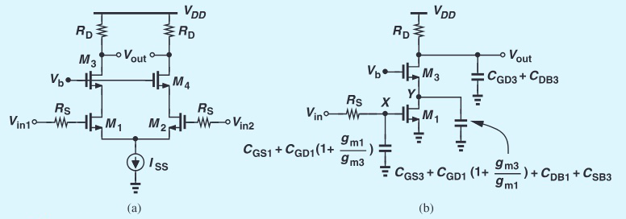

# 연습문제 11.27 — 예제 11.18 파라미터로 캐스코드 차동쌍의 극점 계산 (예제 11.27 이어서)

## 원문
예제 11.18에서 주어진 트랜지스터 파라미터들을 사용하여 극점 주파수를 계산하라. $M_3$의 폭과 그에 따른 커패시턴스가 $M_1$의 2배라고 가정한다. 또한 $g_{m3} = \sqrt{2}\,g_{m1}$이다.

## 조건
- 예제 11.27의 회로: Fig 11.56(a) 캐스코드 차동쌍
- 트랜지스터 파라미터는 예제 11.18에서 주어진 값: $C_{GS} = 250\ \text{fF}$, $C_{GD} = 80\ \text{fF}$, $C_{DB} = 100\ \text{fF}$, $g_m = (150\ \Omega)^{-1}$, $\lambda = 0$ (원문에 없음)
- $M_3$의 폭과 그에 따른 커패시턴스가 $M_1$의 2배
- $g_{m3} = \sqrt{2}\,g_{m1}$
- 예제 11.18의 값은 $M_1$에 쓰는 것으로 봄. $C_{SB}$ 값과 $R_S$, $R_D$ 값은 문제에 없음 (원문에 없음)

## 구할 것
- 극점 주파수

## 상속·참조
- 예제 11.18 (E11.18)의 트랜지스터 파라미터: $C_{GS} = 250\ \text{fF}$, $C_{GD} = 80\ \text{fF}$, $C_{DB} = 100\ \text{fF}$, $g_m = (150\ \Omega)^{-1}$, $\lambda = 0$ (예제 11.18의 $R_S = 200\ \Omega$, $R_L = 2\ \text{k}\Omega$는 CS 단의 회로 값)
- 예제 11.27 (E11.27): 절반 회로(풀이 그림 11.56(b): $V_{DD}$–$R_D$–$V_{out}$–$M_3$–$Y$–$M_1$–접지, $V_b$는 $M_3$ 게이트, $V_{in}$–$R_S$–$X$–$M_1$ 게이트, $X$–접지 $C_{GS1} + C_{GD1}(1 + g_{m1}/g_{m3})$, $Y$–접지 $C_{GS3} + C_{GD1}(1 + g_{m3}/g_{m1}) + C_{DB1} + C_{SB3}$, $V_{out}$–접지 $C_{GD3} + C_{DB3}$)에서 $|\omega_{p,X}| = \dfrac{1}{R_S\left[C_{GS1} + \left(1 + \dfrac{g_{m1}}{g_{m3}}\right)C_{GD1}\right]}$ (식 11.155), $|\omega_{p,Y}| = \dfrac{1}{\dfrac{1}{g_{m3}}\left[C_{DB1} + C_{GS3} + \left(1 + \dfrac{g_{m3}}{g_{m1}}\right)C_{GD1} + C_{SB3}\right]}$ (식 11.156, 인쇄본은 $C_{GD1}$과 $C_{SB3}$ 사이의 + 가 빠짐), $|\omega_{p,out}| = \dfrac{1}{R_L(C_{DB3} + C_{GD3})}$ (식 11.157, 부하 저항은 그림의 $R_D$)

## 회로 — Fig 11.56(a)
```spice
* V_out 라벨은 두 출력 원 사이에 하나만 인쇄됨 → out1(왼쪽), out2(오른쪽)
RD1  VDD   out1  {R_D}
RD2  VDD   out2  {R_D}
M3   out1  Vb    n1    nmos
M4   out2  Vb    n2    nmos
M1   n1    n3    n5    nmos
M2   n2    n4    n5    nmos
RS1  Vin1  n3    {R_S}
RS2  Vin2  n4    {R_S}
ISS  n5    0     {I_SS}
```
- 단자: VDD = 전원, 값 미지정 (가로 레일) / Vb = 이상적 DC 바이어스 (점 단자) / Vin1, Vin2 = 입력 (개방 원) / out1, out2 = 차동 출력 (개방 원 두 개, 사이에 V_out 라벨 하나)
- 표시: 노드 라벨 V_DD (레일 오른쪽 끝), V_out (두 출력 원 사이), V_b (점 단자 왼쪽), V_in1 (왼쪽 입력 원 왼쪽), V_in2 (오른쪽 입력 원 오른쪽) / 소자 라벨 R_D (왼쪽 저항 왼쪽), R_D (오른쪽 저항 오른쪽), M3 (트랜지스터 왼쪽 위, 드레인 접속점 왼쪽), M4 (트랜지스터 오른쪽), R_S (각 저항 위), M1 (트랜지스터 오른쪽), M2 (트랜지스터 왼쪽), I_SS (전류원 오른쪽) / 부호 없음 / 화살표 없음 / 수치·면적 라벨 없음
- 배치: 맨 위 V_DD 가로 레일에 두 R_D가 매달림 / 왼쪽 세로줄 위→아래 R_D, 출력 접속점, M3, M1 / 오른쪽 세로줄 위→아래 R_D, 출력 접속점, M4, M2 / 왼쪽 출력 접속점에서 가로선이 오른쪽 원(out1)에서, 오른쪽 출력 접속점에서 가로선이 왼쪽 원(out2)에서 끝남, 두 원 사이에 V_out 라벨 / M3, M4, M1 NMOS 보통 방향(게이트 왼쪽, 드레인 위, 소스 아래) / M2 NMOS 좌우 반전(게이트 오른쪽, 드레인 위, 소스 아래, 소스 화살표는 왼쪽 바깥을 향함) / V_b 점 단자 → 가로선 → M3 게이트, 같은 가로선이 M3 기호(게이트판과 채널)를 가로질러 오른쪽 M4 게이트까지 이어짐 / V_in1 원 → 가로 R_S → M1 게이트, V_in2 원 → 가로 R_S(오른쪽) → M2 게이트 / M1 소스는 아래로 내려가 오른쪽으로, M2 소스는 아래로 내려가 왼쪽으로 꺾여 가운데 꼬리 접속점, 그 아래 I_SS, 접지 / 접속점 (세 갈래 이상, 3곳): ① 왼쪽 출력 = 위 R_D + 아래 M3 드레인 + 오른쪽 out1 선 (점) ② 오른쪽 출력 = 위 R_D + 아래 M4 드레인 + 왼쪽 out2 선 (점) ③ 꼬리 = 왼쪽 M1 소스 선 + 오른쪽 M2 소스 선 + 아래 I_SS (점) / 교차: V_b–M4 게이트 가로선이 M3 기호(게이트판, 채널 가운데)를 점 없이 지나감


> 참고: 크롭 이미지 오른쪽 (b)는 예제 11.27의 풀이 그림
