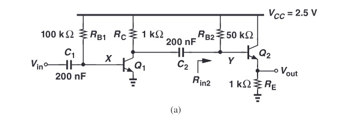

# 연습문제 11.28 — R_E = 500 Ω일 때 이단 바이폴라 증폭기의 차단 저주파수 (예제 11.28 변형)

## 원문
$R_E = 500\ \Omega$일 때, 위의 예제를 반복하라.

## 조건
- 예제 11.28의 회로: Fig 11.59(a) ($V_{CC} = 2.5\ \text{V}$, $C_1 = C_2 = 200\ \text{nF}$, $R_{B1} = 100\ \text{k}\Omega$, $R_C = 1\ \text{k}\Omega$, $R_{B2} = 50\ \text{k}\Omega$), $I_S = 5 \times 10^{-16}\ \text{A}$, $\beta = 100$, $V_A = \infty$
- 변경: $R_E = 500\ \Omega$ (그림은 $1\ \text{k}\Omega$)

## 구할 것
- 예제 11.28 반복: 회로의 차단 저주파수

## 상속·참조
- 예제 11.28 (E11.28): 동작점은 $V_{BE}$ 추정(예: 800 mV)에서 시작해 반복. $I_{C1} = \beta\dfrac{V_{CC} - V_{BE1}}{R_{B1}}$ (식 11.162), $V_{CC} = I_{B2}R_{B2} + V_{BE2} + R_E I_{C2}$ (식 11.164) → $I_{C2} = \dfrac{V_{CC} - V_{BE2}}{R_{B2}/\beta + R_E}$ (식 11.165). $R_E = 1\ \text{k}\Omega$에서 $I_{C1} = 1.75\ \text{mA}$, $g_{m1} = (14.9\ \Omega)^{-1}$, $r_{\pi1} = 1.49\ \text{k}\Omega$, $I_{C2} = 1.17\ \text{mA}$, $g_{m2} = (22.2\ \Omega)^{-1}$, $r_{\pi2} = 2.22\ \text{k}\Omega$
- 첫 단: $\omega_{L1} = \dfrac{1}{(r_{\pi1} \parallel R_{B1})C_1}$ (식 11.167), $R_E = 1\ \text{k}\Omega$에서 $2\pi \times (542\ \text{Hz})$
- 둘째 결합: $R_{in2} = R_{B2} \parallel [r_{\pi2} + (\beta + 1)R_E]$, $\omega_{L2} = \dfrac{1}{(R_C + R_{in2})C_2}$ (식 11.170), $R_E = 1\ \text{k}\Omega$에서 22.9 Hz (식 11.171은 $\pi \times (22.9\ \text{Hz})$로 인쇄됨). $\omega_{L2} \ll \omega_{L1}$이면 $\omega_{L1}$이 저주파수 응답을 주도

## 회로 — Fig 11.59(a)
```spice
C1   Vin   X     200nF
RB1  VCC   X     100k
Q1   n1    X     0     npn
RC   VCC   n1    1k
C2   n1    Y     200nF
RB2  VCC   Y     50k
Q2   VCC   Y     Vout  npn
RE   Vout  0     1k
```
- 단자: VCC = 2.5 V 전원 (가로 레일) / Vin = 입력 (개방 원) / Vout = 출력 (개방 원)
- 표시: 노드 라벨 V_CC = 2.5 V (레일 오른쪽 끝), V_in (입력 원 왼쪽), X (Q1 베이스 선 위), Y (Q2 베이스 선 아래, 접속점 오른쪽), V_out (출력 원 오른쪽) / 소자 라벨 R_B1 (저항 오른쪽), C_1 (커패시터 위), R_C (저항 왼쪽), Q1 (트랜지스터 오른쪽), C_2 (커패시터 아래), R_B2 (저항 왼쪽), Q2 (트랜지스터 오른쪽), R_E (저항 오른쪽) / 부호 없음 / 화살표 "R_in2": Y 노드를 오른쪽(Q2 쪽)으로 들여다봄, 오른쪽 방향, 도선 옆 별도 화살표 (┌ 꺾임: C_2와 Y 사이 가로선 아래에 세로선, 위 끝에서 가로선이 오른쪽으로 뻗고 화살촉은 오른쪽 끝, 글자 R_in2는 세로선 아래 끝) / 수치·면적 라벨 "100 kΩ" (R_B1 왼쪽), "200 nF" (C_1 아래), "1 kΩ" (R_C 오른쪽), "200 nF" (C_2 위), "50 kΩ" (R_B2 오른쪽), "1 kΩ" (R_E 왼쪽)
- 배치: 맨 위 V_CC 가로 레일에 왼쪽부터 R_B1, R_C, R_B2가 매달리고 Q2 컬렉터가 레일 오른쪽 끝 근처로 올라가 닿음 / V_in 원 → 가로 C_1 → X 접속점 → 가로선 → Q1 베이스, X 접속점 위로 R_B1 / Q1 npn 보통 방향(베이스 왼쪽, 컬렉터 위, 이미터 아래), 이미터 아래 접지 / R_C 아래 컬렉터 접속점에서 가로선이 오른쪽으로 C_2를 지나 Y 접속점 → Q2 베이스, Y 접속점 위로 R_B2 / Q2 npn 보통 방향, 이미터 아래 출력 접속점, 그 아래 R_E와 접지 / 출력 접속점에서 가로선이 오른쪽 V_out 원에서 끝남 / 접속점 (세 갈래 이상, 4곳): ① X = 왼쪽 C_1 + 위 R_B1 + 오른쪽 베이스 선 (점) ② Q1 컬렉터 = 위 R_C + 아래 Q1 컬렉터 + 오른쪽 C_2 선 (점) ③ Y = 왼쪽 C_2 선 + 위 R_B2 + 오른쪽 Q2 베이스 (점) ④ 출력 = 위 Q2 이미터 + 아래 R_E + 오른쪽 V_out 선 (점) / 교차: 없음


> 참고: 그림 11.59 전체는 교재 627쪽에 인쇄됨
