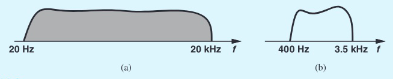

# 예제 11.1 — 전화로 들은 목소리가 마주 보고 들은 목소리와 다른 이유

## 조건
- 사람들의 목소리를 전화를 통해 들을 때와 마주 보고 대화할 때 비교
- 문제 상자 안에 Fig 11.2(a), (b)가 인쇄됨 (문제 문장은 그림을 언급하지 않음, 풀이가 (a) = 사람 목소리의 주파수 성분, (b) = 전화 시스템의 주파수 응답으로 씀)

## 구할 것
- 전화를 통한 사람들의 목소리가 마주 보고 대화할 때의 목소리와 다른 이유 설명

## 상속·참조
- Fig 11.2 (문제 상자 안, 크롭함): 주파수 스펙트럼 그래프 (회로 그림 아님)
  - (a) 가로축 화살표 "f" (세로축과 세로 라벨 없음). 회색으로 채운 영역: 왼쪽 "20 Hz"에서 곡선이 가파르게 올라가 거의 평평하게(약간 물결치며) 이어지다가 오른쪽 "20 kHz"에서 거의 수직으로 떨어짐
  - (b) 가로축 화살표 "f" (세로축 없음). 채우지 않은 곡선: "400 Hz"에서 가파르게 올라가 봉우리 두 개(왼쪽이 조금 낮고 오른쪽이 조금 높음, 사이는 오목)를 지나 "3.5 kHz"에서 거의 수직으로 떨어짐. (a)보다 폭이 훨씬 좁게 그려짐

## 회로 — 없음 (주파수 스펙트럼 그래프 문제, 그림 11.2는 회로가 아닌 그래프로 상속·참조에 적음)

## 답 (검증용)
- 사람의 목소리는 $20\ \text{Hz}$에서 $20\ \text{kHz}$ 사이의 주파수 성분을 가짐 (Fig 11.2(a)) → 목소리를 처리하는 회로는 이 대역을 모두 포용해야 함
- 전화 시스템은 Fig 11.2(b)처럼 제한된 대역폭을 가져 $3.5\ \text{kHz}$ 이상의 주파수를 차단 → 목소리가 달라짐. 고성능 오디오 시스템은 전체 주파수 영역을 다루게 설계됨
