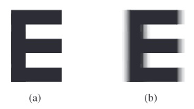

# 예제 11.3 — 영상 시스템의 대역폭이 부족할 때 생기는 일

## 조건
- 영상 신호는 일반적으로 약 $5\ \text{MHz}$의 대역폭을 가짐
- 예: 컴퓨터 화면에 영상 신호를 전송하는 그래픽 카드는 최소한 $5\ \text{MHz}$ 대역폭을 지원해야 함

## 구할 것
- 영상 시스템의 대역폭이 부족하다면 어떤 일이 생기는지 설명

## 회로 — 없음 (글 문제, 그림 11.3은 풀이의 영상 예시)

## 답 (검증용)
- 대역폭이 부족하면 화면 영상의 뚜렷한 테두리들이 부드러워져 흐릿한 영상이 됨. 화면을 구동하는 회로가 한 픽셀에서 다음 픽셀로 콘트라스트를 완전한 백색에서 완전한 검정색으로 급격히 바꿀 만큼 빠르지 못하기 때문
- Fig 11.3(a) = 고대역 드라이버, Fig 11.3(b) = 저대역 드라이버의 효과. 영상은 좌에서 우로 스캔됨
- Fig 11.3(a): 검은 굵은 대문자 "E" 한 글자, 모든 테두리가 뚜렷함
- Fig 11.3(b): 같은 "E"인데 세로 방향 테두리(글자 왼쪽 끝, 세로획의 오른쪽 안쪽 경계, 가로획 세 개의 오른쪽 끝)가 회색으로 번져 흐릿함. 가로 방향 테두리(가로획의 위아래 경계)는 뚜렷함

