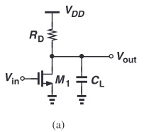
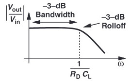

# 예제 11.4 — 부하 커패시턴스를 가진 CS 단의 전달 함수와 주파수 응답

## 원문
그림 11.5(a)에 보여진 공통 소스(CS) 단의 전달 함수와 주파수 응답을 결정하라.

## 조건
- 회로: Fig 11.5(a) 공통 소스(CS) 단 ($M_1$, 드레인 저항 $R_D$, 출력의 부하 커패시턴스 $C_L$)
- 채널길이 변조는 무시 (본문 식 (11.1)의 각주)
- 소자 값은 주어지지 않음 (답은 기호로) (원문에 없음)

## 구할 것
- 전달 함수 $H(s) = \dfrac{V_{out}}{V_{in}}(s)$
- 주파수 응답

## 상속·참조
- 식 (11.1) (본문 Fig 11.5(b) 소신호 등가 회로에서, $R_D$와 $C_L$이 병렬): $V_{out} = -g_m V_{in}\left(R_D \parallel \dfrac{1}{C_L s}\right)$. 채널길이 변조는 여기서 무시 (각주)
- 본문 Fig 11.5(b) (교재 575쪽, 크롭 이미지 오른쪽): 왼쪽 $V_{in}$ 개방 원에서 짧은 가로선이 끝나고, 그 아래에 + (위), − (아래)와 접지 기호 → 게이트–소스 전압이 $V_{in}$. 오른쪽에 전류원 $g_m V_{in}$ (원 안 화살표 아래 = 출력 노드 → 접지), $R_D$, $C_L$이 모두 가로 출력선과 각자의 접지 사이에 병렬, 출력선 오른쪽 끝 $V_{out}$ 개방 원
- 본문 식 (11.3): 사인 입력에 대한 주파수 응답은 $s = j\omega$를 대입한 $|H(j\omega)|$ (크기), $\angle H(j\omega)$ (위상). 이 장은 우선 크기에 관심

## 회로 — Fig 11.5(a)
```spice
RD  VDD   Vout  {R_D}
M1  Vout  Vin   0  nmos
CL  Vout  0     {C_L}
```
- 단자: VDD = 전원, 값 미지정 (T 전원 기호) / Vin = 입력 (개방 원) / Vout = 출력 (개방 원)
- 표시: 노드 라벨 V_DD (T 기호 오른쪽), V_in (입력 원 왼쪽), V_out (출력 원 오른쪽) / 소자 라벨 R_D (저항 왼쪽), M1 (트랜지스터 오른쪽, 소스 옆), C_L (커패시터 오른쪽) / 부호 없음 / 화살표 없음 / 수치·면적 라벨 없음
- 배치: 왼쪽 세로줄 위→아래 V_DD T 기호, R_D, 드레인 접속점, M1, 접지 / M1 NMOS 보통 방향(게이트 왼쪽, 드레인 위, 소스 아래) / V_in 원 → 짧은 가로선 → 게이트 / 드레인 접속점에서 가로선이 오른쪽으로 C_L 접속점을 지나 V_out 원에서 끝남 / C_L은 C_L 접속점에서 세로로 내려가고 그 아래 접지 / 접지 기호는 M1 소스 아래, C_L 아래에 따로 / 접속점 (세 갈래 이상, 2곳): ① 드레인 = 위 R_D + 아래 M1 드레인 + 오른쪽 가로선 (점) ② C_L 위 = 왼쪽 가로선 + 오른쪽 V_out 선 + 아래 C_L (점) / 교차: 없음



## 답 (검증용)
- $H(s) = -g_m\left(R_D \parallel \dfrac{1}{C_L s}\right) = \dfrac{-g_m R_D}{R_D C_L s + 1}$ (식 11.4–11.5)
- $\left|\dfrac{V_{out}}{V_{in}}\right| = \dfrac{g_m R_D}{\sqrt{R_D^2 C_L^2 \omega^2 + 1}}$ (식 11.6). 저주파에서 $g_m R_D$로 시작해 $R_D^2 C_L^2 \omega^2$이 1에 가까워지면서 감소. $\omega = 1/(R_D C_L)$에서 $g_m R_D/\sqrt{2}$ (식 11.7), $20\log\sqrt{2} \approx 3\ \text{dB}$ → −3 dB 대역폭은 $1/(R_D C_L)$ (Fig 11.6)
- Fig 11.6: 세로축 라벨 "|V_out/V_in|", 가로축 "ω". 곡선은 평평하게 가다가 "1/(R_D C_L)" 부근에서 꺾여 내려감, 그 점에서 가로축까지 세로 점선. 평평한 부분 위에 양쪽 화살표와 "−3-dB Bandwidth", 꺾이는 점을 오른쪽 위에서 가리키는 화살표와 "−3-dB Rolloff"


