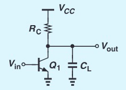

# 예제 11.5 — CE 단의 전압 이득, −3 dB 대역폭, 전력 소모의 관계

## 원문
그림 11.7의 공통 이미터(CE) 단을 살펴보자. 회로의 전압 이득, −3 dB 대역폭, 그리고 전력 소모 간의 관계를 유도하라. $V_A = \infty$를 가정한다.

## 조건
- 회로: Fig 11.7 공통 이미터(CE) 단 ($Q_1$, 컬렉터 저항 $R_C$, 출력의 부하 커패시턴스 $C_L$)
- $V_A = \infty$
- 소자 값은 주어지지 않음 (답은 기호로) (원문에 없음)

## 구할 것
- 회로의 전압 이득, −3 dB 대역폭, 그리고 전력 소모 간의 관계 유도

## 상속·참조
- 예제 11.4 (E11.04)의 CS 단 (본문 Fig 11.5(a)): $H(s) = \dfrac{-g_m R_D}{R_D C_L s + 1}$ (식 11.5), 저주파 이득 $g_m R_D$, −3 dB 대역폭 $1/(R_D C_L)$. 풀이는 "비슷한 방식으로" CE 단에 적용함
- 풀이가 쓰는 바이폴라 관계: $g_m = I_C/V_T$, 전력 소모 $= I_C \cdot V_{CC}$ (전원 전류를 $I_C$로 봄) (원문에 없음)

## 회로 — Fig 11.7
```spice
RC  VCC   Vout  {R_C}
Q1  Vout  Vin   0  npn
CL  Vout  0     {C_L}
```
- 단자: VCC = 전원, 값 미지정 (T 전원 기호) / Vin = 입력 (개방 원) / Vout = 출력 (개방 원)
- 표시: 노드 라벨 V_CC (T 기호 오른쪽), V_in (입력 원 왼쪽), V_out (출력 원 오른쪽) / 소자 라벨 R_C (저항 왼쪽), Q1 (트랜지스터 오른쪽, 이미터 옆), C_L (커패시터 오른쪽) / 부호 없음 / 화살표 없음 / 수치·면적 라벨 없음
- 배치: 왼쪽 세로줄 위→아래 V_CC T 기호, R_C, 컬렉터 접속점, Q1, 접지 / Q1 npn 보통 방향(베이스 왼쪽, 컬렉터 오른쪽 위, 이미터 오른쪽 아래) / V_in 원 → 가로선 → 베이스 / 컬렉터 접속점에서 가로선이 오른쪽으로 C_L 접속점을 지나 V_out 원에서 끝남 / C_L은 C_L 접속점에서 세로로 내려가고 그 아래 접지 / 접지 기호는 Q1 이미터 아래, C_L 아래에 따로 / 접속점 (세 갈래 이상, 2곳): ① 컬렉터 = 위 R_C + 아래 Q1 컬렉터 + 오른쪽 가로선 (점) ② C_L 위 = 왼쪽 가로선 + 오른쪽 V_out 선 + 아래 C_L (점) / 교차: 없음


> 참고: 문제 문장은 576쪽 아래(PDF 4 왼쪽), 그림은 577쪽 위(PDF 4 오른쪽)에 이어진 같은 문제 상자

## 답 (검증용)
- −3 dB 대역폭 $1/(R_C C_L)$, 저주파 전압 이득 $g_m R_C = (I_C/V_T)R_C$, 전력 소모 $I_C \cdot V_{CC}$
- 성능 지수: $\dfrac{\text{Gain} \times \text{Bandwidth}}{\text{Power Consumption}} = \dfrac{\dfrac{I_C}{V_T} R_C \times \dfrac{1}{R_C C_L}}{I_C \cdot V_{CC}} = \dfrac{1}{V_T \cdot V_{CC}} \dfrac{1}{C_L}$ (식 11.8–11.9)
- 성능은 (a) 온도를 낮추거나, (b) 전압 스윙 제한의 손실을 감수하고 $V_{CC}$를 낮추거나, (c) 부하 커패시턴스를 낮춰 개선 가능. 부하 커패시턴스가 가장 큰 비중. 식 (11.9)는 CS 단에서 더 복잡해짐 (문제 11.15)

## 힌트
### $R_C$는 이득과 대역폭을 맞바꾼다
- 저주파 이득은 $R_C$에 비례하고 대역폭은 $R_C$에 반비례하므로, 둘을 곱하면 $R_C$가 빠진 양이 남는다
- 남은 $g_m$과 전력 소모가 같은 $I_C$에 묶여 있다는 점으로 전력과 잇는다

## 풀이
### 이득과 대역폭
- $V_A = \infty$라 CS 단(예제 11.4)과 같은 모양: $H(s) = \dfrac{-g_m R_C}{R_C C_L s + 1}$
- 저주파 이득 $g_m R_C = \dfrac{I_C}{V_T} R_C$, −3 dB 대역폭 $\omega_{-3\text{dB}} = \dfrac{1}{R_C C_L}$
### 전력 소모
- 전원에서 흐르는 전류는 $R_C$와 $Q_1$을 지나는 $I_C$ 하나다 (베이스 전류 무시)
- 전력 소모 $P = I_C \cdot V_{CC}$
### 성능 지수
- 이득 × 대역폭 $= \dfrac{I_C}{V_T} R_C \cdot \dfrac{1}{R_C C_L} = \dfrac{I_C}{V_T C_L}$: $R_C$는 이득과 대역폭을 맞바꾸므로 곱에서 빠진다
- $g_m$과 $P$가 같은 $I_C$에 비례하므로 $P$로 나누면 $I_C$도 빠진다: $\dfrac{\text{Gain} \times \text{Bandwidth}}{\text{Power}} = \dfrac{1}{V_T V_{CC} C_L}$
### 개선 방법
- $V_T = kT/q$를 줄이기(온도를 낮춤), $V_{CC}$를 줄이기(전압 스윙이 줄어드는 손실을 감수), $C_L$을 줄이기
- 실제로는 부하 커패시턴스 $C_L$이 가장 큰 비중을 차지한다
### 답
- 이득 $g_m R_C = (I_C/V_T) R_C$, 대역폭 $1/(R_C C_L)$, 전력 $I_C V_{CC}$이고, $\dfrac{\text{Gain} \times \text{Bandwidth}}{\text{Power}} = \dfrac{1}{V_T V_{CC} C_L}$이다. 온도·$V_{CC}$·$C_L$을 낮추면 성능이 좋아지며, 그중 $C_L$이 가장 중요하다.
