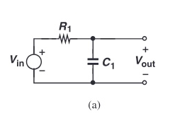
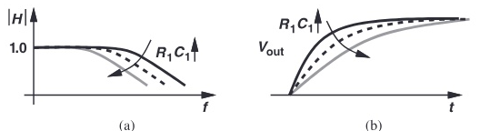

# 예제 11.6 — 간단한 저역여파기의 주파수 응답과 계단 응답의 관계

## 원문
그림 11.4(a)에 나타낸 간단한 저역여파기의 주파수 응답과 계단 응답 사이의 관계를 설명하라.

## 조건
- 회로: Fig 11.4(a) 간단한 저역여파기 (직렬 $R_1$, 출력 양단의 $C_1$, 입력 전압원 $V_{in}$)
- 소자 값은 주어지지 않음 (답은 기호로) (원문에 없음)

## 구할 것
- 이 저역여파기의 주파수 응답과 계단 응답 사이의 관계 설명

## 상속·참조
- 본문 (교재 574쪽): 저주파에서 $C_1$은 거의 오픈이라 $V_{out} = V_{in}$, 주파수가 오르면 $R_1$과 $C_1$의 전압 분배기가 $V_{in}$의 전달을 더 감쇠시킴 → Fig 11.4(b)의 특성

## 회로 — Fig 11.4(a)
```spice
* 접지 기호 없음: 아래 가로선(전압원 − 쪽, C1 아래, 아래 출력 원)을 out2로 적음
* out1/out2 = 두 출력 원. 그 사이에 "V_out" 라벨 하나와 + (위), − (아래)만 인쇄됨
VIN  n1    out2  {V_in}
R1   n1    out1  {R_1}
C1   out1  out2  {C_1}
```
- 단자: out1, out2 = 출력 전압 V_out의 + 쪽, − 쪽 (개방 원) / 입력은 개방 단자 없이 전압원 V_in이 회로 안에 그려짐
- 표시: 노드 라벨 V_out (두 출력 원 사이, 원보다 조금 왼쪽) / 소자 라벨 V_in (전압원 왼쪽), R_1 (저항 위), C_1 (커패시터 오른쪽) / 부호 전압원 원 오른쪽 위 +, 오른쪽 아래 −; 출력 V_out 라벨 위 +, 아래 − / 화살표 없음 / 수치·면적 라벨 없음
- 배치: 왼쪽에 세로 방향 전압원 V_in(원, + 위 − 아래) / 전압원 위 끝에서 세로선이 올라가 모서리에서 오른쪽으로 꺾여 가로 R_1, 위 접속점, 계속 오른쪽 위 출력 원(out1) / 위 접속점에서 C_1이 세로로 내려가 아래 접속점 / 전압원 아래 끝에서 세로선이 내려가 모서리에서 오른쪽으로 꺾여 아래 가로선, 아래 접속점, 계속 오른쪽 아래 출력 원(out2) / 접지 기호 없음 / 접속점 (세 갈래 이상, 2곳): ① 위 = 왼쪽 R_1 + 아래 C_1 + 오른쪽 out1 선 (점) ② 아래 = 왼쪽 가로선 + 위 C_1 + 오른쪽 out2 선 (점) / 교차: 없음



## 답 (검증용)
- 전압 분배기로 보면 $H(s) = \dfrac{V_{out}}{V_{in}}(s) = \dfrac{\frac{1}{C_1 s}}{\frac{1}{C_1 s} + R_1} = \dfrac{1}{R_1 C_1 s + 1}$ (식 11.10–11.11), $|H(s = j\omega)| = \dfrac{1}{\sqrt{R_1^2 C_1^2 \omega^2 + 1}}$ (식 11.12), −3 dB 대역폭 $1/(R_1 C_1)$
- 계단 입력 $V_0 u(t)$에 대한 응답 $V_{out}(t) = V_0\left(1 - \exp\dfrac{-t}{R_1 C_1}\right)u(t)$ (식 11.13)
- $R_1 C_1$이 증가할수록 대역폭은 감소하고 계단 응답은 더 느려짐: 좁은 대역폭은 느린 시간 응답을 초래 (Fig 11.8). 이것이 Fig 11.3(b)의 '흐릿한' 가장자리를 설명 (신호가 낮은 레벨(하양)에서 높은 레벨(검정)로 빠르게 뛰지 못하고 중간 레벨(회색 그림자)에서 시간을 소비)
- Fig 11.8(a): 세로축 라벨 "|H|", 높이 "1.0", 가로축 "f". 세 곡선(검은 실선, 검은 점선, 회색 실선)이 모두 1.0에서 평평하다가 내려감. 검은 실선이 가장 오른쪽(늦게)에서, 점선이 가운데, 회색 실선이 가장 왼쪽(일찍)에서 꺾임. 곡선들을 가로지르는 휜 화살표가 오른쪽 위에서 왼쪽 아래(검은 실선 → 회색 실선 쪽)를 향하고, 옆에 "R_1C_1↑"
- Fig 11.8(b): 세로축 없음 (왼쪽에 "V_out" 라벨만 떠 있음), 가로축 "t". 세 곡선이 가로축 왼쪽 끝에서 조금 오른쪽의 같은 점에서 출발해 올라가 오른쪽에서 같은 최종 레벨에 수렴. 검은 실선이 가장 빨리, 점선이 가운데, 회색 실선이 가장 느리게 올라감. 휜 화살표가 검은 실선 → 회색 실선 쪽(오른쪽 아래)을 향하고, 화살표가 시작하는 곳 왼쪽 위에 "R_1C_1↑"


