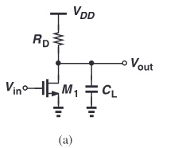
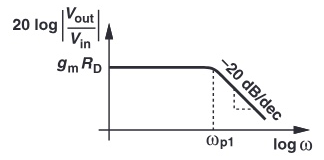

# 예제 11.7 — CS 단의 |H(jω)| 보데 플롯

## 원문
그림 11.5(a)에 도시된 공통 소스(CS) 단에서 $|H(j\omega)|$의 보데 플롯을 그려라.

## 조건
- 회로: Fig 11.5(a) 공통 소스(CS) 단 ($M_1$, $R_D$, $C_L$)
- 소자 값은 주어지지 않음 (답은 기호로) (원문에 없음)

## 구할 것
- $|H(j\omega)|$의 보데 플롯

## 상속·참조
- 예제 11.4 (E11.04): $H(s) = \dfrac{V_{out}}{V_{in}}(s) = \dfrac{-g_m R_D}{R_D C_L s + 1}$ (식 11.5), $\left|\dfrac{V_{out}}{V_{in}}\right| = \dfrac{g_m R_D}{\sqrt{R_D^2 C_L^2 \omega^2 + 1}}$ (식 11.6). 채널길이 변조는 무시
- 11.1.3절 보데의 규칙 (근사):
  - $\omega$가 각 극점 주파수를 지날 때 $|H(j\omega)|$의 기울기는 $20\ \text{dB/dec}$만큼 감소 ($20\ \text{dB/dec}$ = 주파수가 10배 증가할 때 $H$가 10배 변함)
  - $\omega$가 각 영점 주파수를 지날 때 기울기는 $20\ \text{dB/dec}$만큼 증가
- 식 (11.2)의 전달 함수 꼴: $H(s) = A_0 \dfrac{(1 - s/\omega_{z1})(1 - s/\omega_{z2})\cdots}{(1 - s/\omega_{p1})(1 - s/\omega_{p2})\cdots}$, $\omega_{zj}$ = 영점, $\omega_{pj}$ = 극점

## 회로 — Fig 11.5(a)
```spice
RD  VDD   Vout  {R_D}
M1  Vout  Vin   0  nmos
CL  Vout  0     {C_L}
```
- 단자: VDD = 전원, 값 미지정 (T 전원 기호) / Vin = 입력 (개방 원) / Vout = 출력 (개방 원)
- 표시: 노드 라벨 V_DD (T 기호 오른쪽), V_in (입력 원 왼쪽), V_out (출력 원 오른쪽) / 소자 라벨 R_D (저항 왼쪽), M1 (트랜지스터 오른쪽, 소스 옆), C_L (커패시터 오른쪽) / 부호 없음 / 화살표 없음 / 수치·면적 라벨 없음
- 배치: 왼쪽 세로줄 위→아래 V_DD T 기호, R_D, 드레인 접속점, M1, 접지 / M1 NMOS 보통 방향(게이트 왼쪽, 드레인 위, 소스 아래) / V_in 원 → 짧은 가로선 → 게이트 / 드레인 접속점에서 가로선이 오른쪽으로 C_L 접속점을 지나 V_out 원에서 끝남 / C_L은 C_L 접속점에서 세로로 내려가고 그 아래 접지 / 접지 기호는 M1 소스 아래, C_L 아래에 따로 / 접속점 (세 갈래 이상, 2곳): ① 드레인 = 위 R_D + 아래 M1 드레인 + 오른쪽 가로선 (점) ② C_L 위 = 왼쪽 가로선 + 오른쪽 V_out 선 + 아래 C_L (점) / 교차: 없음



## 답 (검증용)
- 식 (11.5)에서 극점 주파수 $|\omega_{p1}| = \dfrac{1}{R_D C_L}$ (식 11.15). 저주파에서 크기는 $g_m R_D$로 시작해 $\omega = |\omega_{p1}|$까지 평평하고, 그 점에서 기울기가 0에서 $-20\ \text{dB/dec}$로 바뀜 (Fig 11.10)
- 풀이 문장: "그림 11.5(b)와 대조해 보면, 보데 근사는 극점 주파수에서 3 dB 감소를 무시하지만, 대수학을 훨씬 간략화한다" (인쇄된 대로)
- 그림 11.5(b)는 소신호 모델이라 문맥과 맞지 않음(오식으로 보임). 3 dB 감소를 보인 그림은 Fig 11.6 (원문에 없음)
- 식 (11.6)으로부터 $R_D^2 C_L^2 \omega^2 \gg 1$이면 보데의 규칙은 훌륭한 근사
- Fig 11.10: 세로축 라벨 "20 log|V_out/V_in|", 가로축 "log ω". 세로축 위 높이 "g_m R_D"에서 굵은 가로선이 "ω_p1"까지 평평하게 가고, 거기서 꺾여 직선으로 내려감. 내려가는 직선을 따라 비스듬히 "−20 dB/dec" 라벨. 꺾이는 점에서 가로축 "ω_p1"까지 세로 점선, 내려가는 직선 아래에 기울기를 나타내는 작은 점선 직각 삼각형(ㄴ자)



## 풀이
### 전달 함수와 극점
- 예제 11.4에서 $H(s) = \dfrac{-g_m R_D}{R_D C_L s + 1}$
- 식 (11.2) 꼴로 보면 $A_0 = -g_m R_D$, 영점 없음, 극점 하나 $|\omega_{p1}| = \dfrac{1}{R_D C_L}$
### 보데 근사
- $\omega < |\omega_{p1}|$: 극점을 지나기 전이라 기울기 0, 크기 $20\log(g_m R_D)$로 평평하다
- $\omega > |\omega_{p1}|$: 극점 하나를 지나 기울기가 $-20\ \text{dB/dec}$로 바뀐다
### 근사의 오차
- 정확한 값은 $\omega = |\omega_{p1}|$에서 $20\log\sqrt{2} = 3.01\ \text{dB}$ 낮다. 보데 근사는 이 3 dB를 무시한다
- $R_D^2 C_L^2 \omega^2 \gg 1$이면 오차가 작다: $\omega = 10|\omega_{p1}|$에서 $20\log\sqrt{101} = 20.04\ \text{dB}$로 근사의 $20\ \text{dB}$와 $0.0432\ \text{dB}$ 차이
### 답
- 세로축 $20\log|V_{out}/V_{in}|$, 가로축 $\log\omega$: 높이 $20\log(g_m R_D)$에서 $\omega_{p1} = 1/(R_D C_L)$까지 평평한 직선, 그 뒤로 $-20\ \text{dB/dec}$로 내려가는 직선
