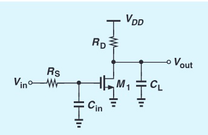

# 예제 11.8 — 입력 RC가 있는 CS 단의 극점

## 조건
- 회로: Fig 11.11 공통 소스(CS) 단 ($M_1$, 드레인 저항 $R_D$, 출력의 부하 커패시턴스 $C_L$, 입력 직렬 저항 $R_S$, 게이트와 접지 사이 커패시턴스 $C_{in}$)
- $\lambda = 0$
- 소자 값은 주어지지 않음 (답은 기호로) (원문에 없음)

## 구할 것
- 회로의 극점

## 상속·참조
- 본문 11.1.4절 (교재 580쪽): 식 (11.5)의 CS 단 극점 주파수는 출력 노드와 접지 사이의 전체 저항과 전체 커패시턴스 곱의 역수. 일반화: 신호 경로상의 노드 $j$에 소신호 저항 $R_j$와 커패시턴스 $C_j$가 접지되어 있으면, 전달 함수에서 $(R_j C_j)^{-1}$ 크기의 극점으로 기여

## 회로 — Fig 11.11
```spice
RS  Vin   n1    {R_S}
CIN n1    0     {C_in}
M1  Vout  n1    0  nmos
RD  VDD   Vout  {R_D}
CL  Vout  0     {C_L}
```
- 단자: VDD = 전원, 값 미지정 (T 전원 기호) / Vin = 입력 (개방 원) / Vout = 출력 (개방 원)
- 표시: 노드 라벨 V_DD (T 기호 오른쪽), V_in (입력 원 왼쪽), V_out (출력 원 오른쪽) / 소자 라벨 R_S (저항 위), C_in (커패시터 오른쪽), R_D (저항 왼쪽), M1 (트랜지스터 오른쪽, 소스 옆), C_L (커패시터 오른쪽) / 부호 없음 / 화살표 없음 / 수치·면적 라벨 없음
- 배치: 가운데 세로줄 위→아래 V_DD T 기호, R_D, 드레인 접속점, M1, 접지 / M1 NMOS 보통 방향(게이트 왼쪽, 드레인 위, 소스 아래) / 왼쪽 V_in 원 → 가로 R_S → 게이트 접속점 → 게이트 / C_in은 게이트 접속점에서 세로로 내려가고 그 아래 접지 / 드레인 접속점에서 가로선이 오른쪽으로 C_L 접속점을 지나 V_out 원에서 끝남 / C_L은 C_L 접속점에서 세로로 내려가고 그 아래 접지 / 접지 기호는 C_in 아래, M1 소스 아래, C_L 아래에 따로 / 접속점 (세 갈래 이상, 3곳): ① 게이트 = 왼쪽 R_S + 오른쪽 게이트 + 아래 C_in (점) ② 드레인 = 위 R_D + 아래 M1 드레인 + 오른쪽 가로선 (점) ③ C_L 위 = 왼쪽 가로선 + 오른쪽 V_out 선 + 아래 C_L (점) / 교차: 없음


> 참고: 문제 문장은 580쪽 아래(PDF 6 왼쪽), 그림은 581쪽 위(PDF 6 오른쪽)에 이어진 같은 문제 상자

## 답 (검증용)
- $V_{in} = 0$으로 두면 게이트는 $R_S$와 $C_{in}$을 접지에 대해 봄 → 입력 극점 $|\omega_{p1}| = \dfrac{1}{R_S C_{in}}$ (식 11.16), 출력 극점 $|\omega_{p2}| = \dfrac{1}{R_D C_L}$ (식 11.17)
- 저주파 이득이 $-g_m R_D$이므로 $\left|\dfrac{V_{out}}{V_{in}}\right| = \dfrac{g_m R_D}{\sqrt{\left(1 + \omega^2/\omega_{p1}^2\right)\left(1 + \omega^2/\omega_{p2}^2\right)}}$ (식 11.18)
