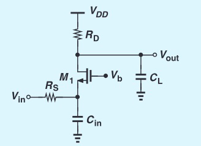

# 예제 11.9 — 입력 RC가 있는 CG 단의 극점

## 원문
그림 11.12에 나타낸 회로의 극점들을 계산하라. $\lambda = 0$으로 가정한다.

## 조건
- 회로: Fig 11.12 공통 게이트(CG) 단 ($M_1$의 게이트는 바이어스 $V_b$, 입력 $V_{in}$이 직렬 $R_S$를 거쳐 소스로, 소스와 접지 사이 $C_{in}$, 드레인 저항 $R_D$, 출력의 부하 커패시턴스 $C_L$)
- $\lambda = 0$
- 소자 값은 주어지지 않음 (답은 기호로) (원문에 없음)

## 구할 것
- 회로의 극점들

## 상속·참조
- 본문 11.1.4절 (교재 580쪽): 신호 경로상의 노드 $j$에 소신호 저항 $R_j$와 커패시턴스 $C_j$가 접지되어 있으면, 전달 함수에서 $(R_j C_j)^{-1}$ 크기의 극점으로 기여

## 회로 — Fig 11.12
```spice
RS  Vin   n1    {R_S}
CIN n1    0     {C_in}
M1  Vout  Vb    n1  nmos
RD  VDD   Vout  {R_D}
CL  Vout  0     {C_L}
```
- 단자: VDD = 전원, 값 미지정 (T 전원 기호) / Vin = 입력 (개방 원) / Vb = 이상적 DC 바이어스 (점 단자) / Vout = 출력 (개방 원)
- 표시: 노드 라벨 V_DD (T 기호 오른쪽), V_b (점 오른쪽), V_in (입력 원 왼쪽), V_out (출력 원 오른쪽) / 소자 라벨 R_D (저항 오른쪽), M1 (트랜지스터 왼쪽 위, 소스 옆), R_S (저항 위), C_in (커패시터 오른쪽), C_L (커패시터 오른쪽) / 부호 없음 / 화살표 없음 / 수치·면적 라벨 없음
- 배치: 왼쪽 세로줄 위→아래 V_DD T 기호, R_D, 드레인 접속점, M1, 소스 접속점, C_in, 접지 / M1은 좌우 반전(게이트 오른쪽, 드레인 위, 소스 아래, 소스 화살표는 왼쪽을 향함) / 게이트에서 짧은 가로선이 오른쪽 V_b 점 단자로 / 왼쪽 V_in 원 → 가로 R_S → 소스 접속점 / 드레인 접속점에서 가로선이 오른쪽으로 C_L 접속점을 지나 V_out 원에서 끝남 / C_L은 C_L 접속점에서 세로로 내려가고 그 아래 접지 / 접지 기호는 C_in 아래, C_L 아래에 따로 / 접속점 (세 갈래 이상, 3곳): ① 드레인 = 위 R_D + 아래 M1 드레인 + 오른쪽 가로선 (점) ② C_L 위 = 왼쪽 가로선 + 오른쪽 V_out 선 + 아래 C_L (점) ③ 소스 = 위 M1 소스 + 왼쪽 R_S + 아래 C_in (점) / 교차: 없음



## 답 (검증용)
- $V_{in} = 0$일 때 $M_1$의 소스에서 본 소신호 저항은 $R_S \parallel (1/g_m)$ → 입력 극점 $\omega_{p1} = \dfrac{1}{\left(R_S \parallel \dfrac{1}{g_m}\right) C_{in}}$ (식 11.19)
- 출력 극점 $\omega_{p2} = (R_D C_L)^{-1}$

## 힌트
### 소스 노드에서 $M_1$ 쪽도 보기
- $V_{in}$을 접지하면 소스 노드에는 $R_S$만 달린 것이 아니다. 게이트가 AC 접지인 $M_1$을 소스에서 들여다본 저항도 같은 노드에 병렬로 붙는다
