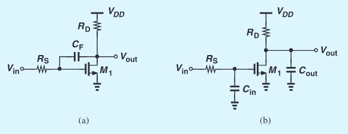

# 예제 11.10 — 게이트–드레인 부유 커패시터가 있는 CS 단의 극점 (밀러 근사)

## 원문
그림 11.16(a)에 보인 회로의 극점을 예측하라. $\lambda = 0$을 가정한다.

## 조건
- 회로: Fig 11.16(a) CS 단 ($M_1$, 드레인 저항 $R_D$, 입력 직렬 저항 $R_S$, 게이트와 드레인(출력) 사이의 부유 커패시터 $C_F$)
- $\lambda = 0$
- 소자 값은 주어지지 않음 (답은 기호로) (원문에 없음)

## 구할 것
- 회로의 극점 예측

## 상속·참조
- 밀러 이론 (본문 Fig 11.14, 교재 583쪽, 크롭 안 함): 노드 1과 노드 2 사이의 부유 임피던스 $Z_F$는 노드 1–접지 사이 $Z_1$과 노드 2–접지 사이 $Z_2$로 바꿀 수 있음. 노드 1에서 노드 2로의 전압 이득을 $A_v$라 하면 $Z_1 = \dfrac{Z_F}{1 - A_v}$ (식 11.23), $Z_2 = \dfrac{Z_F}{1 - \dfrac{1}{A_v}}$ (식 11.25)
- 본문 Fig 11.15 (교재 584쪽, 크롭 안 함): (a) 이득 $-A_0$인 반전 증폭기(삼각형)의 입력 $V_{in}$과 출력 $V_{out}$ 사이에 $C_F$ → (b) 등가 회로: 입력–접지 사이 $C_F(1 + A_0)$, 출력–접지 사이 $C_F(1 + 1/A_0)$ (식 11.27, 11.29, $A_v = -A_0$ 대입)
- 예제 11.8 (E11.08): 신호 경로 노드마다 접지된 $R_j$, $C_j$가 $(R_j C_j)^{-1}$ 극점을 만듦. 입력 극점 $1/(R_S C_{in})$, 출력 극점 $1/(R_D C_L)$

## 회로 — Fig 11.16(a)
```spice
RS  Vin   n1    {R_S}
CF  n1    Vout  {C_F}
M1  Vout  n1    0  nmos
RD  VDD   Vout  {R_D}
```
- 단자: VDD = 전원, 값 미지정 (T 전원 기호) / Vin = 입력 (개방 원) / Vout = 출력 (개방 원)
- 표시: 노드 라벨 V_DD (T 기호 오른쪽), V_in (입력 원 왼쪽), V_out (출력 원 오른쪽) / 소자 라벨 R_S (저항 위), C_F (커패시터 위), R_D (저항 왼쪽), M1 (트랜지스터 오른쪽, 소스 옆) / 부호 없음 / 화살표 없음 / 수치·면적 라벨 없음
- 배치: 오른쪽 세로줄 위→아래 V_DD T 기호, R_D, 드레인 접속점, M1, 접지 / M1 NMOS 보통 방향(게이트 왼쪽, 드레인 위, 소스 아래) / 왼쪽 V_in 원 → 가로 R_S → 게이트 접속점 → 게이트 / 게이트 접속점에서 선이 위로 올라가 모서리에서 오른쪽으로 꺾여 가로 C_F를 지나 드레인 접속점 (C_F는 게이트선보다 한 단 위, 드레인 높이) / 드레인 접속점에서 가로선이 오른쪽 V_out 원에서 끝남 / 접지 기호는 M1 소스 아래 하나 / 접속점 (세 갈래 이상, 2곳): ① 게이트 = 왼쪽 R_S + 오른쪽 게이트 + 위 C_F 선 (점) ② 드레인 = 위 R_D + 아래 M1 드레인 + 왼쪽 C_F + 오른쪽 V_out 선 (점) / 교차: 없음


> 참고: 크롭 이미지 오른쪽의 (b)는 문제 상자 안에 함께 인쇄된 풀이 그림 (답 절 참고)

## 답 (검증용)
- $M_1$과 $R_D$는 이득 $-g_m R_D$의 반전 증폭기 → Fig 11.15(b) 결과로 $C_{in} = (1 + A_0)C_F = (1 + g_m R_D)C_F$ (식 11.30–11.31), $C_{out} = \left(1 + \dfrac{1}{g_m R_D}\right)C_F$ (식 11.32) → Fig 11.16(b)
- 예제 11.8처럼 $\omega_{in} = \dfrac{1}{R_S C_{in}} = \dfrac{1}{R_S (1 + g_m R_D) C_F}$ (식 11.33–11.34), $\omega_{out} = \dfrac{1}{R_D C_{out}} = \dfrac{1}{R_D \left(1 + \dfrac{1}{g_m R_D}\right) C_F}$ (식 11.35–11.36)
- 풀이 끝의 질문 (인쇄된 대로): "왜 (a) 회로는 하나의 폴을 가지고 (b)는 2개의 폴을 가지는가? 이 해답은 아래에 설명되어 있다." → 본문(586쪽): 밀러 근사가 고주파에서도 저주파 이득 $g_m R_D$를 써서 극점이 2개가 됨

### 정답 회로 — Fig 11.16(b)
```spice
RS   Vin   n1    {R_S}
CIN  n1    0     {C_in}
M1   Vout  n1    0  nmos
RD   VDD   Vout  {R_D}
COUT Vout  0     {C_out}
```
- 단자: VDD = 전원, 값 미지정 (T 전원 기호) / Vin = 입력 (개방 원) / Vout = 출력 (개방 원)
- 표시: 노드 라벨 V_DD (T 기호 오른쪽), V_in (입력 원 왼쪽), V_out (출력 원 오른쪽) / 소자 라벨 R_S (저항 위), C_in (커패시터 오른쪽), R_D (저항 왼쪽), M1 (트랜지스터 오른쪽, 소스 옆), C_out (커패시터 오른쪽) / 부호 없음 / 화살표 없음 / 수치·면적 라벨 없음
- 배치: 가운데 세로줄 위→아래 V_DD T 기호, R_D, 드레인 접속점, M1, 접지 / M1 NMOS 보통 방향 / 왼쪽 V_in 원 → 가로 R_S → 게이트 접속점 → 게이트 / C_in은 게이트 접속점에서 세로로 내려가고 그 아래 접지 / 드레인 접속점에서 가로선이 오른쪽으로 C_out 접속점을 지나 V_out 원에서 끝남 / C_out은 C_out 접속점에서 세로로 내려가고 그 아래 접지 / 접지 기호는 C_in 아래, M1 소스 아래, C_out 아래에 따로 / 접속점 (세 갈래 이상, 3곳): ① 게이트 = 왼쪽 R_S + 오른쪽 게이트 + 아래 C_in (점) ② 드레인 = 위 R_D + 아래 M1 드레인 + 오른쪽 가로선 (점) ③ C_out 위 = 왼쪽 가로선 + 오른쪽 V_out 선 + 아래 C_out (점) / 교차: 없음


