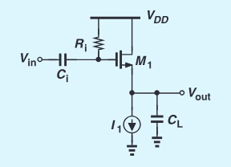

# 예제 11.11 — 오디오 증폭기용 소스 폴로어의 최소 C_i와 최대 C_L

## 원문
그림 11.18은 고성능 오디오 증폭기에서 사용되는 소스 폴로어를 그린 것이다. 여기서 $R_i$는 $M_1$을 위해 $V_{DD}$와 같은 게이트 바이어스 전압을 형성하고, $I_1$은 드레인 바이어스 전류를 정의한다. $\lambda = 0$, $g_m = 1/(200\ \Omega)$, $R_1 = 100\ \text{k}\Omega$으로 가정한다. 필요한 최소 $C_i$ 값과 허용 가능한 최대 $C_L$ 값을 결정하라.

## 조건
- 회로: Fig 11.18 고성능 오디오 증폭기에서 사용되는 소스 폴로어 (입력 결합 커패시터 $C_i$, 게이트 바이어스 저항 $R_i$, $M_1$, 드레인 바이어스 전류원 $I_1$, 부하 커패시턴스 $C_L$)
- $R_i$는 $M_1$을 위해 $V_{DD}$와 같은 게이트 바이어스 전압을 형성
- $I_1$은 드레인 바이어스 전류를 정의
- $\lambda = 0$
- $g_m = 1/(200\ \Omega)$
- $R_1 = 100\ \text{k}\Omega$ (인쇄된 대로)
  - 그림에 $R_1$이라는 소자는 없고 $R_i$만 있음 → $R_i = 100\ \text{k}\Omega$로 읽음 (문맥과 맞지 않음(오식으로 보임), 풀이의 $C_i = 79.6\ \text{nF}$도 $R_i = 100\ \text{k}\Omega$일 때 맞음) (원문에 없음)
- 오디오 대역: 풀이는 저주파 끝 20 Hz, 고주파 끝 20 kHz를 씀 (원문에 없음, 문제 문장은 "고성능 오디오 증폭기"만 적음)

## 구할 것
- 필요한 최소 $C_i$ 값
- 허용 가능한 최대 $C_L$ 값

## 상속·참조
- 본문 Fig 11.17(a) 고역통과 여파기 (교재 587쪽, 크롭 안 함): 직렬 $C_1$, 출력 양단 $R_1$. $\dfrac{V_{out}}{V_{in}}(s) = \dfrac{R_1 C_1 s}{R_1 C_1 s + 1}$ (식 11.38), $\left|\dfrac{V_{out}}{V_{in}}\right| = \dfrac{R_1 C_1 \omega}{\sqrt{R_1^2 C_1^2 \omega_1^2 + 1}}$ (식 11.39) → 주파수가 $1/(R_1 C_1)$ 이하로 떨어지면 응답 감소 (Fig 11.17(b), 원점의 영점 때문)
- 식 (11.39)의 분모는 $\omega_1^2$로 인쇄됨: 분자는 $\omega$이고 식 (11.38)에서 $s = j\omega$로 둔 결과이므로 문맥과 맞지 않음 (오식으로 보임), $\sqrt{R_1^2 C_1^2 \omega^2 + 1}$로 읽음 (원문에 없음)

## 회로 — Fig 11.18
```spice
CI  Vin   n1    {C_i}
RI  VDD   n1    {R_i}
M1  VDD   n1    Vout  nmos
I1  Vout  0     {I_1}
CL  Vout  0     {C_L}
```
- 단자: VDD = 전원, 값 미지정 (가로 레일) / Vin = 입력 (개방 원) / Vout = 출력 (개방 원)
- 표시: 노드 라벨 V_DD (레일 오른쪽 끝), V_in (입력 원 왼쪽), V_out (출력 원 오른쪽) / 소자 라벨 C_i (커패시터 아래), R_i (저항 왼쪽), M1 (트랜지스터 오른쪽, 소스 옆), I_1 (전류원 왼쪽), C_L (커패시터 오른쪽) / 부호 없음 / 화살표 없음 / 수치·면적 라벨 없음
- 배치: 맨 위 V_DD 가로 레일에 R_i(왼쪽)와 M1 드레인 선(오른쪽)이 매달림 / M1 NMOS 보통 방향(게이트 왼쪽, 드레인 위, 소스 아래) / 왼쪽 V_in 원 → 가로 C_i → 게이트 접속점 → 게이트 / R_i는 레일에서 세로로 내려와 게이트 접속점 / M1 소스에서 세로로 내려가 출력 접속점, 그 아래 전류원 I_1(원 안 화살표 아래 방향), 접지 / 출력 접속점에서 가로선이 오른쪽으로 C_L 접속점을 지나 V_out 원에서 끝남 / C_L은 C_L 접속점에서 세로로 내려가고 그 아래 접지 / 접지 기호는 I_1 아래, C_L 아래에 따로 / 접속점 (세 갈래 이상, 3곳): ① 게이트 = 왼쪽 C_i + 위 R_i + 오른쪽 게이트 (점) ② 출력 = 위 M1 소스 + 아래 I_1 + 오른쪽 가로선 (점) ③ C_L 위 = 왼쪽 가로선 + 오른쪽 V_out 선 + 아래 C_L (점) / 교차: 없음



## 답 (검증용)
- $R_i$와 $C_i$의 입력 회로망은 Fig 11.17의 고역통과 여파기와 유사 → 코너 주파수 $1/(R_i C_i) = 2\pi \times (20\ \text{Hz})$로 정하면 $C_i = 79.6\ \text{nF}$ (식 11.40). 칩에 집적하기에는 너무 크며, 20 Hz에서 3 dB 감쇠보다 적은 감쇠가 필요하면 더 큰 커패시터가 필요
- 출력 노드에서 접지를 바라본 저항이 $1/g_m$ → 출력 극점을 음성 범위 상위 끝 20 kHz로 정해 $\omega_{p,out} = \dfrac{g_m}{C_L} = 2\pi \times (20\ \text{kHz})$ (식 11.41–11.42) → $C_L = 39.8\ \text{nF}$ (식 11.43)

## 힌트
### 입력은 $C_i$와 $R_i$의 고역통과
- $V_{DD}$는 AC 접지라서 $R_i$는 게이트에서 접지로 가는 저항이고, 게이트는 전류를 끌지 않으므로 직렬 $C_i$와 함께 고역통과 여파기가 된다
- 이 코너가 오디오 대역의 아래 끝을 정한다

## 풀이
### 입력 고역통과 여파기
- $R_1$은 그림에 없고 $R_i$만 있으므로 $R_i = 100\ \text{k}\Omega$로 읽는다
- $V_{DD}$는 AC 접지라서 $R_i$는 게이트에서 접지로 가는 저항이다. 게이트는 전류를 끌지 않으므로 직렬 $C_i$와 $R_i$가 고역통과 여파기가 된다
- 코너 주파수 $\omega_1 = \dfrac{1}{R_i C_i}$, 이 아래로 가면 응답이 줄어든다
### 최소 $C_i$
- 코너를 오디오 대역 아래 끝 $20\ \text{Hz}$ 이하로 둔다: $\dfrac{1}{R_i C_i} \le 2\pi \times 20\ \text{Hz}$
- $C_i \ge \dfrac{1}{2\pi (20\ \text{Hz})(100\ \text{k}\Omega)} = 79.6\ \text{nF}$
- 칩에 넣기에는 너무 크고, $20\ \text{Hz}$에서 $3\ \text{dB}$보다 덜 줄이려면 더 커야 한다
### 출력 극점
- $\lambda = 0$이고 $I_1$은 이상적이므로 출력 노드에서 접지를 본 저항은 $M_1$ 소스로 들여다본 $1/g_m$뿐이다
- $|\omega_{p,out}| = \dfrac{g_m}{C_L}$
### 최대 $C_L$
- 출력 극점을 오디오 대역 위 끝 $20\ \text{kHz}$ 이상에 둔다: $\dfrac{g_m}{C_L} \ge 2\pi \times 20\ \text{kHz}$
- $C_L \le \dfrac{1/(200\ \Omega)}{2\pi (20\ \text{kHz})} = 39.8\ \text{nF}$
### 답
- 최소 $C_i \approx 79.6\ \text{nF}$
- 최대 $C_L \approx 39.8\ \text{nF}$
