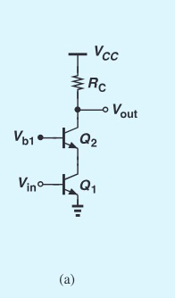
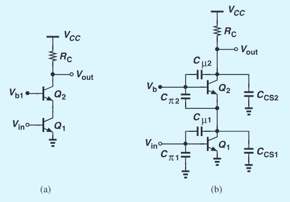

# 예제 11.12 — 바이폴라 캐스코드 단의 모든 커패시턴스

## 원문
그림 11.24(a)에 그려진 회로의 모든 커패시턴스를 확인하라.

## 조건
- 회로: Fig 11.24(a) 바이폴라 캐스코드 단 (입력 $Q_1$, 캐스코드 $Q_2$의 베이스는 바이어스 $V_{b1}$, 컬렉터 저항 $R_C$)
- 소자 값은 주어지지 않음 (답은 커패시턴스 기호로) (원문에 없음)

## 구할 것
- 회로의 모든 커패시턴스 확인

## 상속·참조
- 본문 Fig 11.22–11.23 (교재 591–592쪽, 크롭 안 함): 바이폴라 트랜지스터의 고주파수 모델은 베이스–이미터 사이 $C_\pi$ (베이스 전하 $C_b$와 공핍 커패시턴스 $C_{je}$의 병렬), 베이스–컬렉터 사이 $C_\mu$, 컬렉터–기판(접지) 사이 $C_{CS}$를 가짐. 집적 회로의 기판은 접지 (Fig 11.23(b): $B$–$E$ 사이 $C_\pi \parallel r_\pi$, $B$–$C$ 사이 $C_\mu$, $C$–$E$ 사이 $g_m v_\pi$와 $r_O$, $C$–접지 사이 $C_{CS}$)

## 회로 — Fig 11.24(a)
```spice
RC  VCC   Vout  {R_C}
Q2  Vout  Vb1   n1  npn
Q1  n1    Vin   0   npn
```
- 단자: VCC = 전원, 값 미지정 (T 전원 기호) / Vb1 = 이상적 DC 바이어스 (점 단자) / Vin = 입력 (개방 원) / Vout = 출력 (개방 원)
- 표시: 노드 라벨 V_CC (T 기호 오른쪽), V_b1 (점 왼쪽), V_in (입력 원 왼쪽), V_out (출력 원 오른쪽) / 소자 라벨 R_C (저항 오른쪽), Q2 (트랜지스터 오른쪽, 이미터 옆), Q1 (트랜지스터 오른쪽, 이미터 옆) / 부호 없음 / 화살표 없음 / 수치·면적 라벨 없음
- 배치: 한 세로줄 위→아래 V_CC T 기호, R_C, 출력 접속점, Q2, Q1, 접지 / Q1, Q2 모두 npn 보통 방향(베이스 왼쪽, 컬렉터 위, 이미터 아래) / Q2 이미터가 세로선으로 Q1 컬렉터에 바로 이어짐 (중간 노드 라벨 없음) / V_b1 점 단자 → 가로선 → Q2 베이스, V_in 원 → 가로선 → Q1 베이스 / 출력 접속점에서 가로선이 오른쪽 V_out 원에서 끝남 / 접속점 (세 갈래 이상, 1곳): 출력 = 위 R_C + 아래 Q2 컬렉터 + 오른쪽 V_out 선 (점) / 교차: 없음



## 답 (검증용)
- Fig 11.23(b)로부터 각 트랜지스터에 3개의 커패시턴스($C_\pi$, $C_\mu$, $C_{CS}$)를 추가 → Fig 11.24(b)
- $C_{CS1}$과 $C_{\pi 2}$는 병렬로 나타나고, $C_{\mu 2}$와 $C_{CS2}$도 마찬가지 ($V_b$가 교류 접지이므로) (원문에 없음, 괄호 안 이유)

### 정답 회로 — Fig 11.24(b)
```spice
* (a)의 바이어스 V_b1이 (b)에서는 V_b로 인쇄됨 (같은 노드로 봄)
RC   VCC   Vout  {R_C}
Q2   Vout  Vb    n1  npn
Q1   n1    Vin   0   npn
CMU2 Vb    Vout  {C_μ2}
CPI2 Vb    n1    {C_π2}
CCS2 Vout  0     {C_CS2}
CMU1 Vin   n1    {C_μ1}
CPI1 Vin   0     {C_π1}
CCS1 n1    0     {C_CS1}
```
- 단자: VCC = 전원, 값 미지정 (T 전원 기호) / Vb = 이상적 DC 바이어스 (점 단자) / Vin = 입력 (개방 원) / Vout = 출력 (개방 원)
- 표시: 노드 라벨 V_CC (T 기호 오른쪽), V_b (점 왼쪽), V_in (입력 원 왼쪽), V_out (출력 원 오른쪽) / 소자 라벨 R_C (저항 오른쪽), Q2, Q1 (각 트랜지스터 오른쪽), C_μ2 (커패시터 위), C_π2 (커패시터 왼쪽), C_CS2 (커패시터 오른쪽), C_μ1 (커패시터 위), C_π1 (커패시터 왼쪽), C_CS1 (커패시터 오른쪽) / 부호 없음 / 화살표 없음 / 수치·면적 라벨 없음
- 배치: 가운데 세로줄 위→아래 V_CC T 기호, R_C, V_out 접속점, Q2 컬렉터 접속점, Q2, 중간 접속점(Q2 이미터 아래), Q1 컬렉터 접속점, Q1, 접지 / Q1, Q2 npn 보통 방향 / V_out 접속점에서 가로선이 오른쪽 V_out 원 / Q2 컬렉터 접속점에서 왼쪽으로 가로 C_μ2를 지나 모서리에서 아래로 꺾여 Q2 베이스 접속점, 오른쪽으로 가로선이 가다 아래로 꺾여 세로 C_CS2와 접지 / V_b 점 단자 → 가로선 → Q2 베이스 접속점 → Q2 베이스, 베이스 접속점에서 세로 C_π2가 내려가 모서리에서 오른쪽으로 꺾여 중간 접속점 / Q1 컬렉터 접속점에서 왼쪽으로 가로 C_μ1을 지나 모서리에서 아래로 꺾여 Q1 베이스 접속점, 오른쪽으로 가로선이 가다 아래로 꺾여 세로 C_CS1과 접지 / V_in 원 → 가로선 → Q1 베이스 접속점 → Q1 베이스, 베이스 접속점에서 세로 C_π1과 접지 / 접지 기호는 C_π1 아래, Q1 이미터 아래, C_CS1 아래, C_CS2 아래에 따로 / 접속점 (세 갈래 이상, 6곳): ① V_out = 위 R_C + 아래 컬렉터 쪽 + 오른쪽 V_out 선 (점) ② Q2 컬렉터 = 위 + 아래 Q2 컬렉터 + 왼쪽 C_μ2 + 오른쪽 C_CS2 선 (점) ③ Q2 베이스 = 왼쪽 V_b + 오른쪽 베이스 + 위 C_μ2 선 + 아래 C_π2 (점) ④ 중간 = 위 Q2 이미터 + 왼쪽 C_π2 선 + 아래 (점) ⑤ Q1 컬렉터 = 위 + 아래 Q1 컬렉터 + 왼쪽 C_μ1 + 오른쪽 C_CS1 선 (점) ⑥ Q1 베이스 = 왼쪽 V_in + 오른쪽 베이스 + 위 C_μ1 선 + 아래 C_π1 (점) / 교차: 없음


