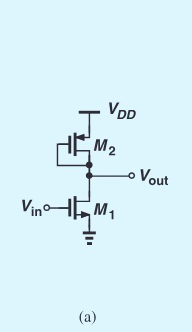
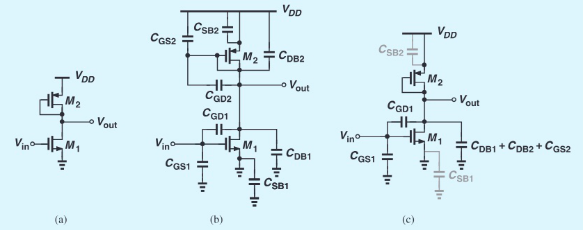

# 예제 11.13 — 다이오드 연결 PMOS 부하를 가진 CS 단의 모든 커패시턴스

## 원문
그림 11.28(a)의 회로의 모든 커패시턴스들을 확인하라.

## 조건
- 회로: Fig 11.28(a) CS 단 (입력 NMOS $M_1$, 부하는 다이오드 연결 PMOS $M_2$)
- 소자 값은 주어지지 않음 (답은 커패시턴스 기호로) (원문에 없음)

## 구할 것
- 회로의 모든 커패시턴스 확인

## 상속·참조
- 본문 Fig 11.27 (교재 594쪽, 크롭 안 함): MOSFET 고주파 모델은 게이트–소스 사이 $C_{GS}$ (겹침 성분 포함), 게이트–드레인 사이 $C_{GD}$ (겹침 성분 포함), 소스–벌크 사이 $C_{SB}$, 드레인–벌크 사이 $C_{DB}$. 벌크는 교류 접지로 가정 ($C_{SB}$, $C_{DB}$는 각 단자와 접지 사이)

## 회로 — Fig 11.28(a)
```spice
* M2는 다이오드 연결: 게이트가 드레인(Vout)에 선으로 이어짐
M2  Vout  Vout  VDD  pmos
M1  Vout  Vin   0    nmos
```
- 단자: VDD = 전원, 값 미지정 (T 전원 기호) / Vin = 입력 (개방 원) / Vout = 출력 (개방 원)
- 표시: 노드 라벨 V_DD (T 기호 오른쪽), V_in (입력 원 왼쪽), V_out (출력 원 오른쪽) / 소자 라벨 M2 (트랜지스터 오른쪽), M1 (트랜지스터 오른쪽, 소스 옆) / 부호 없음 / 화살표 없음 / 수치·면적 라벨 없음
- 배치: 한 세로줄 위→아래 V_DD T 기호, M2, M2 드레인 접속점, V_out 접속점, M1, 접지 / M2 PMOS(게이트 왼쪽, 소스 위, 드레인 아래, 소스 화살표는 게이트 쪽을 향함) / M2 게이트에서 선이 왼쪽으로 나가 아래로 꺾이고 다시 오른쪽으로 꺾여 M2 드레인 접속점 (다이오드 연결) / M1 NMOS 보통 방향 / V_in 원 → 가로선 → M1 게이트 / V_out 접속점에서 가로선이 오른쪽 V_out 원에서 끝남 / 접속점 (세 갈래 이상, 2곳): ① M2 드레인 = 위 M2 드레인 + 왼쪽 게이트 연결선 + 아래 (점) ② V_out = 위 + 오른쪽 V_out 선 + 아래 M1 드레인 (점) / 교차: 없음



## 답 (검증용)
- Fig 11.27로부터 각 소자마다 4개의 커패시턴스를 추가 → Fig 11.28(b)
- $C_{SB1}$과 $C_{SB2}$는 모두 양 끝이 교류 접지에 단락, $C_{GD2}$는 '출력'에 단락(양 끝이 모두 출력) (원문에 없음, 괄호 안 설명), $C_{DB1}$, $C_{DB2}$, $C_{GS2}$는 출력 노드에 병렬 → Fig 11.28(c)로 줄어듦

### 정답 회로 — Fig 11.28(b)
```spice
M2   Vout  Vout  VDD  pmos
M1   Vout  Vin   0    nmos
CGS2 VDD   Vout  {C_GS2}
* CSB2: 레일(VDD)과 M2 소스(레일에 바로 이어짐) 사이 → 양 끝이 같은 노드
CSB2 VDD   VDD   {C_SB2}
CDB2 VDD   Vout  {C_DB2}
* CGD2: M2 게이트 쪽 선과 Vout 사이. 게이트는 다이오드 연결로 Vout에 이어져 양 끝이 같은 노드
CGD2 Vout  Vout  {C_GD2}
CGD1 Vin   Vout  {C_GD1}
CGS1 Vin   0     {C_GS1}
CDB1 Vout  0     {C_DB1}
* CSB1: M1 소스(접지에 바로 이어짐)와 접지 사이 → 양 끝이 같은 노드
CSB1 0     0     {C_SB1}
```
- 단자: VDD = 전원, 값 미지정 (가로 레일) / Vin = 입력 (개방 원) / Vout = 출력 (개방 원)
- 표시: 노드 라벨 V_DD (레일 오른쪽 끝), V_in (입력 원 왼쪽), V_out (출력 원 오른쪽) / 소자 라벨 C_GS2 (커패시터 왼쪽), C_SB2 (커패시터 왼쪽), M2 (트랜지스터 오른쪽), C_DB2 (커패시터 오른쪽), C_GD2 (커패시터 아래), C_GD1 (커패시터 위), M1 (트랜지스터 오른쪽), C_GS1 (커패시터 왼쪽), C_DB1 (커패시터 오른쪽), C_SB1 (커패시터 오른쪽) / 부호 없음 / 화살표 없음 / 수치·면적 라벨 없음
- 배치: 맨 위 V_DD 가로 레일에 왼쪽부터 C_GS2, C_SB2, M2 소스 선, C_DB2가 매달림 / C_GS2는 세로로 내려와 게이트 선 접속점, 여기서 가로선이 오른쪽으로 M2 게이트 쪽 접속점을 지나 M2 게이트, 게이트 선 접속점에서 선이 더 내려가 모서리에서 오른쪽으로 꺾여 가로 C_GD2를 지나 V_out 접속점 / C_SB2는 레일에서 내려와 모서리에서 오른쪽으로 꺾여 M2 소스 접속점 (소스는 위로 레일에 바로 이어짐) / M2 PMOS(게이트 왼쪽, 소스 위, 드레인 아래) / M2 게이트 쪽 접속점에서 선이 내려가 오른쪽으로 꺾여 M2 드레인 접속점 (다이오드 연결) / C_DB2는 레일에서 세로로 내려와 모서리에서 왼쪽으로 꺾여 M2 드레인 접속점 / 가운데 세로줄: M2 드레인 접속점, V_out 접속점(오른쪽 V_out 원), M1 드레인 접속점, M1, M1 소스 접속점, 접지 / M1 드레인 접속점에서 왼쪽으로 가로 C_GD1을 지나 모서리에서 아래로 꺾여 M1 게이트 접속점, 오른쪽으로 가로선이 가다 아래로 꺾여 세로 C_DB1과 접지 / V_in 원 → 가로선 → M1 게이트 접속점 → M1 게이트, 게이트 접속점에서 세로 C_GS1과 접지 / M1 소스 접속점에서 아래 접지, 오른쪽으로 가로선이 가다 아래로 꺾여 세로 C_SB1과 접지 / 접속점 (세 갈래 이상, 8곳): ① 게이트 선 = 위 C_GS2 + 오른쪽 게이트 선 + 아래 C_GD2 선 (점) ② M2 게이트 쪽 = 왼쪽 + 오른쪽 M2 게이트 + 아래 다이오드 선 (점) ③ M2 소스 = 위 레일 선 + 아래 M2 소스 + 왼쪽 C_SB2 선 (점) ④ M2 드레인 = 위 M2 드레인 + 왼쪽 다이오드 선 + 오른쪽 C_DB2 선 + 아래 (점) ⑤ V_out = 위 + 왼쪽 C_GD2 + 오른쪽 V_out 선 + 아래 (점) ⑥ M1 드레인 = 위 + 아래 M1 드레인 + 왼쪽 C_GD1 + 오른쪽 C_DB1 선 (점) ⑦ M1 게이트 = 왼쪽 V_in + 오른쪽 게이트 + 위 C_GD1 선 + 아래 C_GS1 (점) ⑧ M1 소스 = 위 M1 소스 + 아래 접지 + 오른쪽 C_SB1 선 (점) / 교차: 없음

### 정답 회로 — Fig 11.28(c)
```spice
* 회색으로 그려진 소자: CSB2, CSB1 (양 끝이 단락되어 빠지는 것을 뜻함)
M2   Vout  Vout  VDD  pmos
M1   Vout  Vin   0    nmos
CSB2 VDD   VDD   {C_SB2}
CGD1 Vin   Vout  {C_GD1}
CGS1 Vin   0     {C_GS1}
CT   Vout  0     {C_DB1+C_DB2+C_GS2}
CSB1 0     0     {C_SB1}
```
- 단자: VDD = 전원, 값 미지정 (T 전원 기호) / Vin = 입력 (개방 원) / Vout = 출력 (개방 원)
- 표시: 노드 라벨 V_DD (T 기호 오른쪽), V_in (입력 원 왼쪽), V_out (출력 원 오른쪽) / 소자 라벨 C_SB2 (회색, 커패시터 왼쪽), M2 (트랜지스터 오른쪽), C_GD1 (커패시터 위), M1 (트랜지스터 오른쪽), C_GS1 (커패시터 왼쪽), C_DB1 + C_DB2 + C_GS2 (커패시터 하나 오른쪽에 합으로), C_SB1 (회색, 커패시터 오른쪽) / 부호 없음 / 화살표 없음 / 수치·면적 라벨 없음
- 배치: 맨 위 V_DD T 기호(짧은 가로 막대) 아래 가운데 세로줄: M2 소스 접속점, M2, M2 드레인 접속점, V_out 접속점(오른쪽 V_out 원), M1 드레인 접속점, M1, 접지 / 회색 C_SB2는 T 기호 막대 왼쪽에서 세로로 내려와 모서리에서 오른쪽으로 꺾여 M2 소스 접속점 / M2 다이오드 연결((a)와 같은 모양) / M1 드레인 접속점에서 왼쪽으로 가로 C_GD1을 지나 아래로 꺾여 M1 게이트 접속점, 오른쪽으로 가로선이 가다 아래로 꺾여 세로 C_DB1 + C_DB2 + C_GS2와 접지 / V_in 원 → M1 게이트 접속점 → M1 게이트, 게이트 접속점에서 세로 C_GS1과 접지 / M1 소스 아래 접지, 소스선에서 회색 선이 오른쪽으로 꺾여 회색 C_SB1과 회색 접지 / 접속점 (세 갈래 이상, 6곳): ① M2 소스 = 위 T 기호 + 아래 M2 소스 + 왼쪽 회색 C_SB2 선 (점) ② M2 드레인 = 위 M2 드레인 + 왼쪽 다이오드 선 + 아래 (점) ③ V_out = 위 + 오른쪽 V_out 선 + 아래 (점) ④ M1 드레인 = 위 + 아래 M1 드레인 + 왼쪽 C_GD1 + 오른쪽 출력 커패시터 선 (점) ⑤ M1 게이트 = 왼쪽 V_in + 오른쪽 게이트 + 위 C_GD1 선 + 아래 C_GS1 (점) ⑥ M1 소스선 = 위 M1 소스 + 아래 접지 + 오른쪽 회색 C_SB1 선 (점 없음) / 교차: 없음



## 힌트
### 양 끝이 같은 AC 노드면 지운다
- 다이오드 연결은 $M_2$의 게이트와 드레인을 한 노드로 묶고, $V_{DD}$와 접지는 둘 다 AC 접지다
- 커패시턴스마다 두 끝을 AC 노드 이름으로 바꿔 적으면, 사라지는 것과 출력 노드에서 접지로 모여 병렬이 되는 것이 갈린다

## 풀이
### 트랜지스터마다 붙는 커패시턴스
- MOSFET마다 $C_{GS}$, $C_{GD}$, $C_{SB}$, $C_{DB}$를 더한다. 벌크는 AC 접지다
- 다이오드 연결은 $M_2$의 게이트와 드레인을 $V_{out}$ 한 노드로 묶고, $V_{DD}$와 접지는 둘 다 AC 접지다
### $M_1$의 커패시턴스
- $C_{GS1}$: $V_{in}$–접지, $C_{GD1}$: $V_{in}$–$V_{out}$, $C_{DB1}$: $V_{out}$–접지
- $C_{SB1}$: 소스가 접지이므로 양 끝이 접지 → 빠진다
### $M_2$의 커패시턴스
- $C_{GS2}$: 게이트($V_{out}$)–소스($V_{DD}$, AC 접지) → $V_{out}$에서 접지로
- $C_{DB2}$: 드레인($V_{out}$)–벌크($V_{DD}$) → $V_{out}$에서 접지로
- $C_{SB2}$: 소스와 벌크가 모두 $V_{DD}$ → 빠진다. $C_{GD2}$: 게이트와 드레인이 모두 $V_{out}$ → 빠진다
### 출력 노드에서 모으기
- $V_{out}$에서 접지로 $C_{DB1}$, $C_{DB2}$, $C_{GS2}$가 병렬 → $C_{DB1} + C_{DB2} + C_{GS2}$
### 답
- 남는 커패시턴스는 $C_{GS1}$ ($V_{in}$–접지), $C_{GD1}$ ($V_{in}$–$V_{out}$), 그리고 $V_{out}$–접지 사이의 $C_{DB1} + C_{DB2} + C_{GS2}$이다. $C_{SB1}$, $C_{SB2}$는 양 끝이 AC 접지, $C_{GD2}$는 양 끝이 출력이라 빠진다.
