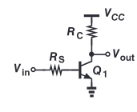

# 예제 11.15 — CE 단의 입력·출력 극점과 대역폭을 제한하는 노드 (밀러 근사)

## 원문
그림 11.31(a)의 CE 단에서 $R_S = 200\ \Omega$, $I_C = 1\ \text{mA}$, $\beta = 100$, $C_\pi = 100\ \text{fF}$, $C_\mu = 20\ \text{fF}$, $C_{CS} = 30\ \text{fF}$이다.

(a) 만약 $R_L = 2\ \text{k}\Omega$일 경우, 입력과 출력 극점을 계산하라. 어떤 노드가 (대역폭을 제한하는) 속도의 장애요인으로 나타나는가?

(b) 출력 극점이 대역폭을 제한하도록 $R_L$을 선택하는 것이 가능한가?

## 조건
- 회로: Fig 11.31(a)의 CE 단 ($R_S$, $Q_1$, $R_C$)
- $R_S = 200\ \Omega$
- $I_C = 1\ \text{mA}$
- $\beta = 100$
- $C_\pi = 100\ \text{fF}$
- $C_\mu = 20\ \text{fF}$
- $C_{CS} = 30\ \text{fF}$
- (a)에서 $R_L = 2\ \text{k}\Omega$ ($R_L$은 그림의 $R_C$ 자리) (원문에 없음)

## 구할 것
- (a) $R_L = 2\ \text{k}\Omega$일 경우, 입력과 출력 극점 계산. 어떤 노드가 (대역폭을 제한하는) 속도의 장애요인으로 나타나는가?
- (b) 출력 극점이 대역폭을 제한하도록 $R_L$을 선택하는 것이 가능한가?

## 상속·참조
- 본문 Fig 11.31(b)–(d) (교재 600쪽, 크롭 안 함): (b) CE 단에 $C_\pi$ (베이스–접지), $C_\mu$ (베이스–컬렉터), $C_{CS}$ (컬렉터–접지), CS 단에 $C_{GS}$ (게이트–접지), $C_{GD}$ (게이트–드레인), $C_{DB}$ (드레인–접지), $C_{SB}$ (양 끝 접지). (d) 두 회로의 통합 모델: $V_{Thev}$–$R_{Thev}$–노드 $X$, $X$–접지 $C_{in}$, $X$–$Y$ 사이 $C_{XY}$, $Y$ = $V_{out}$, $Y$→접지 종속 전류원 $g_m V_X$, $Y$–접지 $C_{out}$과 부하 저항. 즉 $C_{in} = C_\pi$ 또는 $C_{GS}$, $C_{XY} = C_\mu$ 또는 $C_{GD}$, $C_{out} = C_{CS}$ 또는 $C_{DB}$. 얼리 효과와 채널길이 변조는 무시 (각주 10). 부하 저항은 본문에서 $R_L$로 부름 ($R_C$ 또는 $R_D$ 자리)
- 밀러 근사 (식 11.59–11.60): $C_X = (1 + g_m R_L) C_{XY}$, $C_Y = \left(1 + \dfrac{1}{g_m R_L}\right) C_{XY}$
- 본문 Fig 11.32 (교재 601쪽, 크롭 안 함) 밀러 근사 통합 모델의 파라미터: CE 단은 $V_{Thev} = V_{in}\dfrac{r_\pi}{r_\pi + R_S}$, $R_{Thev} = R_S \parallel r_\pi$, $C_X = C_\mu(1 + g_m R_L)$, $C_Y = C_\mu\left(1 + \dfrac{1}{g_m R_L}\right)$ / CS 단은 $V_{Thev} = V_{in}$, $R_{Thev} = R_S$, $C_X = C_{GD}(1 + g_m R_L)$, $C_Y = C_{GD}\left(1 + \dfrac{1}{g_m R_L}\right)$
- 극점 (식 11.61–11.62): $|\omega_{p,in}| = \dfrac{1}{R_{Thev}[C_{in} + (1 + g_m R_L) C_{XY}]}$, $|\omega_{p,out}| = \dfrac{1}{R_L\left[C_{out} + \left(1 + \dfrac{1}{g_m R_L}\right) C_{XY}\right]}$
- 바이폴라 관계: $g_m = I_C/V_T$, $r_\pi = \beta/g_m$. 풀이의 $r_\pi = 2.6\ \text{k}\Omega$은 $V_T = 26\ \text{mV}$와 맞음 (원문에 없음)

## 회로 — Fig 11.31(a)
```spice
RS  Vin   n1    {R_S}
Q1  Vout  n1    0  npn
RC  VCC   Vout  {R_C}
```
- 단자: VCC = 전원, 값 미지정 (T 전원 기호) / Vin = 입력 (개방 원) / Vout = 출력 (개방 원)
- 표시: 노드 라벨 V_CC (T 기호 오른쪽), V_in (입력 원 왼쪽), V_out (출력 원 오른쪽) / 소자 라벨 R_S (저항 위), R_C (저항 왼쪽), Q1 (트랜지스터 오른쪽, 이미터 옆) / 부호 없음 / 화살표 없음 / 수치·면적 라벨 없음
- 배치: 세로줄 위→아래 V_CC T 기호, R_C, 컬렉터 접속점, Q1, 접지 / Q1 npn 보통 방향(베이스 왼쪽, 컬렉터 위, 이미터 아래) / V_in 원 → 가로 R_S → 베이스 / 컬렉터 접속점에서 가로선이 오른쪽 V_out 원에서 끝남 / 접지 기호는 Q1 이미터 아래 / 접속점 (세 갈래 이상, 1곳): 컬렉터 = 위 R_C + 아래 Q1 컬렉터 + 오른쪽 V_out 선 (점) / 패널 글자 (a)는 크롭 이미지에 없음 (책에서는 CE·CS 두 회로 아래 가운데에 하나) / 교차: 없음


> 참고: 크롭은 (a)의 CE(왼쪽) 절반만 (crop: ce). 본문 그림 11.31의 (b) 트랜지스터 커패시턴스 포함, (c) 소신호 등가 회로, (d) 통합 모델은 크롭하지 않음 (상속·참조에 글로)

## 답 (검증용)
- (a) $r_\pi = 2.6\ \text{k}\Omega$, $R_{Thev} = 186\ \Omega$. Fig 11.32와 식 (11.61)–(11.62)로 $|\omega_{p,in}| = 2\pi \times (516\ \text{MHz})$ (식 11.63), $|\omega_{p,out}| = 2\pi \times (1.59\ \text{GHz})$ (식 11.64). 밀러 효과로 $C_\mu$가 78배가 되어 $C_\pi$보다 훨씬 큰 기여 → 입력 극점이 대역폭을 제한
- (b) $|\omega_{p,in}| > |\omega_{p,out}|$ 조건: $\dfrac{1}{(R_S \parallel r_\pi)[C_\pi + (1 + g_m R_L)C_\mu]} > \dfrac{1}{R_L\left[C_{CS} + \left(1 + \dfrac{1}{g_m R_L}\right)C_\mu\right]}$ (식 11.65). $g_m R_L \gg 1$이면 $[C_{CS} + C_\mu - g_m(R_S \parallel r_\pi)C_\mu]R_L > (R_S \parallel r_\pi)C_\pi$ (식 11.66). 이 예제의 값에서는 좌측 값이 음수 → 해답이 존재하지 않음 ($g_m R_L$이 1보다 훨씬 크지 않을 때도 유지됨). 입력 극점이 속도 장애요인으로 남음

## 힌트
### (b) $R_L$은 두 극점을 함께 늦춘다
- $R_L$을 키우면 출력 노드의 저항이 커지지만, 밀러 배수 $1 + g_m R_L$도 커져서 입력 극점도 같이 느려진다
- 두 극점이 $R_L$에 따라 얼마나 빨리 느려지는지 비교한다

## 풀이
### 소신호 파라미터
- $g_m = I_C/V_T = 1\ \text{mA}/26\ \text{mV} = 38.5\ \text{mS}$ ($V_T = 26\ \text{mV}$), $r_\pi = \beta/g_m = 2.60\ \text{k}\Omega$
- $R_{Thev} = R_S \parallel r_\pi = 186\ \Omega$, $g_m R_L = 76.9$
### (a) 입력 극점
- 밀러 근사로 $C_\mu$를 입력 쪽 $(1 + g_m R_L)C_\mu = 1.56\ \text{pF}$로 옮긴다
- $|\omega_{p,in}| = \dfrac{1}{R_{Thev}[C_\pi + (1 + g_m R_L)C_\mu]} = 2\pi \times 517\ \text{MHz}$
### (a) 출력 극점과 느린 노드
- $|\omega_{p,out}| = \dfrac{1}{R_L\left[C_{CS} + \left(1 + \dfrac{1}{g_m R_L}\right)C_\mu\right]} = 2\pi \times 1.58\ \text{GHz}$
- 밀러 효과로 $C_\mu$가 78배가 되어 입력 노드가 대역폭을 제한한다
### (b) 출력 극점이 더 느려질 조건
- $|\omega_{p,in}| > |\omega_{p,out}|$을 풀면 $R_L[C_{CS} + C_\mu - g_m R_{Thev} C_\mu] > R_{Thev}(C_\pi + C_\mu) - C_\mu/g_m$
- 좌변 괄호 $= -92.9\ \text{fF} < 0$, 우변 $= 21.8\ \text{ps} > 0$ → 어떤 $R_L$에서도 성립하지 않는다
- $R_L$을 키우면 밀러 배수도 커져 입력 극점이 함께 느려지기 때문이다
### 답
- (a) $|\omega_{p,in}| \approx 2\pi \times 517\ \text{MHz}$, $|\omega_{p,out}| \approx 2\pi \times 1.58\ \text{GHz}$. 입력 노드가 속도의 장애요인이다.
- (b) 불가능하다. $C_{CS} + C_\mu - g_m(R_S \parallel r_\pi)C_\mu < 0$이라 어떤 $R_L$로도 출력 극점이 더 느려지지 않는다.
