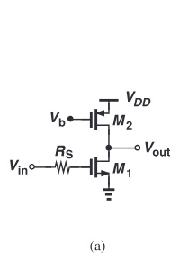
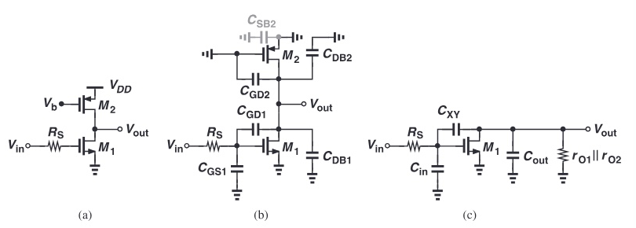

# 예제 11.17 — 전류원 부하 CS 단의 극점 (주극점 근사)

## 원문
주극점 근사를 사용하여, 그림 11.33(a)에 보인 회로의 극점들을 계산하라. 트랜지스터들은 모두 포화 영역에서 동작하며 $\lambda \neq 0$이라고 가정한다.

## 조건
- 회로: Fig 11.33(a) CS 단 (입력 직렬 저항 $R_S$, 입력 NMOS $M_1$, 게이트가 $V_b$에 걸린 PMOS $M_2$ 부하)
- 트랜지스터는 모두 포화 영역에서 동작
- $\lambda \neq 0$
- 소자 값은 주어지지 않음 (답은 기호로) (원문에 없음)

## 구할 것
- 주극점 근사를 사용하여 회로의 극점들 계산

## 상속·참조
- 본문 Fig 11.31(d) 통합 모델 (교재 600쪽, 크롭 안 함): $V_{Thev}$–$R_{Thev}$–노드 $X$, $X$–접지 $C_{in}$, $X$–$Y$ 사이 $C_{XY}$, $Y$ = $V_{out}$, $Y$→접지 종속 전류원 $g_m V_X$, $Y$–접지 $C_{out}$과 부하 저항 $R_L$
- 직접 해석 (11.4.4절): $\dfrac{V_{out}}{V_{Thev}}(s) = \dfrac{(C_{XY}s - g_m)R_L}{as^2 + bs + 1}$ (식 11.73), $a = R_{Thev}R_L(C_{in}C_{XY} + C_{out}C_{XY} + C_{in}C_{out})$ (식 11.74), $b = (1 + g_m R_L)C_{XY}R_{Thev} + R_{Thev}C_{in} + R_L(C_{XY} + C_{out})$ (식 11.75)
- 주극점 근사 ($\omega_{p2} \gg \omega_{p1}$): $|\omega_{p1}| = \dfrac{1}{(1 + g_m R_L)C_{XY}R_{Thev} + R_{Thev}C_{in} + R_L(C_{XY} + C_{out})}$ (식 11.80), $|\omega_{p2}| = \dfrac{b}{a} = \dfrac{(1 + g_m R_L)C_{XY}R_{Thev} + R_{Thev}C_{in} + R_L(C_{XY} + C_{out})}{R_{Thev}R_L(C_{in}C_{XY} + C_{out}C_{XY} + C_{in}C_{out})}$ (식 11.81–11.82)
- MOSFET 커패시턴스 (11.2.2절, 예제 11.13): $C_{GS}$, $C_{GD}$, $C_{SB}$, $C_{DB}$. 벌크는 교류 접지

## 회로 — Fig 11.33(a)
```spice
M2  Vout  Vb   VDD  pmos
RS  Vin   n1   {R_S}
M1  Vout  n1   0    nmos
```
- 단자: VDD = 전원, 값 미지정 (T 전원 기호) / Vb = 이상적 DC 바이어스 (점 단자) / Vin = 입력 (개방 원) / Vout = 출력 (개방 원)
- 표시: 노드 라벨 V_DD (T 기호 오른쪽), V_b (점 단자 왼쪽), V_in (입력 원 왼쪽), V_out (출력 원 오른쪽) / 소자 라벨 M2 (트랜지스터 오른쪽), R_S (저항 위), M1 (트랜지스터 오른쪽, 소스 옆) / 부호 없음 / 화살표 없음 / 수치·면적 라벨 없음
- 배치: 한 세로줄 위→아래 V_DD T 기호, M2, 출력 접속점, M1, 접지 / M2 PMOS(게이트 왼쪽, 소스 위, 드레인 아래, 소스 화살표는 게이트 쪽을 향함) / V_b 점 단자 → 가로선 → M2 게이트 / M1 NMOS 보통 방향(게이트 왼쪽, 드레인 위, 소스 아래) / V_in 원 → 가로 R_S → M1 게이트 / 출력 접속점에서 가로선이 오른쪽 V_out 원에서 끝남 / 접속점 (세 갈래 이상, 1곳): ① 출력 = 위 M2 드레인 + 아래 M1 드레인 + 오른쪽 V_out 선 (점) / 교차: 없음



## 답 (검증용)
- $C_{SB1}$, $C_{GS2}$, $C_{SB2}$는 회로에 영향을 미치지 않음 (풀이: "왜 그럴까?") → 남은 커패시턴스를 더해 Fig 11.33(b), 간략화해 Fig 11.33(c). $C_{in} = C_{GS1}$ (식 11.83), $C_{XY} = C_{GD1}$ (식 11.84), $C_{out} = C_{DB1} + C_{GD2} + C_{DB2}$ (식 11.85)
- 식 (11.80), (11.82)로: $\omega_{p1} \approx \dfrac{1}{[1 + g_{m1}(r_{O1} \parallel r_{O2})]C_{XY}R_S + R_S C_{in} + (r_{O1} \parallel r_{O2})(C_{XY} + C_{out})}$ (식 11.86), $\omega_{p2} \approx \dfrac{[1 + g_{m1}(r_{O1} \parallel r_{O2})]C_{XY}R_S + R_S C_{in} + (r_{O1} \parallel r_{O2})(C_{XY} + C_{out})}{R_S(r_{O1} \parallel r_{O2})(C_{in}C_{XY} + C_{out}C_{XY} + C_{in}C_{out})}$ (식 11.87)

### 정답 회로 — Fig 11.33(b)
```spice
* 옆으로 누운 접지 기호 3개(검정)와 1개(회색): V_b, V_DD 자리가 교류 접지로 그려짐 → 노드 0
* M2 게이트: 왼쪽 접지 기호에 선으로 이어짐. M2 소스: 오른쪽 접지 기호에 선으로 이어짐
M2    Vout  0     0    pmos
* 회색으로 그려진 소자: CSB2 (양 끝이 모두 접지)
CSB2  0     0     {C_SB2}
CGD2  0     Vout  {C_GD2}
CDB2  0     Vout  {C_DB2}
RS    Vin   n1    {R_S}
CGD1  n1    Vout  {C_GD1}
CGS1  n1    0     {C_GS1}
M1    Vout  n1    0    nmos
CDB1  Vout  0     {C_DB1}
```
- 단자: Vin = 입력 (개방 원) / Vout = 출력 (개방 원) / 전원 기호 없음 (V_b, V_DD 자리에 옆으로 누운 접지 기호)
- 표시: 노드 라벨 V_in (입력 원 왼쪽), V_out (출력 원 오른쪽) / 소자 라벨 C_SB2 (회색, 커패시터 위), M2 (트랜지스터 오른쪽), C_DB2 (커패시터 오른쪽), C_GD2 (커패시터 아래), C_GD1 (커패시터 위), R_S (저항 위), M1 (트랜지스터 오른쪽, 소스 옆), C_GS1 (커패시터 왼쪽), C_DB1 (커패시터 오른쪽) / 부호 없음 / 화살표 없음 / 수치·면적 라벨 없음
- 배치: 가운데 세로줄 위→아래 M2 소스 접속점(회색 점), M2, M2 드레인 접속점, V_out 접속점(오른쪽 V_out 원), M1 드레인 접속점, M1, 접지 / M2 PMOS(게이트 왼쪽, 소스 위, 드레인 아래) / M2 소스 접속점에서 회색 선이 왼쪽으로 회색 C_SB2(가로)를 지나 회색의 옆으로 누운 접지, 검정 선이 오른쪽으로 옆으로 누운 접지 / M2 게이트 선: 왼쪽 옆으로 누운 접지 → 게이트 접속점 → M2 게이트, 게이트 접속점에서 선이 내려가 모서리에서 오른쪽으로 꺾여 가로 C_GD2를 지나 M2 드레인 접속점 / M2 드레인 접속점에서 가로선이 오른쪽으로 가다 위로 꺾여 세로 C_DB2, C_DB2 위 끝에서 선이 올라가 오른쪽으로 꺾여 옆으로 누운 접지 / M1 드레인 접속점에서 왼쪽으로 가로 C_GD1을 지나 아래로 꺾여 M1 게이트 접속점, 오른쪽으로 가로선이 가다 아래로 꺾여 세로 C_DB1과 접지 / V_in 원 → 가로 R_S → M1 게이트 접속점 → M1 게이트, 게이트 접속점에서 세로 C_GS1과 접지 / M1 NMOS 보통 방향, 소스 아래 접지 / 접속점 (세 갈래 이상, 6곳): ① M2 게이트 선 = 왼쪽 접지 선 + 오른쪽 M2 게이트 + 아래 C_GD2 선 (점) ② M2 소스 = 아래 M2 소스 + 왼쪽 회색 C_SB2 선 + 오른쪽 접지 선 (회색 점) ③ M2 드레인 = 위 M2 드레인 + 왼쪽 C_GD2 + 오른쪽 C_DB2 선 + 아래 (점) ④ V_out = 위 + 아래 + 오른쪽 V_out 선 (점) ⑤ M1 드레인 = 위 + 아래 M1 드레인 + 왼쪽 C_GD1 + 오른쪽 C_DB1 선 (점) ⑥ M1 게이트 = 왼쪽 R_S + 오른쪽 게이트 + 위 C_GD1 선 + 아래 C_GS1 (점) / 교차: 없음

### 정답 회로 — Fig 11.33(c)
```spice
RS    Vin   n1    {R_S}
CXY   n1    Vout  {C_XY}
CIN   n1    0     {C_in}
M1    Vout  n1    0    nmos
COUT  Vout  0     {C_out}
RO    Vout  0     {r_O1||r_O2}
```
- 단자: Vin = 입력 (개방 원) / Vout = 출력 (개방 원)
- 표시: 노드 라벨 V_in (입력 원 왼쪽), V_out (출력 원 오른쪽) / 소자 라벨 R_S (저항 위), C_XY (커패시터 위), M1 (트랜지스터 오른쪽, 소스 옆), C_in (커패시터 왼쪽), C_out (커패시터 오른쪽), r_O1 || r_O2 (저항 오른쪽) / 부호 없음 / 화살표 없음 / 수치·면적 라벨 없음
- 배치: V_in 원 → 가로 R_S → 게이트 접속점 → M1 게이트 / 게이트 접속점에서 위로 올라가 모서리에서 오른쪽으로 꺾여 가로 C_XY를 지나 드레인 접속점, 아래로 세로 C_in과 접지 / M1 NMOS 보통 방향(드레인이 위로 드레인 접속점, 소스 아래 접지) / 드레인 접속점에서 가로선이 오른쪽으로 C_out 접속점, r_O 접속점을 지나 V_out 원에서 끝남 / C_out, r_O1 || r_O2는 각 접속점에서 세로로 내려가고 그 아래 접지 / 접속점 (세 갈래 이상, 4곳): ① 게이트 = 왼쪽 R_S + 오른쪽 게이트 + 위 C_XY 선 + 아래 C_in (점) ② 드레인 = 왼쪽 C_XY + 아래 M1 드레인 + 오른쪽 가로선 (점) ③ C_out 위 = 왼쪽 + 오른쪽 + 아래 C_out (점) ④ r_O 위 = 왼쪽 + 오른쪽 V_out 선 + 아래 r_O1 || r_O2 (점) / 교차: 없음



## 힌트
### $M_2$는 출력 노드 부하로 접는다
- $V_b$와 $V_{DD}$가 AC 접지이므로 $M_2$는 신호를 받지 않고, 출력 노드에서 접지로 가는 $r_{O2}$와 커패시턴스로만 남는다. $M_1$의 $r_{O1}$도 같은 노드에서 접지로 보인다
- 그러면 회로는 $R_S$로 구동되는 통합 모델 그대로이고, 출력 노드의 부하 저항과 커패시턴스를 모아 넣으면 된다

## 풀이
### 영향 없는 커패시턴스
- $C_{SB1}$: $M_1$ 소스와 벌크가 모두 접지. $C_{SB2}$: $M_2$ 소스와 벌크가 모두 $V_{DD}$
- $C_{GS2}$: 게이트 $V_b$와 소스 $V_{DD}$가 둘 다 AC 접지 → 세 개 모두 빠진다
### $M_2$를 출력 부하로 접기
- $V_b$와 $V_{DD}$가 AC 접지이므로 $M_2$는 신호를 받지 않고, 출력에서 접지로 가는 $r_{O2}$와 $C_{GD2}$, $C_{DB2}$로만 남는다
- $r_{O1}$도 출력에서 접지로 보이므로 $R_L = r_{O1} \parallel r_{O2}$, $R_{Thev} = R_S$
### 통합 모델의 값
- $C_{in} = C_{GS1}$, $C_{XY} = C_{GD1}$, $C_{out} = C_{DB1} + C_{GD2} + C_{DB2}$
### 주극점 근사
- $|\omega_{p1}| \approx \dfrac{1}{b}$, $|\omega_{p2}| \approx \dfrac{b}{a}$, $b = [1 + g_{m1}(r_{O1} \parallel r_{O2})]C_{XY}R_S + R_S C_{in} + (r_{O1} \parallel r_{O2})(C_{XY} + C_{out})$
- $a = R_S(r_{O1} \parallel r_{O2})(C_{in}C_{XY} + C_{out}C_{XY} + C_{in}C_{out})$
### 답
- $C_{in} = C_{GS1}$, $C_{XY} = C_{GD1}$, $C_{out} = C_{DB1} + C_{GD2} + C_{DB2}$로 두면 $|\omega_{p1}| \approx \dfrac{1}{[1 + g_{m1}(r_{O1} \parallel r_{O2})]C_{XY}R_S + R_S C_{in} + (r_{O1} \parallel r_{O2})(C_{XY} + C_{out})}$, $|\omega_{p2}| \approx \dfrac{[1 + g_{m1}(r_{O1} \parallel r_{O2})]C_{XY}R_S + R_S C_{in} + (r_{O1} \parallel r_{O2})(C_{XY} + C_{out})}{R_S(r_{O1} \parallel r_{O2})(C_{in}C_{XY} + C_{out}C_{XY} + C_{in}C_{out})}$
