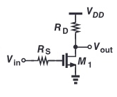
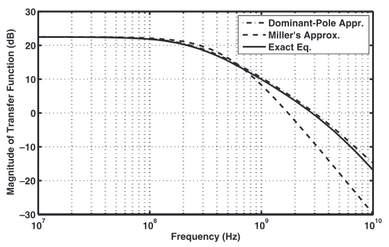

# 예제 11.18 — CS 단의 주파수 응답: 밀러 근사, 정확한 전달 함수, 주극점 근사 비교

## 원문
그림 11.31(a)의 공통 소스(CS) 단에서, $R_S = 200\ \Omega$, $C_{GS} = 250\ \text{fF}$, $C_{GD} = 80\ \text{fF}$, $C_{DB} = 100\ \text{fF}$, $g_m = (150\ \Omega)^{-1}$, $\lambda = 0$, $R_L = 2\ \text{k}\Omega$이다. (a) 밀러 근사, (b) 정확한 전달 함수, (c) 주극점 근사를 이용하여 주파수 응답을 각각 그려라.

## 조건
- 회로: Fig 11.31(a)의 CS 단 ($R_S$, $M_1$, $R_D$)
- $R_S = 200\ \Omega$
- $C_{GS} = 250\ \text{fF}$
- $C_{GD} = 80\ \text{fF}$
- $C_{DB} = 100\ \text{fF}$
- $g_m = (150\ \Omega)^{-1}$
- $\lambda = 0$
- $R_L = 2\ \text{k}\Omega$ ($R_L$은 그림의 $R_D$ 자리) (원문에 없음)

## 구할 것
- 다음 각각을 이용하여 주파수 응답 그리기
  - (a) 밀러 근사
  - (b) 정확한 전달 함수
  - (c) 주극점 근사

## 상속·참조
- 본문 Fig 11.31(b)–(d) (교재 600쪽, 크롭 안 함): (b) CE 단에 $C_\pi$ (베이스–접지), $C_\mu$ (베이스–컬렉터), $C_{CS}$ (컬렉터–접지), CS 단에 $C_{GS}$ (게이트–접지), $C_{GD}$ (게이트–드레인), $C_{DB}$ (드레인–접지), $C_{SB}$ (양 끝 접지). (d) 두 회로의 통합 모델: $V_{Thev}$–$R_{Thev}$–노드 $X$, $X$–접지 $C_{in}$, $X$–$Y$ 사이 $C_{XY}$, $Y$ = $V_{out}$, $Y$→접지 종속 전류원 $g_m V_X$, $Y$–접지 $C_{out}$과 부하 저항. 즉 $C_{in} = C_\pi$ 또는 $C_{GS}$, $C_{XY} = C_\mu$ 또는 $C_{GD}$, $C_{out} = C_{CS}$ 또는 $C_{DB}$. 얼리 효과와 채널길이 변조는 무시 (각주 10). 부하 저항은 본문에서 $R_L$로 부름 ($R_C$ 또는 $R_D$ 자리)
- 밀러 근사 (식 11.59–11.60): $C_X = (1 + g_m R_L) C_{XY}$, $C_Y = \left(1 + \dfrac{1}{g_m R_L}\right) C_{XY}$
- 본문 Fig 11.32 (교재 601쪽, 크롭 안 함) 밀러 근사 통합 모델의 파라미터: CE 단은 $V_{Thev} = V_{in}\dfrac{r_\pi}{r_\pi + R_S}$, $R_{Thev} = R_S \parallel r_\pi$, $C_X = C_\mu(1 + g_m R_L)$, $C_Y = C_\mu\left(1 + \dfrac{1}{g_m R_L}\right)$ / CS 단은 $V_{Thev} = V_{in}$, $R_{Thev} = R_S$, $C_X = C_{GD}(1 + g_m R_L)$, $C_Y = C_{GD}\left(1 + \dfrac{1}{g_m R_L}\right)$
- 극점 (식 11.61–11.62): $|\omega_{p,in}| = \dfrac{1}{R_{Thev}[C_{in} + (1 + g_m R_L) C_{XY}]}$, $|\omega_{p,out}| = \dfrac{1}{R_L\left[C_{out} + \left(1 + \dfrac{1}{g_m R_L}\right) C_{XY}\right]}$
- 직접 해석 (11.4.4절, 통합 모델 Fig 11.31(d)의 두 노드 KCL): $\dfrac{V_{out}}{V_{Thev}}(s) = \dfrac{(C_{XY}s - g_m)R_L}{as^2 + bs + 1}$ (식 11.73), $a = R_{Thev}R_L(C_{in}C_{XY} + C_{out}C_{XY} + C_{in}C_{out})$ (식 11.74), $b = (1 + g_m R_L)C_{XY}R_{Thev} + R_{Thev}C_{in} + R_L(C_{XY} + C_{out})$ (식 11.75). 영점 $\omega_z = g_m/C_{XY}$ (식 11.76)
- 주극점 근사 ($\omega_{p2} \gg \omega_{p1}$): $|\omega_{p1}| = \dfrac{1}{(1 + g_m R_L)C_{XY}R_{Thev} + R_{Thev}C_{in} + R_L(C_{XY} + C_{out})}$ (식 11.80), $|\omega_{p2}| = \dfrac{b}{a}$ (식 11.81–11.82)

## 회로 — Fig 11.31(a)
```spice
RS  Vin   n1    {R_S}
M1  Vout  n1    0  nmos
RD  VDD   Vout  {R_D}
```
- 단자: VDD = 전원, 값 미지정 (T 전원 기호) / Vin = 입력 (개방 원) / Vout = 출력 (개방 원)
- 표시: 노드 라벨 V_DD (T 기호 오른쪽), V_in (입력 원 왼쪽), V_out (출력 원 오른쪽) / 소자 라벨 R_S (저항 위), R_D (저항 왼쪽), M1 (트랜지스터 오른쪽, 소스 옆) / 부호 없음 / 화살표 없음 / 수치·면적 라벨 없음
- 배치: 세로줄 위→아래 V_DD T 기호, R_D, 드레인 접속점, M1, 접지 / M1 NMOS 보통 방향(게이트 왼쪽, 드레인 위, 소스 아래) / V_in 원 → 가로 R_S → 게이트 / 드레인 접속점에서 가로선이 오른쪽 V_out 원에서 끝남 / 접지 기호는 M1 소스 아래 / 접속점 (세 갈래 이상, 1곳): 드레인 = 위 R_D + 아래 M1 드레인 + 오른쪽 V_out 선 (점) / 패널 글자 (a)는 크롭 이미지에 없음 (책에서는 CE·CS 두 회로 아래 가운데에 하나) / 교차: 없음


> 참고: 크롭은 (a)의 CS(오른쪽) 절반만 (crop: cs). 본문 그림 11.31의 (b) 트랜지스터 커패시턴스 포함, (c) 소신호 등가 회로, (d) 통합 모델은 크롭하지 않음 (상속·참조에 글로)

## 답 (검증용)
- (a) $g_m R_L = 13.3$. 식 (11.61)–(11.62)로 $|\omega_{p,in}| = 2\pi \times (571\ \text{MHz})$ (식 11.88), $|\omega_{p,out}| = 2\pi \times (428\ \text{MHz})$ (식 11.89)
- (b) 식 (11.73)의 전달 함수는 $g_m/C_{GD} = 2\pi \times (13.3\ \text{GHz})$에서 영점. $a = 2.12 \times 10^{-20}\ \text{s}^{-2}$, $b = 6.39 \times 10^{-10}$ (b의 단위 s는 인쇄되지 않음) → $|\omega_{p1}| = 2\pi \times (264\ \text{MHz})$ (식 11.90), $|\omega_{p2}| = 2\pi \times (4.53\ \text{GHz})$ (식 11.91). 밀러 근사와 큰 오차: 고주파수에서의 이득이 아닌 중간 주파수 이득 $(1 + g_m R_L)$을 $C_{GD}$와 곱했기 때문 (각주 13: $|\omega_{p,out}|$과 $|\omega_{p2}|$ 사이의 큰 불일치는 '극점 분열' 효과)
- (c) 식 (11.80), (11.82)로 $|\omega_{p1}| = 2\pi \times (249\ \text{MHz})$ (식 11.92), $|\omega_{p2}| = 2\pi \times (4.79\ \text{GHz})$ (식 11.93). 두 극점이 상당히 멀리 떨어져 있어 비교적 정확
- Fig 11.34: 저주파수 이득 $22\ \text{dB} \approx 13$, 정확한 식으로 예상된 −3 dB 대역폭 약 $250\ \text{MHz}$
- Fig 11.34 그래프: 세로축 "Magnitude of Transfer Function (dB)" −30–30 (10 간격), 가로축 "Frequency (Hz)" $10^7$–$10^{10}$ (로그). 오른쪽 위 범례: 점쇄선 "Dominant-Pole Appr.", 파선 "Miller's Approx.", 실선 "Exact Eq.". 세 곡선 모두 약 22.5 dB에서 평평하다가 $10^8$ Hz 부근부터 내려감. 실선과 점쇄선은 거의 겹쳐 $10^{10}$ Hz에서 각각 약 −17 dB, −15 dB. 파선(밀러)은 약 $10^9$ Hz 이후 더 가파르게 내려가 $10^{10}$ Hz에서 약 −28 dB



## 풀이
### (a) 밀러 근사의 극점
- $g_m R_L = 13.3$ ($22.5\ \text{dB}$), $R_{Thev} = R_S$
- $|\omega_{p,in}| = 1/\{R_S[C_{GS} + (1 + g_m R_L)C_{GD}]\} = 2\pi \times 570\ \text{MHz}$
- $|\omega_{p,out}| = 1/\{R_L[C_{DB} + (1 + 1/(g_m R_L))C_{GD}]\} = 2\pi \times 428\ \text{MHz}$
### (b) 정확한 전달 함수
- $V_{out}/V_{in} = (C_{GD}s - g_m)R_L/(as^2 + bs + 1)$, 영점 $g_m/C_{GD} = 2\pi \times 13.3\ \text{GHz}$
- $a = R_S R_L(C_{GS}C_{GD} + C_{DB}C_{GD} + C_{GS}C_{DB}) = 2.12 \times 10^{-20}\ \text{s}^2$, $b = (1 + g_m R_L)C_{GD}R_S + R_S C_{GS} + R_L(C_{GD} + C_{DB}) = 6.39 \times 10^{-10}\ \text{s}$
- 근: $|\omega_{p1}| = 2\pi \times 263\ \text{MHz}$, $|\omega_{p2}| = 2\pi \times 4.54\ \text{GHz}$ (밀러 근사는 중간 주파수 이득을 $C_{GD}$에 곱해 어긋남)
### (c) 주극점 근사
- $|\omega_{p1}| \approx 1/b = 2\pi \times 249\ \text{MHz}$, $|\omega_{p2}| \approx b/a = 2\pi \times 4.80\ \text{GHz}$
### 주파수 응답의 모양
- 셋 모두 $22.5\ \text{dB}$에서 평평하다가 정확한 식·주극점은 약 $250\ \text{MHz}$, 밀러는 약 $310\ \text{MHz}$에서 꺾인다
- $10\ \text{GHz}$에서 정확한 식 $-14.8\ \text{dB}$, 주극점(영점 포함) $-14.9\ \text{dB}$(영점을 빼면 $-16.9\ \text{dB}$), 밀러 $-29.8\ \text{dB}$
- 교재 그림 값(정확 약 $-17\ \text{dB}$, 주극점 약 $-15\ \text{dB}$)과 다름: 영점 $g_m/C_{GD}$를 어느 곡선에 넣었는가의 차이
### 답
- (a) $2\pi \times 570\ \text{MHz}$, $2\pi \times 428\ \text{MHz}$
- (b) $2\pi \times 263\ \text{MHz}$, $2\pi \times 4.54\ \text{GHz}$, 영점 $2\pi \times 13.3\ \text{GHz}$
- (c) $2\pi \times 249\ \text{MHz}$, $2\pi \times 4.80\ \text{GHz}$. 이득 $22.5\ \text{dB}$, 대역폭 약 $250\ \text{MHz}$
