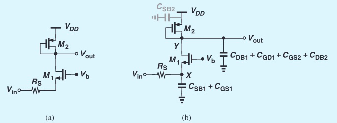

# 예제 11.19 — 다이오드 연결 PMOS 부하를 가진 CG 단의 극점

## 조건
- 회로: Fig 11.38(a) CG 단 (입력 직렬 저항 $R_S$가 $M_1$ 소스에 연결, $M_1$ 게이트는 $V_b$, 부하는 다이오드 연결 PMOS $M_2$)
- $\lambda = 0$
- 소자 값은 주어지지 않음 (답은 기호로) (원문에 없음)

## 구할 것
- 회로의 극점 계산

## 상속·참조
- 본문 Fig 11.37 (교재 608쪽, 크롭 안 함): 트랜지스터 커패시턴스를 포함한 (a) CB 단과 (b) CG 단. $r_O = \infty$. (b) CG 단: $V_{DD}$–$R_D$–$V_{out}$ = 드레인 노드 $Y$, $M_1$ 게이트는 $V_b$ (점 단자), 소스 노드 $X$, $R_S$는 $V_{in}$과 $X$ 사이. $C_{DB}$는 $Y$–접지, $C_{GD}$는 $Y$–$V_b$, $C_{GS}$는 $V_b$–$X$, $C_{SB}$는 $X$–접지. $V_b$가 교류 접지이므로 입력과 출력 사이에 커패시턴스가 없고 밀러 효과가 없음
- CB/CG 단의 극점: $|\omega_{p,X}| = \dfrac{1}{\left(R_S \parallel \dfrac{1}{g_m}\right)C_X}$ (식 11.99), $C_X = C_\pi$ 또는 $C_{GS} + C_{SB}$ / $|\omega_{p,Y}| = \dfrac{1}{R_L C_Y}$ (식 11.100), $C_Y = C_\mu + C_{CS}$ 또는 $C_{GD} + C_{DB}$
- MOSFET 커패시턴스 (11.2.2절, 예제 11.13): $C_{GS}$, $C_{GD}$, $C_{SB}$, $C_{DB}$. 벌크는 교류 접지. 다이오드 연결 소자의 소신호 저항은 $1/g_m$

## 회로 — Fig 11.38(a)
```spice
* M2는 다이오드 연결: 게이트가 드레인(Vout)에 선으로 이어짐
M2  Vout  Vout  VDD  pmos
M1  Vout  Vb    n1   nmos
RS  Vin   n1    {R_S}
```
- 단자: VDD = 전원, 값 미지정 (T 전원 기호) / Vb = 이상적 DC 바이어스 (점 단자) / Vin = 입력 (개방 원) / Vout = 출력 (개방 원)
- 표시: 노드 라벨 V_DD (T 기호 오른쪽), V_b (점 단자 오른쪽), V_in (입력 원 왼쪽), V_out (출력 원 오른쪽) / 소자 라벨 M2 (트랜지스터 오른쪽), M1 (트랜지스터 왼쪽), R_S (저항 위) / 부호 없음 / 화살표 없음 / 수치·면적 라벨 없음
- 배치: 한 세로줄 위→아래 V_DD T 기호, M2, 출력 접속점, M1, M1 소스 모서리 / M2 PMOS(게이트 왼쪽, 소스 위, 드레인 아래, 소스 화살표는 게이트 쪽을 향함) / M2 게이트에서 선이 왼쪽으로 나가 아래로 꺾이고 다시 오른쪽으로 꺾여 출력 접속점 (다이오드 연결) / M1 NMOS 좌우 반전(게이트 오른쪽, 드레인 위, 소스 아래, 소스 화살표는 왼쪽 바깥을 향함) / M1 게이트 → 가로선 → 오른쪽 V_b 점 단자 / M1 소스에서 선이 아래로 내려가 모서리에서 왼쪽으로 꺾여 가로 R_S를 지나 V_in 원 / 출력 접속점에서 가로선이 오른쪽 V_out 원에서 끝남 / 접지 기호 없음 / 접속점 (세 갈래 이상, 1곳): ① 출력 = 위 M2 드레인 + 왼쪽 다이오드 선 + 아래 M1 드레인 + 오른쪽 V_out 선 (점) / 교차: 없음


> 참고: 크롭 이미지 오른쪽 (b)는 문제 상자 안에 함께 인쇄된 풀이 그림 (답 절 참고)

## 답 (검증용)
- $C_{GD2}$와 $C_{SB2}$는 회로에서 아무런 역할을 하지 않음 → 소자의 커패시턴스를 더해 Fig 11.38(b)
- 입력 극점 (인쇄된 대로): $|\omega_{p,X}| = \dfrac{1}{\left(R_S \parallel \dfrac{1}{g_{m1}}\right)(C_{SB1} + C_{GD1})}$ (식 11.101)
  - Fig 11.38(b)의 $X$ 노드 커패시터는 "$C_{SB1} + C_{GS1}$"이고 식 (11.99)도 $C_{GS} + C_{SB}$이므로 식의 $C_{GD1}$은 문맥과 맞지 않음(오식으로 보임) (원문에 없음)
- 출력 노드의 소신호 저항은 $1/g_{m2}$ → $|\omega_{p,Y}| = \dfrac{1}{\dfrac{1}{g_{m2}}(C_{DB1} + C_{GD1} + C_{GS2} + C_{DB2})}$ (식 11.102)

### 정답 회로 — Fig 11.38(b)
```spice
* Y 라벨이 붙은 M2 드레인 접속점 = Vout 노드
* 회색으로 그려진 소자: CSB2 (V_DD 선과 회색 접지 사이, 양 끝이 교류 접지)
M2   Vout  Vout  VDD  pmos
CSB2 0     VDD   {C_SB2}
M1   Vout  Vb    X    nmos
RS   Vin   X     {R_S}
CX   X     0     {C_SB1+C_GS1}
CY   Vout  0     {C_DB1+C_GD1+C_GS2+C_DB2}
```
- 단자: VDD = 전원, 값 미지정 (T 전원 기호) / Vb = 이상적 DC 바이어스 (점 단자) / Vin = 입력 (개방 원) / Vout = 출력 (개방 원)
- 표시: 노드 라벨 V_DD (T 기호 오른쪽), Y (M2 드레인 접속점 왼쪽 아래), X (M1 소스 접속점 오른쪽), V_b (점 단자 오른쪽), V_in (입력 원 왼쪽), V_out (출력 원 오른쪽) / 소자 라벨 C_SB2 (회색, 커패시터 위), M2 (트랜지스터 오른쪽), M1 (트랜지스터 왼쪽), R_S (저항 위), C_SB1 + C_GS1 (커패시터 하나 오른쪽에 합으로), C_DB1 + C_GD1 + C_GS2 + C_DB2 (커패시터 하나 오른쪽에 합으로) / 부호 없음 / 화살표 없음 / 수치·면적 라벨 "C_SB1 + C_GS1" (X 커패시터 오른쪽), "C_DB1 + C_GD1 + C_GS2 + C_DB2" (출력 커패시터 오른쪽)
- 배치: (a)와 같은 세로줄 위→아래 V_DD T 기호, M2, Y 접속점, M1, X 접속점, X 커패시터, 접지 / 회색 C_SB2는 T 기호 아래 V_DD 선에서 왼쪽으로 가로로 나가 회색의 옆으로 누운 접지 / M2 다이오드 연결((a)와 같은 모양) / M1 좌우 반전(게이트 오른쪽 → V_b 점 단자) / M1 소스에서 선이 X 접속점으로 내려감, X 접속점에서 왼쪽 가로 R_S → V_in 원, 아래 세로 커패시터 "C_SB1 + C_GS1"과 접지 / Y 접속점에서 가로선이 오른쪽으로 출력 커패시터 접속점을 지나 V_out 원에서 끝남, 출력 커패시터는 세로로 내려가고 그 아래 접지 / 접속점 (세 갈래 이상, 4곳): ① V_DD 선 = 위 T 기호 + 아래 M2 소스 + 왼쪽 회색 C_SB2 선 (점 없음) ② Y = 위 M2 드레인 + 왼쪽 다이오드 선 + 아래 M1 드레인 + 오른쪽 가로선 (점) ③ 출력 커패시터 위 = 왼쪽 + 오른쪽 V_out 선 + 아래 커패시터 (점) ④ X = 위 M1 소스 + 왼쪽 R_S + 아래 커패시터 (점) / 교차: 없음


