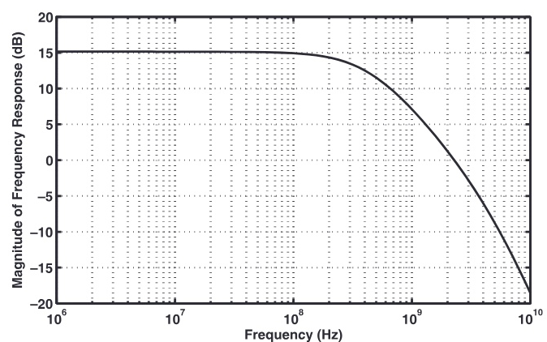

# 예제 11.20 — 예제 11.18의 CS 단을 CG 증폭기로 재구성한 주파수 응답

## 원문
예제 11.18의 공통 소스(CS) 단을 ($R_S$가 트랜지스터의 소스에 연결된) 공통 게이트 증폭기로 재구성하였다. 이 회로의 주파수 응답을 그려라.

## 조건
- 예제 11.18의 공통 소스(CS) 단을 ($R_S$가 트랜지스터의 소스에 연결된) 공통 게이트(CG) 증폭기로 재구성
- 파라미터는 예제 11.18과 같음: $R_S = 200\ \Omega$, $C_{GS} = 250\ \text{fF}$, $C_{GD} = 80\ \text{fF}$, $C_{DB} = 100\ \text{fF}$, $g_m = (150\ \Omega)^{-1}$, $\lambda = 0$, $R_L = 2\ \text{k}\Omega$ (원문에 없음)
- $C_{SB} = C_{DB}$로 봄 (문제는 값을 적지 않음, 풀이가 이렇게 둠, 원문에 없음)

## 구할 것
- 이 회로의 주파수 응답 그리기

## 상속·참조
- 예제 11.18 (E11.18)의 값: $R_S = 200\ \Omega$, $C_{GS} = 250\ \text{fF}$, $C_{GD} = 80\ \text{fF}$, $C_{DB} = 100\ \text{fF}$, $g_m = (150\ \Omega)^{-1}$, $\lambda = 0$, $R_L = 2\ \text{k}\Omega$ (Fig 11.31(a) CS 단의 $R_D$ 자리). 예제 11.18의 CS 단 저주파수 이득 $g_m R_L = 13.3$ ($22\ \text{dB}$)
- 본문 Fig 11.37 (교재 608쪽, 크롭 안 함): 트랜지스터 커패시턴스를 포함한 (a) CB 단과 (b) CG 단. $r_O = \infty$. (b) CG 단: $V_{DD}$–$R_D$–$V_{out}$ = 드레인 노드 $Y$, $M_1$ 게이트는 $V_b$ (점 단자), 소스 노드 $X$, $R_S$는 $V_{in}$과 $X$ 사이. $C_{DB}$는 $Y$–접지, $C_{GD}$는 $Y$–$V_b$, $C_{GS}$는 $V_b$–$X$, $C_{SB}$는 $X$–접지. $V_b$가 교류 접지이므로 입력과 출력 사이에 커패시턴스가 없고 밀러 효과가 없음
- CB/CG 단의 극점: $|\omega_{p,X}| = \dfrac{1}{\left(R_S \parallel \dfrac{1}{g_m}\right)C_X}$ (식 11.99), $C_X = C_\pi$ 또는 $C_{GS} + C_{SB}$ / $|\omega_{p,Y}| = \dfrac{1}{R_L C_Y}$ (식 11.100), $C_Y = C_\mu + C_{CS}$ 또는 $C_{GD} + C_{DB}$

## 회로 — 없음 (문제 그림 없음, 예제 11.18의 CS 단을 CG로 바꾼 회로. 본문 Fig 11.37(b) 참고)

## 답 (검증용)
- 예제 11.18의 값과 $C_{SB} = C_{DB}$로 두고 (각주 16: 실제로는 역바이어스 전압이 달라 완전히 같지는 않음) 식 (11.99)–(11.100)으로 $|\omega_{p,in}| = 2\pi \times (5.31\ \text{GHz})$ (식 11.103), $|\omega_{p,out}| = 2\pi \times (442\ \text{MHz})$ (식 11.104)
- 밀러 효과가 없어 입력 극점은 크기가 상당히 증가. 출력 극점이 대역폭을 제한. 저주파수 이득 $R_D/(R_S + 1/g_m) = 5.7$ (CS 단의 저주파수 이득보다 2배 이상 낮음)
- Fig 11.39: 저주파수 이득 $15\ \text{dB} \approx 5.7$, −3 dB 대역폭 약 $450\ \text{MHz}$
- Fig 11.39 그래프: 세로축 "Magnitude of Frequency Response (dB)" −20–20 (5 간격), 가로축 "Frequency (Hz)" $10^6$–$10^{10}$ (로그). 실선 곡선 하나가 약 15 dB에서 평평하다가 $10^8$ Hz 부근부터 내려가 $10^{10}$ Hz에서 약 −18 dB

## 풀이
### CG 증폭기의 모양
- 게이트는 $V_b$(AC 접지), $R_S$는 $V_{in}$과 소스 노드 $X$ 사이, $R_L$은 드레인 노드 $Y$와 $V_{DD}$ 사이
- 게이트가 AC 접지라 입력과 출력 사이에 커패시턴스가 없어 밀러 효과가 없다
### 입력 극점
- $X$에서 접지로 $C_{GS} + C_{SB} = 250 + 100 = 350\ \text{fF}$ ($C_{SB} = C_{DB}$)
- $X$의 저항 $R_S \parallel \dfrac{1}{g_m} = 200\ \Omega \parallel 150\ \Omega = 85.7\ \Omega$
- $|\omega_{p,in}| = \dfrac{1}{(85.7\ \Omega)(350\ \text{fF})} = 2\pi \times 5.31\ \text{GHz}$
### 출력 극점
- $Y$에서 접지로 $C_{GD} + C_{DB} = 180\ \text{fF}$ ($\lambda = 0$이라 $Y$의 저항은 $R_L$)
- $|\omega_{p,out}| = \dfrac{1}{(2\ \text{k}\Omega)(180\ \text{fF})} = 2\pi \times 442\ \text{MHz}$
### 저주파수 이득과 응답
- 저주파수 전압 이득 $A_v = \dfrac{R_L}{R_S + 1/g_m} = \dfrac{2\ \text{k}\Omega}{350\ \Omega} = 5.71$ ($15.1\ \text{dB}$), CS 단의 $13.3$보다 2배 넘게 낮다
- $15.1\ \text{dB}$에서 평평하다가 $442\ \text{MHz}$에서 꺾이고, $5.31\ \text{GHz}$ 위에서 더 가파르게 떨어진다 ($10\ \text{GHz}$에서 $-18.5\ \text{dB}$)
### 답
- $|\omega_{p,in}| \approx 2\pi \times 5.31\ \text{GHz}$, $|\omega_{p,out}| \approx 2\pi \times 442\ \text{MHz}$, 저주파수 이득 $5.71$ ($15.1\ \text{dB}$). 출력 극점이 대역폭(약 $440\ \text{MHz}$)을 정하고, 밀러 효과가 없어 입력 극점은 CS 단보다 훨씬 높다.
