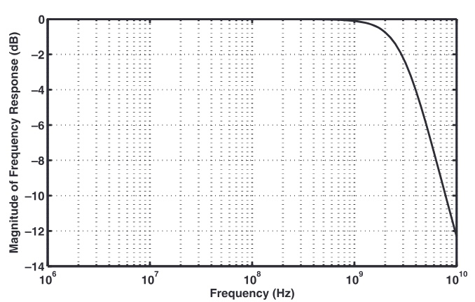

# 예제 11.21 — 200 Ω으로 구동되고 100 fF를 구동하는 소스 폴로어의 주파수 응답

## 원문
소스 폴로어가 $200\ \Omega$의 저항에 의해 구동되고 $100\ \text{fF}$의 부하 커패시턴스를 구동하고 있다. 예제 11.18에 주어진 트랜지스터 파라미터들을 이용하여 회로의 주파수 응답을 그려라.

## 조건
- 소스 폴로어
- 구동 저항 $200\ \Omega$ (그림 11.40(b)의 $R_S$ 자리) (원문에 없음)
- 부하 커패시턴스 $100\ \text{fF}$ ($C_L$)
- 트랜지스터 파라미터는 예제 11.18의 값: $C_{GS} = 250\ \text{fF}$, $C_{GD} = 80\ \text{fF}$, $C_{DB} = 100\ \text{fF}$, $g_m = (150\ \Omega)^{-1}$, $\lambda = 0$ (원문에 없음)
- $C_{SB} = 100\ \text{fF}$ ($= C_{DB}$)로 봄 (문제와 풀이 모두 값을 적지 않지만 풀이의 $a$ 값이 이 값에 맞음, 원문에 없음)

## 구할 것
- 회로의 주파수 응답 그리기

## 상속·참조
- 예제 11.18 (E11.18)의 트랜지스터 파라미터: $C_{GS} = 250\ \text{fF}$, $C_{GD} = 80\ \text{fF}$, $C_{DB} = 100\ \text{fF}$, $g_m = (150\ \Omega)^{-1}$, $\lambda = 0$ (예제 11.18의 $R_S = 200\ \Omega$, $R_L = 2\ \text{k}\Omega$는 CS 단의 회로 값)
- 본문 Fig 11.40(b) 소스 폴로어 (교재 611쪽, 크롭 안 함): $M_1$ 드레인은 $V_{DD}$, $R_S$는 $V_{in}$과 게이트 노드 $X$ 사이, $C_{GD}$는 $X$–$V_{DD}$(드레인), 회색 $C_{DB}$는 드레인–접지 (양 끝 교류 접지), $C_{GS}$는 $X$–소스 노드 $Y$, $Y$ = $V_{out}$, $Y$→접지 바이어스 전류원, $V_{out}$–접지 $C_{SB} + C_L$
- 이미터 폴로어 결과에서 $r_\pi \to \infty$로 둔 소스 폴로어 전달 함수 ($C_{SB}$와 $C_L$이 병렬): $\dfrac{V_{out}}{V_{in}} = \dfrac{1 + \dfrac{C_{GS}}{g_m}s}{as^2 + bs + 1}$ (식 11.112), $a = \dfrac{R_S}{g_m}[C_{GD}C_{GS} + C_{GD}(C_{SB} + C_L) + C_{GS}(C_{SB} + C_L)]$ (식 11.113), $b = R_S C_{GD} + \dfrac{C_{GS} + C_{SB} + C_L}{g_m}$ (식 11.114)

## 회로 — 없음 (문제 그림 없음, 소스 폴로어. 본문 Fig 11.40(b) 참고)

## 답 (검증용)
- 영점 $g_m/C_{GS} = 2\pi \times (4.24\ \text{GHz})$. 식 (11.113)–(11.114)로 $a = 2.58 \times 10^{-21}\ \text{s}^{-2}$ (식 11.115), $b = 5.8 \times 10^{-11}\ \text{s}$ (식 11.116)
- 두 극점: $\omega_{p1} = 2\pi[-1.79\ \text{GHz} + j(2.57\ \text{GHz})]$ (식 11.117), $\omega_{p2} = 2\pi[-1.79\ \text{GHz} - j(2.57\ \text{GHz})]$ (식 11.118). 선택된 값에서 극점은 복소수
- 문맥과 맞지 않음(오식으로 보임): 식 (11.114)에 위 값과 $C_{SB} = 100\ \text{fF}$를 넣으면 $b \approx 8.35 \times 10^{-11}\ \text{s}$이고, 극점은 $2\pi[-2.58\ \text{GHz} \pm j(1.78\ \text{GHz})]$로 책의 실수부와 허수부가 뒤바뀐 꼴이 됨. 이 값으로 구한 −3 dB 대역폭 약 $3.45\ \text{GHz}$가 책의 "대략 3.5 GHz"와 맞고, 책의 $b$로 구하면 약 $4.7\ \text{GHz}$가 됨 (원문에 없음)
- Fig 11.42: −3 dB 대역폭 대략 $3.5\ \text{GHz}$
- Fig 11.42 그래프: 세로축 "Magnitude of Frequency Response (dB)" −14–0 (2 간격), 가로축 "Frequency (Hz)" $10^6$–$10^{10}$ (로그). 실선 곡선 하나가 0 dB에서 평평하다가 $10^9$ Hz 부근부터 내려가 $10^{10}$ Hz에서 약 −12 dB

