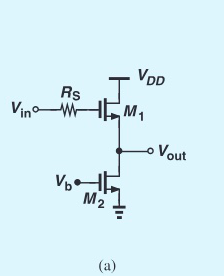
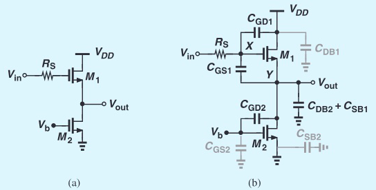

# 예제 11.22 — 전류원 M2로 바이어스된 소스 폴로어의 전달 함수

## 원문
그림 11.43(a)에 그려진 소스 폴로어의 전달 함수를 결정하라. 여기서 $M_2$는 전류원으로 동작한다.

## 조건
- 회로: Fig 11.43(a) 소스 폴로어 (입력 직렬 저항 $R_S$, 폴로어 $M_1$, 아래쪽 $M_2$)
- $M_2$는 전류원으로 동작 (게이트는 $V_b$)
- 소자 값은 주어지지 않음 (답은 기호로) (원문에 없음)

## 구할 것
- 소스 폴로어의 전달 함수

## 상속·참조
- 본문 Fig 11.40(b) 소스 폴로어 (교재 611쪽, 크롭 안 함): $M_1$ 드레인은 $V_{DD}$, $R_S$는 $V_{in}$과 게이트 노드 $X$ 사이, $C_{GD}$는 $X$–$V_{DD}$(드레인), 회색 $C_{DB}$는 드레인–접지 (양 끝 교류 접지), $C_{GS}$는 $X$–소스 노드 $Y$, $Y$ = $V_{out}$, $Y$→접지 바이어스 전류원, $V_{out}$–접지 $C_{SB} + C_L$
- 이미터 폴로어 결과에서 $r_\pi \to \infty$로 둔 소스 폴로어 전달 함수 ($C_{SB}$와 $C_L$이 병렬): $\dfrac{V_{out}}{V_{in}} = \dfrac{1 + \dfrac{C_{GS}}{g_m}s}{as^2 + bs + 1}$ (식 11.112), $a = \dfrac{R_S}{g_m}[C_{GD}C_{GS} + C_{GD}(C_{SB} + C_L) + C_{GS}(C_{SB} + C_L)]$ (식 11.113), $b = R_S C_{GD} + \dfrac{C_{GS} + C_{SB} + C_L}{g_m}$ (식 11.114)

## 회로 — Fig 11.43(a)
```spice
RS  Vin   n1    {R_S}
M1  VDD   n1    Vout  nmos
M2  Vout  Vb    0     nmos
```
- 단자: VDD = 전원, 값 미지정 (T 전원 기호) / Vin = 입력 (개방 원) / Vb = 이상적 DC 바이어스 (점 단자) / Vout = 출력 (개방 원)
- 표시: 노드 라벨 V_DD (T 기호 오른쪽), V_in (입력 원 왼쪽), V_b (점 단자 왼쪽), V_out (출력 원 오른쪽) / 소자 라벨 R_S (저항 위), M1 (트랜지스터 오른쪽, 소스 옆), M2 (트랜지스터 왼쪽 아래, V_b 점 단자 아래) / 부호 없음 / 화살표 없음 / 수치·면적 라벨 없음
- 배치: 한 세로줄 위→아래 V_DD T 기호, M1, 출력 접속점, M2, 접지 / M1, M2 모두 NMOS 보통 방향(게이트 왼쪽, 드레인 위, 소스 아래) / V_in 원 → 가로 R_S → M1 게이트 / M2 게이트 → 가로선 → 왼쪽 V_b 점 단자 / 출력 접속점에서 가로선이 오른쪽 V_out 원에서 끝남 / 접속점 (세 갈래 이상, 1곳): ① 출력 = 위 M1 소스 + 아래 M2 드레인 + 오른쪽 V_out 선 (점) / 교차: 없음



## 답 (검증용)
- $C_{GS2}$와 $C_{SB2}$는 이 회로에서 아무런 역할을 하지 않음 → 트랜지스터 커패시턴스를 포함한 Fig 11.43(b). 결과는 그림 11.40과 닮았지만 $C_{SB1}$과 병렬로 $C_{GD2}$와 $C_{DB2}$가 나타남
- 식 (11.112)를 다시 쓰면 $\dfrac{V_{out}}{V_{in}}(s) = \dfrac{1 + \dfrac{C_{GS1}}{g_{m1}}s}{as^2 + bs + 1}$ (식 11.119)
- $a = \dfrac{R_S}{g_{m1}}[C_{GD1}C_{GS1} + (C_{GD1} + C_{GS1})(C_{SB1} + C_{GD2} + C_{DB2})]$ (식 11.120)
- 인쇄된 대로: $b = R_S C_{GD1} + \dfrac{C_{GD1} + C_{SB1} + C_{GD2} + C_{DB2}}{g_{m1}}$ (식 11.121)
  - 식 (11.114)는 분자가 $C_{GS} + C_{SB} + C_L$이므로 식 (11.121) 분자 첫 항 $C_{GD1}$은 문맥과 맞지 않음(오식으로 보임), $C_{GS1}$로 읽음 (원문에 없음)

### 정답 회로 — Fig 11.43(b)
```spice
* Y 라벨이 붙은 M1 소스 접속점 = Vout 노드
* 회색으로 그려진 소자: CDB1, CGS2, CSB2
RS   Vin   X     {R_S}
M1   VDD   X     Vout  nmos
CGD1 X     VDD   {C_GD1}
CDB1 VDD   0     {C_DB1}
CGS1 X     Vout  {C_GS1}
CT   Vout  0     {C_DB2+C_SB1}
M2   Vout  Vb    0     nmos
CGD2 Vb    Vout  {C_GD2}
CGS2 Vb    0     {C_GS2}
* CSB2: M2 소스(접지에 바로 이어짐)와 옆으로 누운 회색 접지 사이 → 양 끝이 같은 노드
CSB2 0     0     {C_SB2}
```
- 단자: VDD = 전원, 값 미지정 (T 전원 기호) / Vin = 입력 (개방 원) / Vb = 이상적 DC 바이어스 (점 단자) / Vout = 출력 (개방 원)
- 표시: 노드 라벨 V_DD (T 기호 오른쪽), V_in (입력 원 왼쪽), X (게이트 접속점 오른쪽 위), Y (M1 소스 접속점 왼쪽 위), V_b (점 단자 왼쪽), V_out (출력 원 오른쪽) / 소자 라벨 C_GD1 (커패시터 위), R_S (저항 위), M1 (트랜지스터 오른쪽), C_DB1 (회색, 커패시터 오른쪽), C_GS1 (커패시터 왼쪽), C_DB2 + C_SB1 (커패시터 하나 오른쪽에 합으로), C_GD2 (커패시터 위), M2 (트랜지스터 왼쪽 아래), C_GS2 (회색, 커패시터 왼쪽), C_SB2 (회색, 커패시터 위) / 부호 없음 / 화살표 없음 / 수치·면적 라벨 없음
- 배치: 가운데 세로줄 위→아래 V_DD T 기호, M1 드레인 접속점, M1, Y 접속점, M2 드레인 접속점, M2, 접지 / M1, M2 모두 NMOS 보통 방향 / V_in 원 → 가로 R_S → X 접속점 → M1 게이트 / X 접속점에서 선이 위로 올라가 모서리에서 오른쪽으로 꺾여 가로 C_GD1을 지나 M1 드레인 접속점 / M1 드레인 접속점에서 회색 선이 오른쪽으로 나가 아래로 꺾여 회색 세로 C_DB1과 회색 접지 / X 접속점 아래 세로 C_GS1, 그 아래 모서리에서 오른쪽으로 꺾여 Y 접속점 / Y 접속점에서 가로선이 오른쪽으로 출력 커패시터 접속점을 지나 V_out 원에서 끝남, 출력 커패시터 C_DB2 + C_SB1은 세로로 내려가고 그 아래 접지 / M2 게이트 접속점: 왼쪽 V_b 점 단자, 오른쪽 M2 게이트, 위로 올라가 모서리에서 오른쪽으로 꺾여 가로 C_GD2를 지나 M2 드레인 접속점, 아래로 회색 세로 C_GS2와 회색 접지 / M2 소스는 아래 접지, 소스선에서 회색 선이 오른쪽으로 나가 가로 회색 C_SB2와 옆으로 누운 회색 접지 / 접속점 (세 갈래 이상, 7곳): ① M1 드레인 = 위 T 기호 + 아래 M1 드레인 + 왼쪽 C_GD1 + 오른쪽 회색 C_DB1 선 (점) ② X = 왼쪽 R_S + 오른쪽 게이트 + 위 C_GD1 선 + 아래 C_GS1 (점) ③ Y = 위 M1 소스 + 왼쪽 C_GS1 선 + 오른쪽 가로선 + 아래 (점) ④ 출력 커패시터 위 = 왼쪽 + 오른쪽 V_out 선 + 아래 커패시터 (점) ⑤ M2 드레인 = 위 + 왼쪽 C_GD2 + 아래 M2 드레인 (점) ⑥ M2 게이트 = 왼쪽 V_b + 오른쪽 게이트 + 위 C_GD2 선 + 아래 회색 C_GS2 (점) ⑦ M2 소스선 = 위 M2 소스 + 아래 접지 + 오른쪽 회색 C_SB2 선 (점 없음) / 교차: 없음


