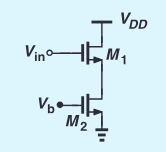

# 예제 11.23 — 전류원 M2로 바이어스된 소스 폴로어의 입력 커패시턴스 (λ ≠ 0)

## 조건
- 회로: Fig 11.45 소스 폴로어 ($M_1$ 게이트가 입력, 아래쪽 $M_2$ 게이트는 $V_b$)
- $\lambda \neq 0$
- 소자 값은 주어지지 않음 (답은 기호로) (원문에 없음)

## 구할 것
- 폴로어의 입력 커패시턴스

## 상속·참조
- 본문 Fig 11.44 (교재 615쪽, 크롭 안 함): (a) 이미터 폴로어와 (b) 소스 폴로어의 입력 임피던스. (b): 입력 단자(개방 원)가 게이트 노드 $X$, $M_1$ 드레인은 $V_{DD}$, $C_{GD}$는 $X$–$V_{DD}$, 회색 $C_{DB}$는 드레인–접지, $C_{XY} = C_{GS}$는 $X$–소스 노드 $Y$, $Y$–접지에 $R_L$과 $C_L + C_{SB}$
- 폴로어 입력 커패시턴스 (밀러 이론): 저주파수 이득 $A_v = \dfrac{R_L}{R_L + \dfrac{1}{g_m}}$ (식 11.122), $C_\pi$ 또는 $C_{GS}$의 '입력' 성분 $C_X = (1 - A_v)C_{XY}$ (식 11.123) $= \dfrac{1}{1 + g_m R_L}C_{XY}$ (식 11.124). $C_\mu$ 또는 $C_{GD}$는 이 값에 직접 더해짐

## 회로 — Fig 11.45
```spice
* M1 소스–M2 드레인 노드는 라벨도 출력 원도 없음 (원문에 없음)
M1  VDD  Vin  n1  nmos
M2  n1   Vb   0   nmos
```
- 단자: VDD = 전원, 값 미지정 (T 전원 기호) / Vin = 입력 (개방 원) / Vb = 이상적 DC 바이어스 (점 단자)
- 표시: 노드 라벨 V_DD (T 기호 오른쪽), V_in (입력 원 왼쪽), V_b (점 단자 왼쪽) / 소자 라벨 M1 (트랜지스터 오른쪽, 소스 옆), M2 (트랜지스터 왼쪽 아래, V_b 점 단자 아래) / 부호 없음 / 화살표 없음 / 수치·면적 라벨 없음
- 배치: 한 세로줄 위→아래 V_DD T 기호, M1, M2, 접지 / M1, M2 모두 NMOS 보통 방향(게이트 왼쪽, 드레인 위, 소스 아래) / V_in 원 → 가로선 → M1 게이트 / M2 게이트 → 가로선 → 왼쪽 V_b 점 단자 / M1 소스에서 세로선이 바로 M2 드레인으로 이어짐 (가지 없음) / 접속점: 없음 / 교차: 없음



## 답 (검증용)
- 7장으로부터 저주파수 이득 $A_v = \dfrac{r_{O1} \parallel r_{O2}}{r_{O1} \parallel r_{O2} + \dfrac{1}{g_{m1}}}$ (식 11.125)
- 그림 11.44(b)로부터 입출력 사이에 나타나는 커패시턴스는 $C_{GS1}$ → $C_{in} = C_{GD1} + (1 - A_v)C_{GS1}$ (식 11.126) $= C_{GD1} + \dfrac{1}{1 + g_{m1}(r_{O1} \parallel r_{O2})}C_{GS1}$ (식 11.127)
- 예: $g_{m1}(r_{O1} \parallel r_{O2}) \approx 10$이면 $C_{GS1}$의 9%만 입력에서 나타남
