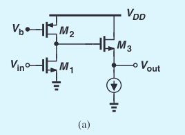
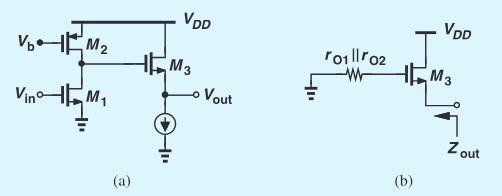

# 예제 11.24 — CS 단 + 소스 폴로어 이단 증폭기의 출력 임피던스

## 원문
그림 11.49는 CS 회로와 소스 폴로어로 구성된 이단 증폭기를 나타낸다. $M_1$과 $M_2$에 대하여 $\lambda \neq 0$이고, 그러나 $M_3$의 $\lambda = 0$이라 가정하고, $C_{GS3}$를 제외한 모든 커패시턴스를 무시하면서, 증폭기의 출력 임피던스를 계산하라.

## 조건
- 회로: Fig 11.49(a) 이단 증폭기 (CS 단: $M_1$ 입력, $M_2$ PMOS 부하 게이트 $V_b$ / 소스 폴로어: $M_3$와 바이어스 전류원)
- $M_1$과 $M_2$: $\lambda \neq 0$
- $M_3$: $\lambda = 0$
- $C_{GS3}$를 제외한 모든 커패시턴스 무시
- 소자 값은 주어지지 않음 (답은 기호로) (원문에 없음)

## 구할 것
- 증폭기의 출력 임피던스

## 상속·참조
- 폴로어 출력 임피던스 (교재 616–617쪽, 본문 Fig 11.46(a): 구동 저항 $R_S$로 구동되는 이미터 폴로어와 소스 폴로어, 다른 커패시턴스와 저항은 무시): 소스 폴로어는 $\dfrac{V_X}{I_X} = \dfrac{R_S C_{GS}s + 1}{C_{GS}s + g_m}$ (식 11.132)

## 회로 — Fig 11.49(a)
```spice
M2  n1    Vb   VDD   pmos
M1  n1    Vin  0     nmos
M3  VDD   n1   Vout  nmos
* 라벨 없는 바이어스 전류원, 화살표 아래 방향
I1  Vout  0
```
- 단자: VDD = 전원, 값 미지정 (가로 레일) / Vb = 이상적 DC 바이어스 (점 단자) / Vin = 입력 (개방 원) / Vout = 출력 (개방 원)
- 표시: 노드 라벨 V_DD (레일 오른쪽 끝), V_b (점 단자 왼쪽), V_in (입력 원 왼쪽), V_out (출력 원 오른쪽) / 소자 라벨 M2 (트랜지스터 오른쪽), M3 (트랜지스터 오른쪽), M1 (트랜지스터 오른쪽), I1 (라벨 없음) / 부호 없음 / 화살표 없음 / 수치·면적 라벨 없음
- 배치: 맨 위 V_DD 가로 레일 / 왼쪽 세로줄 위→아래 레일, M2, 가운데 접속점, M1, 접지 / M2 PMOS(게이트 왼쪽, 소스 위 레일, 드레인 아래, 소스 화살표는 게이트 쪽을 향함), 게이트 → 왼쪽 V_b 점 단자 / M1 NMOS 보통 방향, 게이트 → 가로선 → 왼쪽 V_in 원 / 가운데 접속점에서 가로선이 오른쪽으로 M3 게이트 / 오른쪽 세로줄 위→아래 레일(오른쪽 끝 근처에서 내려옴), M3, 출력 접속점, 전류원, 접지 / M3 NMOS 보통 방향(게이트 왼쪽, 드레인 위, 소스 아래) / 출력 접속점에서 가로선이 오른쪽 V_out 원에서 끝남 / 접속점 (세 갈래 이상, 2곳): ① M2 드레인 = 위 M2 드레인 + 아래 M1 드레인 + 오른쪽 M3 게이트 선 (점) ② 출력 = 위 M3 소스 + 아래 전류원 + 오른쪽 V_out 선 (점) / 교차: 없음



## 답 (검증용)
- 폴로어에서 바라본 소스 임피던스는 CS 단의 출력 저항과 같고 $r_{O1} \parallel r_{O2}$ → Fig 11.49(b)
- 식 (11.132)에서 $R_S = r_{O1} \parallel r_{O2}$로 두면 $\dfrac{V_X}{I_X} = \dfrac{(r_{O1} \parallel r_{O2})C_{GS3}s + 1}{C_{GS3}s + g_{m3}}$ (식 11.133)

### 정답 회로 — Fig 11.49(b)
```spice
RO  0    n1   {r_O1||r_O2}
M3  VDD  n1   out  nmos
```
- 단자: VDD = 전원, 값 미지정 (T 전원 기호) / out = Z_out 측정 단자 (개방 원)
- 표시: 노드 라벨 V_DD (T 기호 오른쪽) / 소자 라벨 r_O1 || r_O2 (저항 위), M3 (트랜지스터 오른쪽) / 부호 없음 / 화살표 "Z_out": out 단자를 왼쪽(M3 소스 쪽)으로 들여다봄, 왼쪽 방향, 도선 옆 별도 화살표 (┌ 꺾임을 좌우 반전: out 원 아래쪽에 세로선, 위 끝에서 가로선이 왼쪽으로 뻗고 화살촉은 왼쪽 끝, 글자 Z_out은 세로선 아래 끝) / 수치·면적 라벨 없음
- 배치: 왼쪽 접지 기호에서 세로선이 위로 올라가 모서리에서 오른쪽으로 꺾여 가로 저항 r_O1 || r_O2를 지나 M3 게이트 / M3 NMOS 보통 방향(게이트 왼쪽, 드레인 위 V_DD T 기호, 소스 아래) / M3 소스에서 선이 아래로 내려가 모서리에서 오른쪽으로 꺾여 out 원에서 끝남 / 접속점: 없음 / 교차: 없음



## 힌트
### $M_3$ 게이트 쪽은 저항 하나로
- $V_{in}$을 AC 접지하면 $M_1$과 $M_2$는 각자의 $r_O$만 남아, $M_3$ 게이트에서 AC 접지로 가는 저항이 된다
- 그러면 회로는 본문에서 본 "저항으로 구동되는 소스 폴로어"의 출력 임피던스 문제가 된다

## 풀이
### $M_3$ 게이트에서 본 저항
- 출력 임피던스를 구하므로 $V_{in}$을 AC 접지한다. $M_1$은 $r_{O1}$, 게이트가 $V_b$인 $M_2$는 $r_{O2}$만 남는다
- 둘 다 $M_3$ 게이트 노드에서 AC 접지로 가므로 $M_3$을 구동하는 저항 $R_G = r_{O1} \parallel r_{O2}$
- 커패시턴스는 $C_{GS3}$만, $M_3$은 $\lambda = 0$, 바이어스 전류원은 이상적이라 출력 노드에는 $M_3$만 남는다
### 출력 노드의 KCL
- 출력에 시험 전압 $V_X$를 걸고 전류 $I_X$를 넣는다. $R_G$와 $C_{GS3}$는 출력에서 접지로 가는 직렬 경로이므로 그 전류는 $\dfrac{V_X}{R_G + 1/(C_{GS3}s)}$
- 게이트 전압 $V_G = V_X\dfrac{R_G}{R_G + 1/(C_{GS3}s)}$, $M_3$가 소스로 넣는 전류 $g_{m3}(V_G - V_X)$
- $I_X = \dfrac{V_X}{R_G + 1/(C_{GS3}s)} - g_{m3}(V_G - V_X) = V_X\dfrac{C_{GS3}s + g_{m3}}{R_G C_{GS3}s + 1}$
### 출력 임피던스
- $Z_{out} = \dfrac{V_X}{I_X} = \dfrac{(r_{O1} \parallel r_{O2})C_{GS3}s + 1}{C_{GS3}s + g_{m3}}$
- 저주파수에서 $1/g_{m3}$, 고주파수에서 $r_{O1} \parallel r_{O2}$로 간다. 보통 $r_{O1} \parallel r_{O2} > 1/g_{m3}$이라 주파수가 오르면 커져 유도성으로 보인다
### 답
- $Z_{out} = \dfrac{(r_{O1} \parallel r_{O2})C_{GS3}s + 1}{C_{GS3}s + g_{m3}}$
