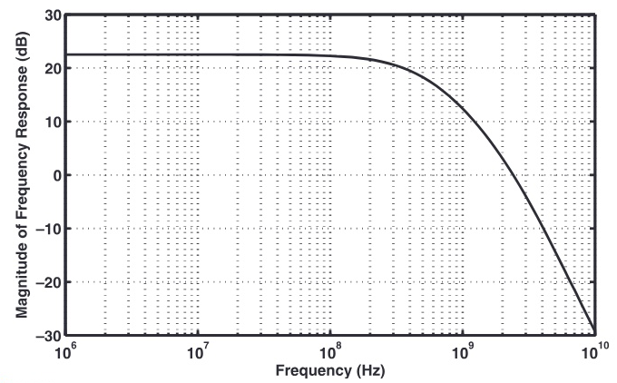

# 예제 11.25 — 예제 11.18의 CS 단을 캐스코드로 바꾼 극점과 주파수 응답

## 원문
예제 11.18에서 학습한 CS 단이 캐스코드 토폴로지로 변환되었다. 2개의 트랜지스터가 동일하다고 가정하여, 극점을 예측하고 주파수 응답을 그리고, 예제 11.18과 결과를 비교하라. $C_{DB} = C_{SB}$로 가정한다.

## 조건
- 예제 11.18에서 학습한 CS 단을 캐스코드 토폴로지로 변환
- 2개의 트랜지스터는 동일
- $C_{DB} = C_{SB}$
- 파라미터는 예제 11.18과 같음: $R_S = 200\ \Omega$, $C_{GS} = 250\ \text{fF}$, $C_{GD} = 80\ \text{fF}$, $C_{DB} = 100\ \text{fF}$, $g_m = (150\ \Omega)^{-1}$, $\lambda = 0$, $R_L = 2\ \text{k}\Omega$ (원문에 없음)

## 구할 것
- 극점 예측
- 주파수 응답 그리기
- 예제 11.18과 결과 비교

## 상속·참조
- 예제 11.18 (E11.18)의 값: $R_S = 200\ \Omega$, $C_{GS} = 250\ \text{fF}$, $C_{GD} = 80\ \text{fF}$, $C_{DB} = 100\ \text{fF}$, $g_m = (150\ \Omega)^{-1}$, $\lambda = 0$, $R_L = 2\ \text{k}\Omega$ (Fig 11.31(a) CS 단의 $R_D$ 자리). 예제 11.18의 CS 단 결과: 저주파수 이득 $g_m R_L = 13.3$ ($22\ \text{dB}$), 밀러 근사 $|\omega_{p,in}| = 2\pi \times (571\ \text{MHz})$, $|\omega_{p,out}| = 2\pi \times (428\ \text{MHz})$, 정확한 전달 함수 $|\omega_{p1}| = 2\pi \times (264\ \text{MHz})$, $|\omega_{p2}| = 2\pi \times (4.53\ \text{GHz})$, −3 dB 대역폭 약 $250\ \text{MHz}$
- 본문 Fig 11.52 (교재 621쪽, 크롭 안 함) 밀러 근사 후 트랜지스터 커패시턴스를 포함한 MOS 캐스코드: $V_{DD}$–$R_L$–$V_{out}$, $M_2$ 드레인 $V_{out}$, 게이트 $V_b$ (점 단자), 소스 노드 $Y$ = $M_1$ 드레인, $M_1$ 소스 접지, $V_{in}$–$R_S$–게이트 노드 $X$. $V_{out}$–접지 $C_{GD2} + C_{DB2}$, $Y$–접지 $C_{GS2} + C_{GD1}(1 + g_{m2}/g_{m1}) + C_{DB1} + C_{SB2}$, $X$–접지 $C_{GS1} + C_{GD1}(1 + g_{m1}/g_{m2})$. $X$에서 $Y$까지의 이득은 $-g_{m1}/g_{m2}$
- MOS 캐스코드의 극점 (각 노드에 극점 하나): $|\omega_{p,X}| = \dfrac{1}{R_S\left[C_{GS1} + \left(1 + \dfrac{g_{m1}}{g_{m2}}\right)C_{GD1}\right]}$ (식 11.141), $|\omega_{p,Y}| = \dfrac{1}{\dfrac{1}{g_{m2}}\left[C_{DB1} + C_{GS2} + \left(1 + \dfrac{g_{m2}}{g_{m1}}\right)C_{GD1} + C_{SB2}\right]}$ (식 11.142), $|\omega_{p,out}| = \dfrac{1}{R_L(C_{DB2} + C_{GD2})}$ (식 11.143)

## 회로 — 없음 (문제 그림 없음, 예제 11.18의 CS 단을 캐스코드로 바꾼 회로. 본문 Fig 11.52 참고)

## 답 (검증용)
- 예제 11.18의 값과 식 (11.141)–(11.143)으로 $|\omega_{p,X}| = 2\pi \times (1.95\ \text{GHz})$ (식 11.144), $|\omega_{p,Y}| = 2\pi \times (1.73\ \text{GHz})$ (식 11.145), $|\omega_{p,out}| = 2\pi \times (442\ \text{MHz})$ (식 11.146)
- $Y$ 노드의 극점이 $f_T/2$보다 상당히 작음. 예제 11.18의 밀러 근사 결과와 비교해 입력 극점은 상당히 증가. 정확한 값과 비교하면 캐스코드 대역폭(442 MHZ, 인쇄된 대로)은 거의 2배
- Fig 11.53 그래프: 세로축 "Magnitude of Frequency Response (dB)" −30–30 (10 간격), 가로축 "Frequency (Hz)" $10^6$–$10^{10}$ (로그). 실선 곡선 하나가 약 22.5 dB에서 평평하다가 $10^8$ Hz 부근부터 내려가 약 $2 \times 10^9$ Hz에서 0 dB를 지나고 $10^{10}$ Hz에서 약 −30 dB

## 풀이
### 캐스코드의 세 노드
- $M_1$ 게이트 노드 $X$, $M_1$ 드레인–$M_2$ 소스 노드 $Y$, 출력 노드마다 극점 하나
- $X$에서 $Y$까지 이득은 $-g_{m1}/g_{m2} = -1$(두 트랜지스터 동일)이라 $C_{GD1}$의 밀러 증배는 $1 + g_{m1}/g_{m2} = 2$
### $X$ 노드 극점
- $C_X = C_{GS1} + 2C_{GD1} = 250 + 160 = 410\ \text{fF}$
- $|\omega_{p,X}| = \dfrac{1}{R_S C_X} = \dfrac{1}{(200\ \Omega)(410\ \text{fF})} = 2\pi \times 1.94\ \text{GHz}$
### $Y$ 노드 극점
- $M_2$ 소스에서 본 저항은 $1/g_{m2}$ ($\lambda = 0$), $C_{DB} = C_{SB}$이므로 $C_Y = C_{DB1} + C_{GS2} + 2C_{GD1} + C_{SB2} = 100 + 250 + 160 + 100 = 610\ \text{fF}$
- $|\omega_{p,Y}| = \dfrac{g_{m2}}{C_Y} = \dfrac{1}{(150\ \Omega)(610\ \text{fF})} = 2\pi \times 1.74\ \text{GHz}$
### 출력 노드 극점
- $|\omega_{p,out}| = \dfrac{1}{R_L(C_{DB2} + C_{GD2})} = \dfrac{1}{(2\ \text{k}\Omega)(180\ \text{fF})} = 2\pi \times 442\ \text{MHz}$
### 응답과 비교
- 저주파수 이득 $g_m R_L = 13.3$ ($22.5\ \text{dB}$)은 CS 단과 같다. $442\ \text{MHz}$에서 꺾이고 $1.7$–$1.9\ \text{GHz}$ 위에서 더 가파르다 (약 $2.3\ \text{GHz}$에서 $0\ \text{dB}$)
- 예제 11.18의 CS 단(밀러 입력 극점 $2\pi \times 570\ \text{MHz}$, 정확한 주극점 $2\pi \times 263\ \text{MHz}$)과 비교하면 $C_{GD1}$의 밀러 증배가 $14.3$에서 $2$로 줄어 입력 극점이 크게 올랐고, 대역폭은 출력 극점 기준 $442/263 = 1.68$배로 넓어졌다 (세 극점을 모두 넣은 $-3\ \text{dB}$ 주파수는 약 $401\ \text{MHz}$)
### 답
- $|\omega_{p,X}| = 2\pi \times 1.94\ \text{GHz}$, $|\omega_{p,Y}| = 2\pi \times 1.74\ \text{GHz}$, $|\omega_{p,out}| = 2\pi \times 442\ \text{MHz}$
- 응답은 $22.5\ \text{dB}$에서 평평하다가 출력 극점 $442\ \text{MHz}$에서 꺾인다
- 예제 11.18과 이득은 같고, 밀러 효과가 줄어 입력 극점은 크게 오르며 대역폭은 약 $1.7$배(거의 2배)다
