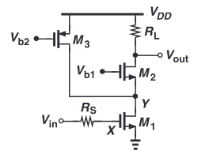

# 예제 11.26 — 전류원 M3로 M1에 더 큰 전류를 흘리는 캐스코드의 극점

## 원문
그림 11.54의 캐스코드에서, 트랜지스터 $M_3$는 일정한 전류원 역할을 하고, $M_1$에 $M_2$보다 큰 전류를 흐르도록 해 준다. $\lambda = 0$임을 가정하고 이 회로의 극점을 계산하라.

## 조건
- 회로: Fig 11.54 캐스코드 ($M_1$ 입력, $M_2$ 캐스코드, 부하 $R_L$, PMOS $M_3$가 $Y$ 노드에 연결)
- $M_3$는 일정한 전류원 역할을 하여 $M_1$에 $M_2$보다 큰 전류가 흐르도록 함
- $\lambda = 0$
- 소자 값은 주어지지 않음 (답은 기호로) (원문에 없음)

## 구할 것
- 회로의 극점

## 상속·참조
- 본문 Fig 11.52 (교재 621쪽, 크롭 안 함) 밀러 근사 후 트랜지스터 커패시턴스를 포함한 MOS 캐스코드: $V_{DD}$–$R_L$–$V_{out}$, $M_2$ 드레인 $V_{out}$, 게이트 $V_b$ (점 단자), 소스 노드 $Y$ = $M_1$ 드레인, $M_1$ 소스 접지, $V_{in}$–$R_S$–게이트 노드 $X$. $V_{out}$–접지 $C_{GD2} + C_{DB2}$, $Y$–접지 $C_{GS2} + C_{GD1}(1 + g_{m2}/g_{m1}) + C_{DB1} + C_{SB2}$, $X$–접지 $C_{GS1} + C_{GD1}(1 + g_{m1}/g_{m2})$. $X$에서 $Y$까지의 이득은 $-g_{m1}/g_{m2}$
- MOS 캐스코드의 극점 (각 노드에 극점 하나): $|\omega_{p,X}| = \dfrac{1}{R_S\left[C_{GS1} + \left(1 + \dfrac{g_{m1}}{g_{m2}}\right)C_{GD1}\right]}$ (식 11.141), $|\omega_{p,Y}| = \dfrac{1}{\dfrac{1}{g_{m2}}\left[C_{DB1} + C_{GS2} + \left(1 + \dfrac{g_{m2}}{g_{m1}}\right)C_{GD1} + C_{SB2}\right]}$ (식 11.142), $|\omega_{p,out}| = \dfrac{1}{R_L(C_{DB2} + C_{GD2})}$ (식 11.143)

## 회로 — Fig 11.54
```spice
M3  Y     Vb2  VDD   pmos
RL  VDD   Vout {R_L}
M2  Vout  Vb1  Y     nmos
M1  Y     X    0     nmos
RS  Vin   X    {R_S}
```
- 단자: VDD = 전원, 값 미지정 (가로 레일) / Vb2, Vb1 = 이상적 DC 바이어스 (점 단자) / Vin = 입력 (개방 원) / Vout = 출력 (개방 원)
- 표시: 노드 라벨 V_DD (레일 오른쪽 끝), V_b2 (점 단자 왼쪽), V_out (출력 원 오른쪽), V_b1 (점 단자 왼쪽), Y (Y 접속점 오른쪽 아래), V_in (입력 원 왼쪽), X (M1 게이트 선 아래, 게이트 바로 왼쪽) / 소자 라벨 M3 (트랜지스터 오른쪽), R_L (저항 오른쪽), M2 (트랜지스터 오른쪽), R_S (저항 위), M1 (트랜지스터 오른쪽) / 부호 없음 / 화살표 없음 / 수치·면적 라벨 없음
- 배치: 맨 위 V_DD 가로 레일 / 왼쪽: 레일 왼쪽 끝에 M3 소스, M3 PMOS(게이트 왼쪽 → V_b2 점 단자, 소스 위, 드레인 아래, 소스 화살표는 게이트 쪽을 향함) / M3 드레인에서 긴 세로선이 Y 높이까지 내려가 모서리에서 오른쪽으로 꺾여 Y 접속점 / 오른쪽 세로줄 위→아래 레일, R_L, 출력 접속점, M2, Y 접속점, M1, 접지 / M2, M1 NMOS 보통 방향(게이트 왼쪽, 드레인 위, 소스 아래) / M2 게이트 → 가로선 → 왼쪽 V_b1 점 단자 / V_in 원 → 가로 R_S → M1 게이트 / 출력 접속점에서 가로선이 오른쪽 V_out 원에서 끝남 / 접속점 (세 갈래 이상, 2곳): ① 출력 = 위 R_L + 아래 M2 드레인 + 오른쪽 V_out 선 (점) ② Y = 위 M2 소스 + 아래 M1 드레인 + 왼쪽 M3 드레인 선 (점) / 교차: 없음


> 참고: 그림 11.54는 문제 설명 쪽이 아니라 풀이 상자 끝(교재 622쪽 아래)에 인쇄됨

## 답 (검증용)
- 트랜지스터 $M_3$는 $Y$ 노드에 $C_{GD3}$와 $C_{DB3}$를 더해 그 극점 크기를 낮춤
- $|\omega_{p,X}| = \dfrac{1}{R_S\left[C_{GS1} + \left(1 + \dfrac{g_{m1}}{g_{m2}}\right)C_{GD1}\right]}$ (식 11.147)
- $|\omega_{p,Y}| = \dfrac{1}{\dfrac{1}{g_{m2}}\left[C_{DB1} + C_{GS2} + \left(1 + \dfrac{g_{m2}}{g_{m1}}\right)C_{GD1} + C_{GD3} + C_{DB3} + C_{SB2}\right]}$ (식 11.148)
- $|\omega_{p,out}| = \dfrac{1}{R_L(C_{DB2} + C_{GD2})}$ (식 11.149)
- $M_3$의 추가는 $I_{D2}$와 그에 따른 $g_{m2}$를 감소시키므로 $\omega_{p,X}$도 크기가 감소
