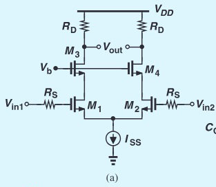
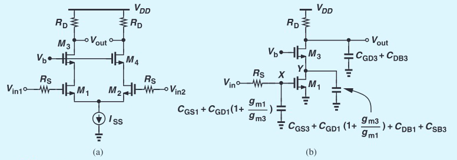

# 예제 11.27 — 캐스코드 소자를 쓴 MOS 차동쌍의 극점 어림 계산

## 원문
차동쌍이 밀러 효과를 낮추기 위해서 캐스코드 소자를 사용한다[그림 11.56(a)]. 이 회로의 극점을 어림잡아 계산하라.

## 조건
- 회로: Fig 11.56(a) 차동쌍 (입력 $M_1$, $M_2$, 캐스코드 $M_3$, $M_4$, 부하 $R_D$, 꼬리 전류원 $I_{SS}$)
- 밀러 효과를 낮추기 위해 캐스코드 소자 사용
- 소자 값은 주어지지 않음 (답은 기호로) (원문에 없음)

## 구할 것
- 회로의 극점 어림 계산

## 상속·참조
- 10장의 절반 회로 개념은 차동쌍의 고주파수 모델에도 적용됨 (본문 Fig 11.55(b), 교재 624쪽, 크롭 안 함: 작은 차동 입력에서 꼬리 노드는 교류 접지, 한쪽 절반 회로만 해석)
- 11.7절 MOS 캐스코드 결과 (본문 Fig 11.52: 밀러 근사 후 $X$–접지 $C_{GS1} + C_{GD1}(1 + g_{m1}/g_{m2})$, $Y$–접지 $C_{GS2} + C_{GD1}(1 + g_{m2}/g_{m1}) + C_{DB1} + C_{SB2}$, $V_{out}$–접지 $C_{GD2} + C_{DB2}$): $|\omega_{p,X}| = \dfrac{1}{R_S\left[C_{GS1} + \left(1 + \dfrac{g_{m1}}{g_{m2}}\right)C_{GD1}\right]}$ (식 11.141), $|\omega_{p,Y}| = \dfrac{1}{\dfrac{1}{g_{m2}}\left[C_{DB1} + C_{GS2} + \left(1 + \dfrac{g_{m2}}{g_{m1}}\right)C_{GD1} + C_{SB2}\right]}$ (식 11.142), $|\omega_{p,out}| = \dfrac{1}{R_L(C_{DB2} + C_{GD2})}$ (식 11.143). 여기서 $M_2$는 캐스코드 소자, $R_L$은 부하 저항

## 회로 — Fig 11.56(a)
```spice
* V_out 라벨은 두 출력 원 사이에 하나만 인쇄됨 → out1(왼쪽), out2(오른쪽)
RD1  VDD   out1  {R_D}
RD2  VDD   out2  {R_D}
M3   out1  Vb    n1    nmos
M4   out2  Vb    n2    nmos
M1   n1    n3    n5    nmos
M2   n2    n4    n5    nmos
RS1  Vin1  n3    {R_S}
RS2  Vin2  n4    {R_S}
ISS  n5    0     {I_SS}
```
- 단자: VDD = 전원, 값 미지정 (가로 레일) / Vb = 이상적 DC 바이어스 (점 단자) / Vin1, Vin2 = 입력 (개방 원) / out1, out2 = 차동 출력 (개방 원 두 개, 사이에 V_out 라벨 하나)
- 표시: 노드 라벨 V_DD (레일 오른쪽 끝), V_out (두 출력 원 사이), V_b (점 단자 왼쪽), V_in1 (왼쪽 입력 원 왼쪽), V_in2 (오른쪽 입력 원 오른쪽) / 소자 라벨 R_D (왼쪽 저항 왼쪽), R_D (오른쪽 저항 오른쪽), M3 (트랜지스터 왼쪽 위, 드레인 접속점 왼쪽), M4 (트랜지스터 오른쪽), R_S (각 저항 위), M1 (트랜지스터 오른쪽), M2 (트랜지스터 왼쪽), I_SS (전류원 오른쪽) / 부호 없음 / 화살표 없음 / 수치·면적 라벨 없음
- 배치: 맨 위 V_DD 가로 레일에 두 R_D가 매달림 / 왼쪽 세로줄 위→아래 R_D, 출력 접속점, M3, M1 / 오른쪽 세로줄 위→아래 R_D, 출력 접속점, M4, M2 / 왼쪽 출력 접속점에서 가로선이 오른쪽 원(out1)에서, 오른쪽 출력 접속점에서 가로선이 왼쪽 원(out2)에서 끝남, 두 원 사이에 V_out 라벨 / M3, M4, M1 NMOS 보통 방향(게이트 왼쪽, 드레인 위, 소스 아래) / M2 NMOS 좌우 반전(게이트 오른쪽, 드레인 위, 소스 아래, 소스 화살표는 왼쪽 바깥을 향함) / V_b 점 단자 → 가로선 → M3 게이트, 같은 가로선이 M3 기호(게이트판과 채널)를 가로질러 오른쪽 M4 게이트까지 이어짐 / V_in1 원 → 가로 R_S → M1 게이트, V_in2 원 → 가로 R_S(오른쪽) → M2 게이트 / M1 소스는 아래로 내려가 오른쪽으로, M2 소스는 아래로 내려가 왼쪽으로 꺾여 가운데 꼬리 접속점, 그 아래 I_SS, 접지 / 접속점 (세 갈래 이상, 3곳): ① 왼쪽 출력 = 위 R_D + 아래 M3 드레인 + 오른쪽 out1 선 (점) ② 오른쪽 출력 = 위 R_D + 아래 M4 드레인 + 왼쪽 out2 선 (점) ③ 꼬리 = 왼쪽 M1 소스 선 + 오른쪽 M2 소스 선 + 아래 I_SS (점) / 교차: V_b–M4 게이트 가로선이 M3 기호(게이트판, 채널 가운데)를 점 없이 지나감


> 참고: 이미지 오른쪽 아래 가장자리의 글자 조각은 (b)의 식 일부

## 답 (검증용)
- Fig 11.56(b)의 절반 회로와 11.7절의 결과를 이용
- $|\omega_{p,X}| = \dfrac{1}{R_S\left[C_{GS1} + \left(1 + \dfrac{g_{m1}}{g_{m3}}\right)C_{GD1}\right]}$ (식 11.155)
- 인쇄된 대로: $|\omega_{p,Y}| = \dfrac{1}{\dfrac{1}{g_{m3}}\left[C_{DB1} + C_{GS3} + \left(1 + \dfrac{g_{m3}}{g_{m1}}\right)C_{GD1}C_{SB3}\right]}$ (식 11.156)
  - $C_{GD1}$과 $C_{SB3}$ 사이에 + 가 없음. 식 (11.142)와 Fig 11.56(b)의 $Y$ 커패시터 라벨 "$C_{GS3} + C_{GD1}(1 + g_{m3}/g_{m1}) + C_{DB1} + C_{SB3}$"와 맞지 않음(오식으로 보임), $\left(1 + \dfrac{g_{m3}}{g_{m1}}\right)C_{GD1} + C_{SB3}$로 읽음 (원문에 없음)
- $|\omega_{p,out}| = \dfrac{1}{R_L(C_{DB3} + C_{GD3})}$ (식 11.157) (그림의 부하 저항은 $R_D$) (원문에 없음)

### 정답 회로 — Fig 11.56(b)
```spice
RD   VDD   Vout  {R_D}
M3   Vout  Vb    Y     nmos
M1   Y     X     0     nmos
RS   Vin   X     {R_S}
CX   X     0     {C_GS1+C_GD1*(1+g_m1/g_m3)}
CY   Y     0     {C_GS3+C_GD1*(1+g_m3/g_m1)+C_DB1+C_SB3}
COUT Vout  0     {C_GD3+C_DB3}
```
- 단자: VDD = 전원, 값 미지정 (T 전원 기호) / Vb = 이상적 DC 바이어스 (점 단자) / Vin = 입력 (개방 원) / Vout = 출력 (개방 원)
- 표시: 노드 라벨 V_DD (T 기호 오른쪽), V_out (출력 원 오른쪽), V_b (점 단자 왼쪽), Y (Y 접속점 왼쪽 위), X (X 접속점 위), V_in (입력 원 왼쪽) / 소자 라벨 R_D (저항 왼쪽), M3 (트랜지스터 오른쪽), R_S (저항 위), M1 (트랜지스터 오른쪽), C_GD3 + C_DB3 (출력 커패시터 오른쪽), C_GS1 + C_GD1(1 + g_m1/g_m3) (X 커패시터 왼쪽), C_GS3 + C_GD1(1 + g_m3/g_m1) + C_DB1 + C_SB3 (Y 커패시터 오른쪽 아래, 곡선 화살표로 가리킴) / 부호 없음 / 화살표 C_Y 지시 (라벨 없음): 아래 라벨 "C_GS3 + C_GD1 (1 + g_m3/g_m1) + C_DB1 + C_SB3" 위쪽에서 위로 올라가 왼쪽으로 휘어 Y 커패시터를 가리킴, 도선 옆 별도 화살표 (곡선) / 수치·면적 라벨 없음
- 배치: 가운데 세로줄 위→아래 V_DD T 기호, R_D, 출력 접속점, M3, Y 접속점, M1, 접지 / M3, M1 NMOS 보통 방향 / 출력 접속점에서 가로선이 오른쪽으로 출력 커패시터 접속점을 지나 V_out 원에서 끝남, 출력 커패시터 C_GD3 + C_DB3는 세로로 내려가고 그 아래 접지 / M3 게이트 → 가로선 → 왼쪽 V_b 점 단자 / Y 접속점에서 가로선이 오른쪽으로 가다 아래로 꺾여 세로 Y 커패시터와 접지 / V_in 원 → 가로 R_S → X 접속점 → M1 게이트, X 접속점에서 세로 X 커패시터와 접지 / 접속점 (세 갈래 이상, 4곳): ① 출력 = 위 R_D + 아래 M3 드레인 + 오른쪽 가로선 (점) ② 출력 커패시터 위 = 왼쪽 + 오른쪽 V_out 선 + 아래 커패시터 (점) ③ Y = 위 M3 소스 + 아래 M1 드레인 + 오른쪽 Y 커패시터 선 (점) ④ X = 왼쪽 R_S + 오른쪽 게이트 + 아래 X 커패시터 (점) / 교차: 없음



## 힌트
### 꼬리 노드는 AC 접지, 반쪽만
- 작은 차동 입력에서는 꼬리 노드가 AC 접지라서, 한쪽 반회로는 $R_S$로 구동되는 $M_1$ 위에 $M_3$가 얹힌 캐스코드와 같다
- 11.7절 식의 캐스코드 소자 자리에 이 그림의 $M_3$가 들어간다(이 그림의 $M_2$는 반대쪽 입력 소자다)

## 풀이
### 절반 회로
- 차동 입력에서 두 쪽 전류 변화가 크기는 같고 부호가 반대라 꼬리 노드는 AC 접지
- 한쪽 절반: $V_{in1}$–$R_S$–$M_1$ 게이트(노드 $X$), $M_1$ 소스 접지, $M_1$ 드레인과 $M_3$ 소스가 만나는 노드 $Y$, $M_3$ 드레인–$R_D$–$V_{DD}$(출력)
- 곧 캐스코드 CS 단이고, 두 절반의 극점이 회로의 극점이다
### $X$ 노드 극점
- $X$에서 $Y$까지 이득 $-g_{m1}/g_{m3}$ ($\lambda$를 무시하면 $Y$에서 본 저항이 $1/g_{m3}$) → $C_{GD1}$의 밀러 성분 $(1 + g_{m1}/g_{m3})C_{GD1}$
- $|\omega_{p,X}| = \dfrac{1}{R_S\left[C_{GS1} + \left(1 + \dfrac{g_{m1}}{g_{m3}}\right)C_{GD1}\right]}$
### $Y$ 노드 극점
- $Y$ 쪽 $C_{GD1}$ 성분 $(1 + g_{m3}/g_{m1})C_{GD1}$, 저항 $1/g_{m3}$
- $|\omega_{p,Y}| = \dfrac{g_{m3}}{C_{DB1} + C_{GS3} + \left(1 + \dfrac{g_{m3}}{g_{m1}}\right)C_{GD1} + C_{SB3}}$
- 교재 식은 $C_{GD1}$과 $C_{SB3}$ 사이의 $+$가 빠진 오식이다
### 출력 노드 극점
- $|\omega_{p,out}| = \dfrac{1}{R_D(C_{DB3} + C_{GD3})}$
### 답
- $|\omega_{p,X}| = \dfrac{1}{R_S\left[C_{GS1} + \left(1 + \dfrac{g_{m1}}{g_{m3}}\right)C_{GD1}\right]}$, $|\omega_{p,Y}| = \dfrac{g_{m3}}{C_{DB1} + C_{GS3} + \left(1 + \dfrac{g_{m3}}{g_{m1}}\right)C_{GD1} + C_{SB3}}$, $|\omega_{p,out}| = \dfrac{1}{R_D(C_{DB3} + C_{GD3})}$
