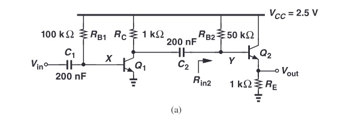
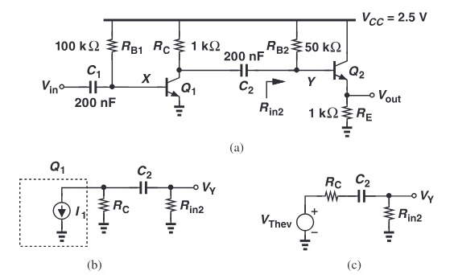

# 예제 11.28 — 입력과 단 사이가 커패시터 결합된 이단 바이폴라 증폭기의 차단 저주파수

## 원문
그림 11.59(a)에 보인 증폭기는 입력과 2개의 단 사이에 커패시터 커플링을 형성한다. 이 회로의 차단 저주파수를 결정하라. $I_S = 5 \times 10^{-16}\ \text{A}$, $\beta = 100$, $V_A = \infty$라고 가정한다.

## 조건
- 회로: Fig 11.59(a) 이단 증폭기 (CE 단 $Q_1$ + 이미터 폴로어 $Q_2$), 입력과 두 단 사이가 커패시터 결합
- $V_{CC} = 2.5\ \text{V}$
- $C_1 = 200\ \text{nF}$, $R_{B1} = 100\ \text{k}\Omega$, $R_C = 1\ \text{k}\Omega$, $C_2 = 200\ \text{nF}$, $R_{B2} = 50\ \text{k}\Omega$, $R_E = 1\ \text{k}\Omega$
- $I_S = 5 \times 10^{-16}\ \text{A}$
- $\beta = 100$
- $V_A = \infty$

## 구할 것
- 회로의 차단 저주파수

## 회로 — Fig 11.59(a)
```spice
C1   Vin   X     200nF
RB1  VCC   X     100k
Q1   n1    X     0     npn
RC   VCC   n1    1k
C2   n1    Y     200nF
RB2  VCC   Y     50k
Q2   VCC   Y     Vout  npn
RE   Vout  0     1k
```
- 단자: VCC = 2.5 V 전원 (가로 레일) / Vin = 입력 (개방 원) / Vout = 출력 (개방 원)
- 표시: 노드 라벨 V_CC = 2.5 V (레일 오른쪽 끝), V_in (입력 원 왼쪽), X (Q1 베이스 선 위), Y (Q2 베이스 선 아래, 접속점 오른쪽), V_out (출력 원 오른쪽) / 소자 라벨 R_B1 (저항 오른쪽), C_1 (커패시터 위), R_C (저항 왼쪽), Q1 (트랜지스터 오른쪽), C_2 (커패시터 아래), R_B2 (저항 왼쪽), Q2 (트랜지스터 오른쪽), R_E (저항 오른쪽) / 부호 없음 / 화살표 "R_in2": Y 노드를 오른쪽(Q2 쪽)으로 들여다봄, 오른쪽 방향, 도선 옆 별도 화살표 (┌ 꺾임: C_2와 Y 사이 가로선 아래에 세로선, 위 끝에서 가로선이 오른쪽으로 뻗고 화살촉은 오른쪽 끝, 글자 R_in2는 세로선 아래 끝) / 수치·면적 라벨 "100 kΩ" (R_B1 왼쪽), "200 nF" (C_1 아래), "1 kΩ" (R_C 오른쪽), "200 nF" (C_2 위), "50 kΩ" (R_B2 오른쪽), "1 kΩ" (R_E 왼쪽)
- 배치: 맨 위 V_CC 가로 레일에 왼쪽부터 R_B1, R_C, R_B2가 매달리고 Q2 컬렉터가 레일 오른쪽 끝 근처로 올라가 닿음 / V_in 원 → 가로 C_1 → X 접속점 → 가로선 → Q1 베이스, X 접속점 위로 R_B1 / Q1 npn 보통 방향(베이스 왼쪽, 컬렉터 위, 이미터 아래), 이미터 아래 접지 / R_C 아래 컬렉터 접속점에서 가로선이 오른쪽으로 C_2를 지나 Y 접속점 → Q2 베이스, Y 접속점 위로 R_B2 / Q2 npn 보통 방향, 이미터 아래 출력 접속점, 그 아래 R_E와 접지 / 출력 접속점에서 가로선이 오른쪽 V_out 원에서 끝남 / 접속점 (세 갈래 이상, 4곳): ① X = 왼쪽 C_1 + 위 R_B1 + 오른쪽 베이스 선 (점) ② Q1 컬렉터 = 위 R_C + 아래 Q1 컬렉터 + 오른쪽 C_2 선 (점) ③ Y = 왼쪽 C_2 선 + 위 R_B2 + 오른쪽 Q2 베이스 (점) ④ 출력 = 위 Q2 이미터 + 아래 R_E + 오른쪽 V_out 선 (점) / 교차: 없음


> 참고: 그림 11.59 (a)–(c) 전체가 다음 쪽(교재 627쪽)에 인쇄됨

## 답 (검증용)
- 동작점: $V_{BE1}$ 추정(예: 800 mV)에서 시작해 $I_{C1} = \beta\dfrac{V_{CC} - V_{BE1}}{R_{B1}}$ (식 11.162) $= 1.7\ \text{mA}$ (식 11.163) → $V_{BE1} = V_T \ln(I_{C1}/I_{S1}) = 748\ \text{mV}$, $I_{C1} = 1.75\ \text{mA}$, $g_{m1} = (14.9\ \Omega)^{-1}$, $r_{\pi1} = 1.49\ \text{k}\Omega$
- $Q_2$: $V_{CC} = I_{B2}R_{B2} + V_{BE2} + R_E I_{C2}$ (식 11.164) → $I_{C2} = \dfrac{V_{CC} - V_{BE2}}{R_{B2}/\beta + R_E}$ (식 11.165) $= 1.13\ \text{mA}$ (식 11.166, $V_{BE2} \approx 800\ \text{mV}$) → 반복하면 $I_{C2} = 1.17\ \text{mA}$, $g_{m2} = (22.2\ \Omega)^{-1}$, $r_{\pi2} = 2.22\ \text{k}\Omega$
- 첫 단: $C_1$과 $R_{in1} = r_{\pi1} \parallel R_{B1}$의 고역통과 → $\omega_{L1} = \dfrac{1}{(r_{\pi1} \parallel R_{B1})C_1}$ (식 11.167) $= 2\pi \times (542\ \text{Hz})$ (식 11.168)
- 둘째 결합: $R_{in2} = R_{B2} \parallel [r_{\pi2} + (\beta + 1)R_E]$. Fig 11.59(b) 간략화 인터페이스에서 $V_Y/I_1$을 구하고, Fig 11.59(c)처럼 $I_1$과 $R_C$를 테브냉 등가($V_{Thev} = -I_1 R_C$)로 바꾸면 $\dfrac{V_Y}{V_{Thev}}(s) = \dfrac{R_{in2}}{R_C + \dfrac{1}{C_2 s} + R_{in2}}$ (식 11.169) → $\omega_{L2} = \dfrac{1}{(R_C + R_{in2})C_2}$ (식 11.170)
- 인쇄된 대로: $\omega_{L2} = \pi \times (22.9\ \text{Hz})$ (식 11.171)
  - 다른 극점은 모두 $2\pi \times$ 꼴이고, 인쇄된 값들로 계산하면 $1/[(R_C + R_{in2})C_2] \approx 2\pi \times (22.9\ \text{Hz})$이므로 $\pi$는 문맥과 맞지 않음(오식으로 보임) (원문에 없음)
- $\omega_{L2} \ll \omega_{L1}$이므로 $\omega_{L1}$이 저주파수 응답을 '주도': $\omega_{L1}$에서 이득이 3 dB 감소

### 정답 회로 — Fig 11.59(b)
```spice
* 점선 상자(라벨 Q1)는 Q1을 전류원 I1로 본 것 (상자는 소자가 아님)
I1   n1    0     {I_1}
RC   n1    0     {R_C}
C2   n1    VY    {C_2}
RIN2 VY    0     {R_in2}
```
- 단자: VY = V_Y 출력 (개방 원)
- 표시: 노드 라벨 V_Y (출력 원 오른쪽) / 소자 라벨 Q1 (점선 상자 위), I_1 (전류원 오른쪽), R_C (저항 오른쪽), C_2 (커패시터 위), R_in2 (저항 오른쪽) / 부호 없음 / 화살표 없음 / 수치·면적 라벨 없음
- 배치: 왼쪽 점선 사각형 안에 전류원 I_1 (위 선에서 아래 접지로, 원 안 화살표 아래 방향)과 그 아래 접지 / 전류원 위에서 선이 위로 올라가 오른쪽으로 꺾여 점선 상자 오른쪽 변을 지나 R_C 접속점, R_C는 세로로 내려가 접지 / 가로선이 C_2를 지나 R_in2 접속점, R_in2는 세로로 내려가 접지 / 가로선이 오른쪽 V_Y 원에서 끝남 / 접속점 (세 갈래 이상, 2곳): ① R_C 위 = 왼쪽 전류원 선 + 아래 R_C + 오른쪽 C_2 (점) ② R_in2 위 = 왼쪽 C_2 + 아래 R_in2 + 오른쪽 V_Y 선 (점) / 교차: 전류원 선이 점선 상자 오른쪽 변을 지나감 (점 없음)

### 정답 회로 — Fig 11.59(c)
```spice
VTHEV n1   0     {V_Thev}
RC    n1   n2    {R_C}
C2    n2   VY    {C_2}
RIN2  VY   0     {R_in2}
```
- 단자: VY = V_Y 출력 (개방 원)
- 표시: 노드 라벨 V_Y (출력 원 오른쪽) / 소자 라벨 V_Thev (전압원 왼쪽), R_C (저항 위), C_2 (커패시터 위), R_in2 (저항 오른쪽) / 부호 + (전압원 오른쪽 위), − (전압원 오른쪽 아래) / 화살표 없음 / 수치·면적 라벨 없음
- 배치: 왼쪽 전압원 V_Thev (아래 접지), 위 단자에서 선이 위로 올라가 오른쪽으로 꺾여 가로 R_C, 가로 C_2를 지나 R_in2 접속점, R_in2는 세로로 내려가 접지, 가로선이 오른쪽 V_Y 원에서 끝남 / 접속점 (세 갈래 이상, 1곳): ① R_in2 위 = 왼쪽 C_2 + 아래 R_in2 + 오른쪽 V_Y 선 (점) / 교차: 없음



## 힌트
### $Q_1$은 전류원, $R_C$와 묶어 테브냉
- $V_A = \infty$이므로 $Q_1$의 컬렉터는 이상적인 전류원이고, 이것을 $R_C$와 함께 테브냉 등가로 바꾸면 $R_C$는 직렬 저항이 된다
- 그러면 $C_2$는 한쪽에 $R_C$, 다른 쪽에 둘째 단 입력 저항을 둔 직렬 고리 안에 놓인다
