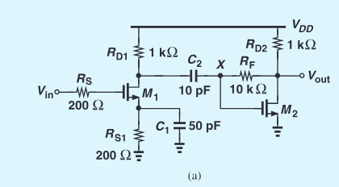
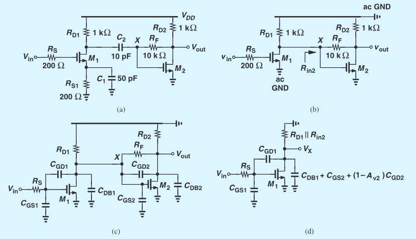
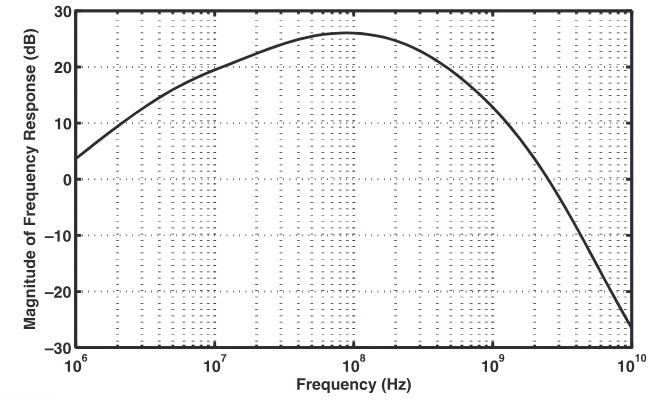

# 예제 11.29 — 축퇴 CS 단과 자가 바이어스 단으로 된 이단 MOS 증폭기의 주파수 응답

## 원문
그림 11.60(a)의 회로는 집적 회로들에서 구현되는 증폭기들의 예이다. 이것은 역퇴단과 자가 바이어스 단으로 구성되어 있으며, 적당한 값의 $C_1$과 $C_2$를 갖는다. $M_1$과 $M_2$는 동일하며 예제 11.18에 주어진 것과 동일한 파라미터들을 갖는다고 가정하고, 증폭기의 주파수 응답을 그려라.

## 조건
- 회로: Fig 11.60(a) 이단 증폭기 (첫 단 $M_1$: 소스에 $R_{S1}$과 $C_1$, 둘째 단 $M_2$: 드레인–게이트 사이 $R_F$로 자가 바이어스, 두 단 사이 결합 커패시터 $C_2$)
- 원문 표현: "역퇴단과 자가 바이어스 단으로 구성", 적당한 값의 $C_1$과 $C_2$를 가짐
  - "역퇴단"은 인쇄된 대로. 본문(11.4.1절)은 소스 저항의 효과를 '축퇴'라고 부르므로 $R_{S1}$이 붙은 축퇴 CS 단을 뜻하는 것으로 보임 (원문에 없음)
- 그림의 값: $R_S = 200\ \Omega$, $R_{D1} = 1\ \text{k}\Omega$, $R_{S1} = 200\ \Omega$, $C_1 = 50\ \text{pF}$, $C_2 = 10\ \text{pF}$, $R_F = 10\ \text{k}\Omega$, $R_{D2} = 1\ \text{k}\Omega$
- $M_1$과 $M_2$는 동일하며 예제 11.18과 같은 파라미터: $C_{GS} = 250\ \text{fF}$, $C_{GD} = 80\ \text{fF}$, $C_{DB} = 100\ \text{fF}$, $g_m = (150\ \Omega)^{-1}$, $\lambda = 0$ (원문에 없음)

## 구할 것
- 증폭기의 주파수 응답 그리기

## 상속·참조
- 예제 11.18 (E11.18)의 트랜지스터 파라미터: $C_{GS} = 250\ \text{fF}$, $C_{GD} = 80\ \text{fF}$, $C_{DB} = 100\ \text{fF}$, $g_m = (150\ \Omega)^{-1}$, $\lambda = 0$ (예제 11.18의 $R_S = 200\ \Omega$, $R_L = 2\ \text{k}\Omega$는 CS 단의 회로 값). $C_{SB}$ 값은 주어지지 않음
- 바이패스된 축퇴 CS 단 (11.4.1절, 교재 599쪽): 소스 저항 $R_S$와 병렬로 바이패스 커패시터 $C_b$ → $\dfrac{V_{out}}{V_X}(s) = \dfrac{-g_m R_D(R_S C_b s + 1)}{R_S C_b s + g_m R_S + 1}$ (식 11.58). 본문 Fig 11.30(c) (교재 598쪽, 크롭 안 함): $|V_{out}/V_X|$의 보데 근사, 저주파수에서 $\dfrac{g_m R_D}{1 + g_m R_S}$, $\omega = \dfrac{1}{R_S C_b}$부터 증가해 $\omega = \dfrac{1 + g_m R_S}{R_S C_b}$에서 $g_m R_D$로 평평해짐
- CS 단 직접 해석 (11.4.4절, 통합 모델: $R_{Thev}$–노드 $X$, $X$–접지 $C_{in}$, $X$–$Y$ 사이 $C_{XY}$, $Y$ = 출력, $Y$–접지 $C_{out}$과 부하 $R_L$): $\dfrac{V_{out}}{V_{Thev}}(s) = \dfrac{(C_{XY}s - g_m)R_L}{as^2 + bs + 1}$ (식 11.73), $a = R_{Thev}R_L(C_{in}C_{XY} + C_{out}C_{XY} + C_{in}C_{out})$ (식 11.74), $b = (1 + g_m R_L)C_{XY}R_{Thev} + R_{Thev}C_{in} + R_L(C_{XY} + C_{out})$ (식 11.75)
- 밀러 이론: 이득 $A_v$인 노드 사이 임피던스 $Z_F$는 입력 쪽에서 $Z_F/(1 - A_v)$, 출력 쪽에서 $Z_F/(1 - A_v^{-1})$로 나뉨 (11.1.5절)

## 회로 — Fig 11.60(a)
```spice
RS   Vin   n2    200
RD1  VDD   n1    1k
M1   n1    n2    n3    nmos
RS1  n3    0     200
C1   n3    0     50pF
C2   n1    X     10pF
RF   X     Vout  10k
RD2  VDD   Vout  1k
M2   Vout  X     0     nmos
```
- 단자: VDD = 전원, 값 미지정 (가로 레일) / Vin = 입력 (개방 원) / Vout = 출력 (개방 원)
- 표시: 노드 라벨 V_DD (레일 오른쪽 끝), V_in (입력 원 왼쪽), X (X 접속점 왼쪽 위), V_out (출력 원 오른쪽) / 소자 라벨 R_D1 (저항 왼쪽), R_S (저항 위), M1 (트랜지스터 오른쪽), C_2 (커패시터 위), R_F (저항 위), R_D2 (저항 왼쪽), M2 (트랜지스터 오른쪽), C_1 (커패시터 왼쪽), R_S1 (저항 왼쪽) / 부호 없음 / 화살표 없음 / 수치·면적 라벨 "1 kΩ" (R_D1 오른쪽), "200 Ω" (R_S 아래), "10 pF" (C_2 아래), "10 kΩ" (R_F 아래), "1 kΩ" (R_D2 오른쪽), "50 pF" (C_1 오른쪽), "200 Ω" (R_S1 아래 왼쪽, 접지 기호 왼쪽)
- 배치: 맨 위 V_DD 가로 레일, 왼쪽에 R_D1, 오른쪽 끝에 R_D2가 매달림 / 왼쪽 세로줄 위→아래 R_D1, M1 드레인 접속점, M1, M1 소스 접속점, R_S1, 접지 / M1, M2 NMOS 보통 방향(게이트 왼쪽, 드레인 위, 소스 아래) / V_in 원 → 가로 R_S → M1 게이트 / M1 소스 접속점에서 가로선이 오른쪽으로 가다 아래로 꺾여 세로 C_1과 접지 / M1 드레인 접속점에서 가로선이 오른쪽으로 C_2를 지나 X 접속점 → 가로 R_F → 출력 접속점 → 오른쪽 V_out 원 / X 접속점에서 선이 아래로 내려가 모서리에서 오른쪽으로 꺾여 M2 게이트 / 오른쪽 세로줄 위→아래 R_D2, 출력 접속점, M2, 접지 / 접속점 (세 갈래 이상, 4곳): ① M1 드레인 = 위 R_D1 + 아래 M1 드레인 + 오른쪽 C_2 선 (점) ② M1 소스 = 위 M1 소스 + 아래 R_S1 + 오른쪽 C_1 선 (점) ③ X = 왼쪽 C_2 + 오른쪽 R_F + 아래 M2 게이트 선 (점) ④ 출력 = 왼쪽 R_F + 위 R_D2 + 아래 M2 드레인 + 오른쪽 V_out 선 (점) / 교차: 없음



## 답 (검증용)
- 저주파수 동작: 식 (11.58)과 그림 11.30(c)로부터 $C_1$은 $\omega_{L1} = \dfrac{g_{m1}R_{S1} + 1}{R_{S1}C_1}$ (식 11.172) $= 2\pi \times (37.1\ \text{MHz})$ (식 11.173)에서 저주파수 차단에 기여
- 둘째 차단은 $C_2$와 둘째 단 입력 저항: 밀러 이론으로 $R_{in2} = \dfrac{R_F}{1 - A_{v2}}$ (식 11.174), $A_{v2}$는 $X$부터 출력까지의 전압 이득. $R_F \gg R_{D2}$이므로 $A_{v2} \approx -g_{m2}R_{D2} = -6.67$, $R_{in2} \approx 1.30\ \text{k}\Omega$ → $\omega_{L2} = \dfrac{1}{(R_{D1} + R_{in2})C_2}$ (식 11.175) $= 2\pi \times (6.92\ \text{MHz})$ (식 11.176). $\omega_{L1}$이 $\omega_{L2}$보다 상당히 위에 있어 차단은 $\omega_{L1}$이 주도
- 중간대역 동작: $C_1$, $C_2$는 단락, 트랜지스터 커패시턴스는 무시 → Fig 11.60(b). $\dfrac{v_X}{v_{in}} = -g_{m1}(R_{D1} \parallel R_{in2})$ (식 11.177) $= -3.77$ (식 11.178), $X$부터 출력까지 약 $-g_{m2}R_{D2}$ → 전체 중간대역 이득 약 25.1
- 고주파수 동작: $M_1$, $M_2$의 소스가 교류 접지이므로 $C_{SB1}$, $C_{SB2}$는 역할 없음 → Fig 11.60(c), $V_{out}/V_{in} = (V_X/V_{in})(V_{out}/V_X)$. $C_{DB1}$과 $C_{GS2}$는 병렬, $R_F$의 밀러 효과는 $R_{in2} = 1.3\ \text{k}\Omega$, $C_{GD2}$의 밀러 증배 $(1 - A_{v2})C_{GD2} = 614\ \text{fF}$ → 첫 단은 Fig 11.60(d) (11.4절 CS 분석)
- 영점 $g_{m1}/C_{GD1} = 2\pi \times (13.3\ \text{GHz})$. 식 (11.73)–(11.75)로 $|\omega_{p1}| = 2\pi \times (242\ \text{MHz})$ (식 11.179), $|\omega_{p2}| = 2\pi \times (2.74\ \text{GHz})$ (식 11.180)
- 둘째 단 출력 노드: $C_{GD2}$의 밀러 효과 $(1 - A_{v2}^{-1})C_{GD2} \approx 1.15C_{GD2} = 92\ \text{fF}$, 여기에 $C_{DB2}$를 더해 $|\omega_{p3}| = \dfrac{1}{R_{L2}(1.15C_{GD2} + C_{DB2})}$ (식 11.181) $= 2\pi \times (0.829\ \text{GHz})$ (식 11.182)
  - $R_{L2}$는 인쇄된 대로. 그림에는 없는 기호이며 둘째 단 부하 $R_{D2}$ 자리로 보임. 같은 쪽 각주 19도 $R_{L2}$를 씀. $R_{L2} = R_{D2} = 1\ \text{k}\Omega$로 두면 $1/[1\ \text{k}\Omega \times (92 + 100)\ \text{fF}] = 2\pi \times 0.829\ \text{GHz}$로 식 (11.182) 값과 맞음 (원문에 없음)
- $\omega_{p1}$이 고주파수 응답을 주도
- Fig 11.61: 중간대역 이득 약 $26\ \text{dB} \approx 20$ (계산 결과보다 대략 20% 낮음, 주로 $R_F$에 대한 밀러 근사 때문). '유용한' 대역폭은 저주파 −3 dB 차단(≈40 MHz)에서 고주파 −3 dB 차단(≈300 MHz)까지로 거의 10배. 이득은 약 2.3 GHz에서 1로 떨어짐
- Fig 11.61 그래프: 세로축 "Magnitude of Frequency Response (dB)" −30–30 (10 간격), 가로축 "Frequency (Hz)" $10^6$–$10^{10}$ (로그). 실선 곡선 하나가 $10^6$ Hz에서 약 4 dB로 시작해 올라가 $10^8$ Hz 부근에서 약 26 dB 최대, 그 뒤 내려가 $10^9$ Hz에서 약 13 dB, $10^{10}$ Hz에서 약 −26 dB

### 정답 회로 — Fig 11.60(b)
```spice
* 레일은 옆으로 누운 접지 기호에 이어짐("ac GND") → 노드 0. M1 소스 아래 접지에도 "ac GND"
* C2 단락: M1 드레인 선이 바로 X로 이어짐
RS   vin   n1    200
RD1  0     X     1k
M1   X     n1    0     nmos
RF   X     vout  10k
RD2  0     vout  1k
M2   vout  X     0     nmos
```
- 단자: vin = 입력 (개방 원) / vout = 출력 (개방 원)
- 표시: 노드 라벨 ac GND (레일 오른쪽 끝 옆으로 누운 접지 기호 위), v_in (입력 원 왼쪽), X (X 접속점 위), v_out (출력 원 오른쪽), ac GND (M1 소스 접지 아래) / 소자 라벨 R_D1 (저항 왼쪽), R_S (저항 위), M1 (트랜지스터 오른쪽), R_F (저항 위), R_D2 (저항 왼쪽), M2 (트랜지스터 오른쪽) / 부호 없음 / 화살표 "R_in2": X 노드를 오른쪽(둘째 단 쪽)으로 들여다봄, 오른쪽 방향, 도선 옆 별도 화살표 (┌ 꺾임: M1 드레인–X 가로선 아래에 세로선, 위 끝에서 가로선이 오른쪽으로 뻗고 화살촉은 오른쪽 끝, 글자 R_in2는 세로선 아래 끝) / 수치·면적 라벨 "1 kΩ" (R_D1 오른쪽), "200 Ω" (R_S 아래), "10 kΩ" (R_F 아래), "1 kΩ" (R_D2 오른쪽)
- 배치: (a)에서 C_1, R_S1, C_2를 뺀 모양 / 맨 위 가로 레일, 오른쪽 끝에서 가로선이 옆으로 누운 접지 기호 / 레일에 R_D1(왼쪽)과 R_D2(오른쪽)가 매달림 / R_D1 아래 M1 드레인 접속점, 여기서 가로선이 오른쪽 X 접속점 → R_F → 출력 접속점 → v_out 원 / M1 소스 바로 아래 접지 (ac GND) / X 접속점에서 선이 아래로 내려가 오른쪽으로 꺾여 M2 게이트 / 접속점 (세 갈래 이상, 3곳): ① M1 드레인 = 위 R_D1 + 아래 M1 드레인 + 오른쪽 X 선 (점) ② X = 왼쪽 + 오른쪽 R_F + 아래 M2 게이트 선 (점) ③ 출력 = 왼쪽 R_F + 위 R_D2 + 아래 M2 드레인 + 오른쪽 v_out 선 (점) / 교차: 없음

### 정답 회로 — Fig 11.60(c)
```spice
* 레일은 옆으로 누운 접지 기호에 이어짐 → 노드 0
* M1 드레인 선은 바로 X로 이어짐
RS   Vin   n1    {R_S}
RD1  0     X     {R_D1}
M1   X     n1    0     nmos
CGD1 n1    X     {C_GD1}
CGS1 n1    0     {C_GS1}
CDB1 X     0     {C_DB1}
RF   X     Vout  {R_F}
RD2  0     Vout  {R_D2}
CGD2 X     Vout  {C_GD2}
M2   Vout  X     0     nmos
CGS2 X     0     {C_GS2}
CDB2 Vout  0     {C_DB2}
```
- 단자: Vin = 입력 (개방 원) / Vout = 출력 (개방 원)
- 표시: 노드 라벨 X (X 접속점 왼쪽 위), V_in (입력 원 왼쪽), V_out (출력 원 오른쪽) / 소자 라벨 R_D1 (저항 왼쪽), R_D2 (저항 왼쪽), R_F (저항 위), C_GD1 (커패시터 위), C_GD2 (커패시터 위), R_S (저항 위), M1 (트랜지스터 왼쪽 아래), C_DB1 (커패시터 오른쪽), C_GS1 (커패시터 왼쪽), C_GS2 (커패시터 왼쪽), M2 (트랜지스터 오른쪽), C_DB2 (커패시터 오른쪽) / 부호 없음 / 화살표 없음 / 수치·면적 라벨 없음
- 배치: 맨 위 가로 레일, 오른쪽 끝에서 가로선이 옆으로 누운 접지 기호 / 왼쪽: 레일에서 R_D1이 내려와 위쪽 드레인 접속점, 그 아래 아래쪽 드레인 접속점, M1 드레인 / V_in 원 → 가로 R_S → 게이트 접속점 → M1 게이트, 게이트 접속점에서 위로 올라가 모서리에서 오른쪽으로 꺾여 가로 C_GD1을 지나 아래쪽 드레인 접속점, 아래로 세로 C_GS1과 접지 / 아래쪽 드레인 접속점에서 가로선이 오른쪽으로 가다 아래로 꺾여 세로 C_DB1과 접지 / M1 소스 아래 접지 / 위쪽 드레인 접속점에서 가로선이 오른쪽 X 접속점 / 가운데 X 세로선: 위 모서리(오른쪽으로 R_F)에서 내려와 X 접속점, 그 아래 C_GD2 접속점, 더 내려가 모서리에서 오른쪽으로 꺾여 M2 게이트 접속점 → M2 게이트, M2 게이트 접속점에서 아래로 세로 C_GS2와 접지 / 오른쪽: 레일에서 R_D2가 내려와 출력 접속점(왼쪽 R_F, 오른쪽 V_out 원), 그 아래 C_GD2 오른쪽 접속점, 그 아래 M2 드레인 / C_GD2는 X 쪽 접속점과 오른쪽 접속점 사이 가로 / 오른쪽 접속점에서 가로선이 오른쪽으로 가다 아래로 꺾여 세로 C_DB2와 접지 / M2 소스 아래 접지 / 접속점 (세 갈래 이상, 8곳): ① M1 위쪽 드레인 = 위 R_D1 + 아래 + 오른쪽 X 선 (점) ② M1 아래쪽 드레인 = 위 + 왼쪽 C_GD1 + 오른쪽 C_DB1 선 + 아래 M1 드레인 (점) ③ M1 게이트 = 왼쪽 R_S + 오른쪽 게이트 + 위 C_GD1 선 + 아래 C_GS1 (점) ④ X = 왼쪽 M1 드레인 선 + 위 R_F 선 + 아래 (점) ⑤ X 아래 = 위 + 오른쪽 C_GD2 + 아래 (점) ⑥ M2 게이트 = 왼쪽 X 선 + 오른쪽 게이트 + 아래 C_GS2 (점) ⑦ 출력 = 위 R_D2 + 왼쪽 R_F + 오른쪽 V_out 선 + 아래 (점) ⑧ M2 드레인 위 = 위 + 왼쪽 C_GD2 + 오른쪽 C_DB2 선 + 아래 M2 드레인 (점) / 교차: 없음

### 정답 회로 — Fig 11.60(d)
```spice
* 저항 위쪽은 옆으로 누운 접지 기호에 이어짐 → 노드 0
RP   0     VX    {R_D1||R_in2}
M1   VX    n1    0     nmos
RS   Vin   n1    {R_S}
CGD1 n1    VX    {C_GD1}
CGS1 n1    0     {C_GS1}
CT   VX    0     {C_DB1+C_GS2+(1-A_v2)*C_GD2}
```
- 단자: Vin = 입력 (개방 원) / VX = V_X 출력 (개방 원)
- 표시: 노드 라벨 V_X (출력 원 오른쪽), V_in (입력 원 왼쪽) / 소자 라벨 R_D1 || R_in2 (저항 오른쪽), C_GD1 (커패시터 위), R_S (저항 위), M1 (트랜지스터 왼쪽 아래), C_GS1 (커패시터 왼쪽), C_DB1 + C_GS2 + (1 − A_v2)C_GD2 (커패시터 하나 오른쪽에 합으로) / 부호 없음 / 화살표 없음 / 수치·면적 라벨 없음
- 배치: 맨 위 옆으로 누운 접지 기호에서 가로선이 왼쪽으로 가 모서리에서 아래로 꺾여 세로 R_D1 || R_in2 → V_X 접속점(오른쪽 V_X 원) → 드레인 접속점 → M1 드레인 / V_in 원 → 가로 R_S → 게이트 접속점 → M1 게이트, 게이트 접속점에서 위로 올라가 오른쪽으로 꺾여 가로 C_GD1을 지나 드레인 접속점, 아래로 세로 C_GS1과 접지 / 드레인 접속점에서 가로선이 오른쪽으로 가다 아래로 꺾여 세로 합성 커패시터와 접지 / M1 소스 아래 접지 / 접속점 (세 갈래 이상, 3곳): ① V_X = 위 저항 + 오른쪽 V_X 선 + 아래 (점) ② 드레인 = 위 + 왼쪽 C_GD1 + 오른쪽 커패시터 선 + 아래 M1 드레인 (점) ③ 게이트 = 왼쪽 R_S + 오른쪽 게이트 + 위 C_GD1 선 + 아래 C_GS1 (점) / 교차: 없음




## 힌트
### $R_F$는 밀러로 나눠 $X$ 쪽 저항으로
- $R_F$는 이득 $A_{v2}$인 둘째 단의 입력 $X$와 출력 사이에 걸려 있으므로, 밀러 이론으로 $X$에서 접지로 가는 작은 저항으로 바꿀 수 있다
- 이 저항이 첫 단의 부하가 되고 $C_2$의 저주파 차단도 정한다
### 둘째 단 입력을 $X$의 부하로 모은다
- 고주파에서는 $C_{DB1}$, $C_{GS2}$, $C_{GD2}$의 밀러 성분, $R_F$의 밀러 저항이 모두 $X$에서 접지로 가는 소자가 된다
- $C_1$이 $R_{S1}$을 단락해 $M_1$ 소스가 AC 접지이므로, 첫 단은 이 부하를 단 축퇴 없는 CS 단이다
