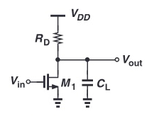

# 장말문제 11.1 — CS 증폭기(Fig 11.62)의 이득이 10% 떨어지는 주파수

## 원문
In the amplifier of Fig. 11.62, $R_D = 1\ \text{k}\Omega$ and $C_L = 1\ \text{pF}$. Neglecting channel-length modulation and other capacitances, determine the frequency at which the gain falls by 10% ($\approx 1\ \text{dB}$).

## 조건
- 회로: Fig 11.62 (저항 부하 CS 증폭기, 출력에 부하 커패시턴스 $C_L$)
- $R_D = 1\ \text{k}\Omega$, $C_L = 1\ \text{pF}$
- 채널길이 변조와 다른 커패시턴스는 무시

## 구할 것
- 이득이 10% ($\approx 1\ \text{dB}$) 떨어지는 주파수

## 회로 — Fig 11.62
```spice
RD  VDD   Vout  {R_D}
M1  Vout  Vin   0  nmos
CL  Vout  0     {C_L}
```
- 단자: VDD = 전원, 값 미지정 (T 전원 기호) / Vin = 입력 (개방 원) / Vout = 출력 (개방 원)
- 표시: 노드 라벨 V_DD (T 기호 오른쪽), V_in (입력 원 왼쪽), V_out (출력 원 오른쪽) / 소자 라벨 R_D (저항 왼쪽), M1 (트랜지스터 오른쪽, 소스 옆), C_L (커패시터 오른쪽) / 부호 없음 / 화살표 없음 / 수치·면적 라벨 없음
- 배치: 왼쪽 세로줄 위→아래 V_DD T 기호, R_D, 드레인 접속점, M1, 접지 / M1 NMOS 보통 방향(게이트 왼쪽, 드레인 위, 소스 아래) / V_in 원 → 짧은 가로선 → 게이트 / 드레인 접속점에서 가로선이 오른쪽으로 C_L 접속점을 지나 V_out 원에서 끝남 / C_L은 C_L 접속점에서 세로로 내려가고 그 아래 접지 / 접지 기호는 M1 소스 아래, C_L 아래에 따로 / 접속점 (세 갈래 이상, 2곳): ① 드레인 = 위 R_D + 아래 M1 드레인 + 오른쪽 가로선 (점) ② C_L 위 = 왼쪽 가로선 + 오른쪽 V_out 선 + 아래 C_L (점) / 교차: 없음



## 풀이
### 전달 함수
- 채널길이 변조를 무시하므로 출력 노드에서 접지로 $R_D$와 $C_L$뿐: $\dfrac{V_{out}}{V_{in}} = \dfrac{-g_m R_D}{R_D C_L s + 1}$ ($g_m$: $M_1$의 트랜스컨덕턴스)
- 극점 $\omega_p = \dfrac{1}{R_D C_L} = \dfrac{1}{(1\ \text{k}\Omega)(1\ \text{pF})} = 10^9\ \text{rad/s}$
### 10% 떨어지는 조건
- $\dfrac{|V_{out}/V_{in}|}{g_m R_D} = \dfrac{1}{\sqrt{1 + \omega^2/\omega_p^2}} = 0.9$ → $\omega = \omega_p\sqrt{1/0.81 - 1} = 0.484\,\omega_p$
- $\omega = 4.84 \times 10^8\ \text{rad/s}$, $f = \omega/2\pi = 77.1\ \text{MHz}$ ($20\log 0.9 = -0.915\ \text{dB}$)
### 답
- $\omega \approx 4.84 \times 10^8\ \text{rad/s}$, 곧 $f \approx 77.1\ \text{MHz}$ (극점 주파수의 $0.484$배)
