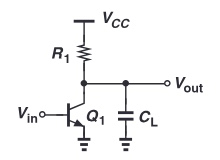

# 장말문제 11.2 — 1 GHz 대역폭, 2 mW 전력에서 CE 단(Fig 11.63)의 최대 이득

## 원문
In the circuit of Fig. 11.63, we wish to achieve a −3-dB bandwidth of $1\ \text{GHz}$ with a load capacitance of $2\ \text{pF}$. What is the maximum (low-frequency) gain that can be achieved with a power dissipation of $2\ \text{mW}$? Assume $V_{CC} = 2.5\ \text{V}$ and neglect the Early effect and other capacitances.

## 조건
- 회로: Fig 11.63 (저항 $R_1$ 부하 CE 단, 출력에 부하 커패시턴스 $C_L$)
- 목표 −3 dB 대역폭 $1\ \text{GHz}$, 부하 커패시턴스 $2\ \text{pF}$
- 전력 소모 $2\ \text{mW}$
- $V_{CC} = 2.5\ \text{V}$
- 얼리 효과와 다른 커패시턴스는 무시

## 구할 것
- 얻을 수 있는 최대 (저주파) 이득

## 회로 — Fig 11.63
```spice
R1  VCC   Vout  {R_1}
Q1  Vout  Vin   0  npn
CL  Vout  0     {C_L}
```
- 단자: VCC = 전원, 2.5 V (문제 문장의 값, 그림에는 라벨만) (T 전원 기호) / Vin = 입력 (개방 원) / Vout = 출력 (개방 원)
- 표시: 노드 라벨 V_CC (T 기호 오른쪽), V_in (입력 원 왼쪽), V_out (출력 원 오른쪽) / 소자 라벨 R_1 (저항 왼쪽), Q1 (트랜지스터 오른쪽, 이미터 옆), C_L (커패시터 오른쪽) / 부호 없음 / 화살표 없음 / 수치·면적 라벨 없음
- 배치: 왼쪽 세로줄 위→아래 V_CC T 기호, R_1, 컬렉터 접속점, Q1, 접지 / Q1 npn 보통 방향(베이스 왼쪽, 컬렉터 오른쪽 위, 이미터 오른쪽 아래) / V_in 원 → 가로선 → 베이스 / 컬렉터 접속점에서 가로선이 오른쪽으로 C_L 접속점을 지나 V_out 원에서 끝남 / C_L은 C_L 접속점에서 세로로 내려가고 그 아래 접지 / 접지 기호는 Q1 이미터 아래, C_L 아래에 따로 / 접속점 (세 갈래 이상, 2곳): ① 컬렉터 = 위 R_1 + 아래 Q1 컬렉터 + 오른쪽 가로선 (점) ② C_L 위 = 왼쪽 가로선 + 오른쪽 V_out 선 + 아래 C_L (점) / 교차: 없음



## 풀이
### 바이어스 전류
- 전력은 모두 $V_{CC}$에서 $Q_1$ 컬렉터로 흐르는 전류가 쓴다고 본다(베이스 전류 무시): $I_C = P/V_{CC} = 2\ \text{mW}/2.5\ \text{V} = 0.8\ \text{mA}$
- $g_m = I_C/V_T = 0.8\ \text{mA}/26\ \text{mV} = (32.5\ \Omega)^{-1}$ ($g_m$: $Q_1$의 트랜스컨덕턴스, $V_T = 26\ \text{mV}$)
### 대역폭이 정하는 $R_1$
- 얼리 효과를 무시하므로 출력 노드에서 접지로 $R_1$과 $C_L$뿐: $\omega_{-3\text{dB}} = \dfrac{1}{R_1 C_L}$
- $R_1 = \dfrac{1}{2\pi (1\ \text{GHz})(2\ \text{pF})} = 79.6\ \Omega$ (이보다 크면 대역폭이 모자란다)
### 최대 이득
- $|A_v| = g_m R_1 = \dfrac{I_C R_1}{V_T} = \dfrac{79.6\ \Omega}{32.5\ \Omega} = 2.45$ ($7.78\ \text{dB}$)
- $I_C$와 $R_1$이 모두 최대값이므로 이것이 최대다. $R_1$ 양단 전압은 $I_C R_1 = 63.7\ \text{mV}$라 $Q_1$은 능동 영역에 여유 있게 머문다
### 답
- 최대 저주파 이득 $\approx 2.45$ ($7.78\ \text{dB}$)
