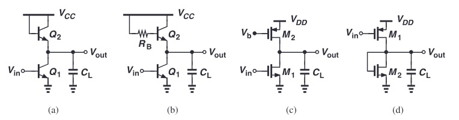

# 장말문제 11.3 — Fig 11.64 네 회로의 −3 dB 대역폭

## 원문
Determine the −3 dB bandwidth of the circuits shown in Fig. 11.64. Assume $V_A = \infty$ but $\lambda > 0$. Neglect other capacitances.

## 조건
- 회로: Fig 11.64 (a)–(d) — 출력에 $C_L$이 달린 네 단 ((a) 다이오드 연결 $Q_2$ 부하 CE 단, (b) $R_B$를 거친 $Q_2$ 부하 CE 단, (c) $V_b$로 바이어스한 PMOS 전류원 부하 CS 단, (d) 다이오드 연결 NMOS 부하 PMOS CS 단) (괄호 안 회로 이름은 원문에 없음)
- $V_A = \infty$이지만 $\lambda > 0$으로 가정 (인쇄된 대로)
- (a)(b)는 바이폴라에 $V_A = \infty$, (c)(d)는 MOS에 $\lambda > 0$을 적용한다고 봄 (원문에 없음)
- 다른 커패시턴스는 무시 ($C_L$만 고려) (원문에 없음, 괄호 안 설명)

## 구할 것
- 네 회로 각각의 −3 dB 대역폭

## 회로 — Fig 11.64(a)
```spice
Q2  VCC   VCC   Vout  npn   ; 베이스가 선으로 VCC 레일에 이어짐 (다이오드 연결)
Q1  Vout  Vin   0     npn
CL  Vout  0     {C_L}
```
- 단자: VCC = 전원, 값 미지정 (가로 레일, 짧고 굵은 가로선) / Vin = 입력 (개방 원) / Vout = 출력 (개방 원)
- 표시: 노드 라벨 V_CC (레일 오른쪽 끝), V_in (입력 원 왼쪽), V_out (출력 원 오른쪽) / 소자 라벨 Q2 (Q2 오른쪽), Q1 (Q1 오른쪽, 이미터 옆), C_L (커패시터 오른쪽) / 부호 없음 / 화살표 없음 / 수치·면적 라벨 없음
- 배치: 맨 위 짧은 굵은 가로 레일 V_CC / 한 세로줄 위→아래 Q2, 출력 접속점, Q1, 접지 / Q2 npn 보통 방향(베이스 왼쪽, 컬렉터 위 → 레일, 이미터 아래) / 레일 왼쪽 끝에서 선이 아래로 내려와 Q2 베이스 높이에서 오른쪽으로 꺾여 Q2 베이스 / Q1 npn 보통 방향, V_in 원 → 가로선 → Q1 베이스 / 출력 접속점에서 가로선이 오른쪽으로 C_L 접속점을 지나 V_out 원에서 끝남 / C_L은 세로로 내려가고 그 아래 접지 / 접지 기호는 Q1 이미터 아래, C_L 아래에 따로 / 접속점 (세 갈래 이상, 2곳): ① 출력 = 위 Q2 이미터 + 아래 Q1 컬렉터 + 오른쪽 가로선 (점) ② C_L 위 = 왼쪽 가로선 + 오른쪽 V_out 선 + 아래 C_L (점) / 교차: 없음

## 회로 — Fig 11.64(b)
```spice
RB  VCC   n1    {R_B}
Q2  VCC   n1    Vout  npn
Q1  Vout  Vin   0     npn
CL  Vout  0     {C_L}
```
- 단자: VCC = 전원, 값 미지정 (가로 레일) / Vin = 입력 (개방 원) / Vout = 출력 (개방 원)
- 표시: 노드 라벨 V_CC (레일 오른쪽 끝), V_in (입력 원 왼쪽), V_out (출력 원 오른쪽) / 소자 라벨 R_B (저항 아래), Q2 (Q2 오른쪽), Q1 (Q1 오른쪽, 이미터 옆), C_L (커패시터 오른쪽) / 부호 없음 / 화살표 없음 / 수치·면적 라벨 없음
- 배치: (a)와 같은 모양에서 Q2 베이스 연결선에 가로 R_B가 들어감 / 맨 위 굵은 가로 레일 V_CC (a보다 김) / 레일 왼쪽 끝에서 선이 아래로 내려와 Q2 베이스 높이에서 오른쪽으로 꺾여 가로 R_B를 지나 Q2 베이스 / Q2 컬렉터는 위로 레일, 이미터는 아래로 출력 접속점 / Q1 npn 보통 방향, V_in 원 → 가로선 → Q1 베이스 / 출력 접속점에서 가로선이 오른쪽으로 C_L 접속점을 지나 V_out 원에서 끝남 / 접지 기호는 Q1 이미터 아래, C_L 아래에 따로 / 접속점 (세 갈래 이상, 2곳): ① 출력 = 위 Q2 이미터 + 아래 Q1 컬렉터 + 오른쪽 가로선 (점) ② C_L 위 = 왼쪽 가로선 + 오른쪽 V_out 선 + 아래 C_L (점) / 교차: 없음

## 회로 — Fig 11.64(c)
```spice
M2  Vout  Vb    VDD  pmos
M1  Vout  Vin   0    nmos
CL  Vout  0     {C_L}
```
- 단자: VDD = 전원, 값 미지정 (T 전원 기호) / Vb = 이상적 DC 바이어스 (점 단자) / Vin = 입력 (개방 원) / Vout = 출력 (개방 원)
- 표시: 노드 라벨 V_DD (T 기호 오른쪽), V_b (점 단자 왼쪽), V_in (입력 원 왼쪽), V_out (출력 원 오른쪽) / 소자 라벨 M2 (M2 오른쪽), M1 (M1 오른쪽, 소스 옆), C_L (커패시터 오른쪽) / 부호 없음 / 화살표 없음 / 수치·면적 라벨 없음
- 배치: 한 세로줄 위→아래 V_DD T 기호, M2, 출력 접속점, M1, 접지 / M2 PMOS(게이트 왼쪽, 소스 위 → V_DD, 드레인 아래, 소스 화살표는 게이트 쪽을 향함) / V_b 점 단자 → 가로선 → M2 게이트 / M1 NMOS 보통 방향, V_in 원 → 가로선 → M1 게이트 / 출력 접속점에서 가로선이 오른쪽으로 C_L 접속점을 지나 V_out 원에서 끝남 / 접지 기호는 M1 소스 아래, C_L 아래에 따로 / 접속점 (세 갈래 이상, 2곳): ① 출력 = 위 M2 드레인 + 아래 M1 드레인 + 오른쪽 가로선 (점) ② C_L 위 = 왼쪽 가로선 + 오른쪽 V_out 선 + 아래 C_L (점) / 교차: 없음

## 회로 — Fig 11.64(d)
```spice
M1  Vout  Vin   VDD  pmos
M2  Vout  Vout  0    nmos   ; 게이트가 선으로 드레인(Vout)에 이어짐 (다이오드 연결)
CL  Vout  0     {C_L}
```
- 단자: VDD = 전원, 값 미지정 (T 전원 기호) / Vin = 입력 (개방 원) / Vout = 출력 (개방 원)
- 표시: 노드 라벨 V_DD (T 기호 오른쪽), V_in (입력 원 왼쪽), V_out (출력 원 오른쪽) / 소자 라벨 M1 (M1 오른쪽), M2 (M2 오른쪽, 소스 옆), C_L (커패시터 오른쪽) / 부호 없음 / 화살표 없음 / 수치·면적 라벨 없음
- 배치: 한 세로줄 위→아래 V_DD T 기호, M1, 출력 접속점, M2, 접지 / 위 트랜지스터가 M1(PMOS, 게이트 왼쪽, 소스 위 → V_DD, 소스 화살표는 게이트 쪽을 향함), 아래 트랜지스터가 M2(NMOS 보통 방향) / V_in 원 → 가로선 → M1 게이트 / M2 게이트에서 선이 왼쪽으로 나가 위로 꺾여 출력 접속점 높이에서 오른쪽으로 꺾여 출력 접속점 (다이오드 연결) / 출력 접속점에서 가로선이 오른쪽으로 C_L 접속점을 지나 V_out 원에서 끝남 / 접지 기호는 M2 소스 아래, C_L 아래에 따로 / 접속점 (세 갈래 이상, 2곳): ① 출력 = 위 M1 드레인 + 왼쪽 다이오드 연결선 + 아래 M2 드레인 + 오른쪽 가로선 (점) ② C_L 위 = 왼쪽 가로선 + 오른쪽 V_out 선 + 아래 C_L (점) / 교차: 없음


