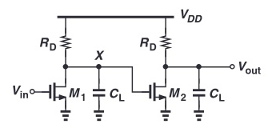

# 장말문제 11.10 — Fig 11.65 캐스케이드의 전달 함수, |V_out/V_in|, −3 dB 대역폭

## 조건
- 회로: Fig 11.65 (문제 11.9의 회로)
- 문제 11.9의 가정을 이어받음: 두 CS 단은 똑같음, 채널길이 변조와 다른 커패시턴스는 무시

## 구할 것
- 회로의 전달 함수 유도
- $s = j\omega$를 대입해 $|V_{out}/V_{in}|$의 식을 구함
- 회로의 −3 dB 대역폭

## 상속·참조
- 문제 11.9 (P11.09): Fig 11.65의 똑같은 CS 단 두 개 캐스케이드에서 채널길이 변조와 다른 커패시턴스를 무시하고 $|V_{out}/V_{in}|$의 보데 선도를 그림. $V_{out}/V_{in} = (V_X/V_{in})(V_{out}/V_X)$

## 회로 — Fig 11.65
```spice
* 두 저항 모두 R_D, 두 커패시터 모두 C_L로 인쇄 (넷리스트 이름 RD1/RD2, CL1/CL2는 원문에 없음)
RD1  VDD   X     {R_D}
M1   X     Vin   0  nmos
CL1  X     0     {C_L}
RD2  VDD   Vout  {R_D}
M2   Vout  X     0  nmos
CL2  Vout  0     {C_L}
```
- 단자: VDD = 전원, 값 미지정 (가로 레일) / Vin = 입력 (개방 원) / Vout = 출력 (개방 원)
- 표시: 노드 라벨 V_DD (레일 오른쪽 끝), X (X 접속점 위), V_in (입력 원 왼쪽), V_out (출력 원 오른쪽) / 소자 라벨 R_D (왼쪽 저항 왼쪽), R_D (오른쪽 저항 왼쪽), M1 (M1 오른쪽, 소스 옆), M2 (M2 오른쪽, 소스 옆), C_L (왼쪽 커패시터 오른쪽), C_L (오른쪽 커패시터 오른쪽) / 부호 없음 / 화살표 없음 / 수치·면적 라벨 없음
- 배치: 맨 위 굵은 가로 레일 V_DD, 두 R_D가 레일에 매달려 세로로 내려옴 / 왼쪽 단: R_D, M1 드레인 접속점, M1(NMOS 보통 방향), 접지 / V_in 원 → 가로선 → M1 게이트 / M1 드레인 접속점에서 가로선이 오른쪽으로 X 접속점(C_L이 세로로 매달려 접지)을 지나 더 오른쪽에서 아래로 꺾이고 M2 게이트 높이에서 다시 오른쪽으로 꺾여 M2 게이트 (계단 모양) / 오른쪽 단: R_D, M2 드레인 접속점, M2(NMOS 보통 방향), 접지 / M2 드레인 접속점에서 가로선이 오른쪽으로 C_L 접속점을 지나 V_out 원에서 끝남 / 접지 기호는 M1 소스, 왼쪽 C_L, M2 소스, 오른쪽 C_L 아래에 따로 (4개) / 접속점 (세 갈래 이상, 4곳): ① M1 드레인 = 위 R_D + 아래 M1 드레인 + 오른쪽 가로선 (점) ② X = 왼쪽 가로선 + 아래 C_L + 오른쪽 M2 게이트로 가는 선 (점) ③ M2 드레인 = 위 R_D + 아래 M2 드레인 + 오른쪽 가로선 (점) ④ 오른쪽 C_L 위 = 왼쪽 가로선 + 오른쪽 V_out 선 + 아래 C_L (점) / 교차: 없음


