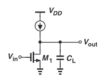

# 장말문제 11.11 — 전류원 부하 CS 단(Fig 11.66)의 전달 함수, λ → 0에서 이상적 적분기

## 원문
Consider the circuit shown in Fig. 11.66. Derive the transfer function assuming $\lambda > 0$ but neglecting other capacitances. Explain why the circuit operates as an ideal integrator if $\lambda \to 0$.

## 조건
- 회로: Fig 11.66 (이상적 전류원 부하 CS 단, 출력에 $C_L$) (원문에 없음, 괄호 안 "이상적"은 작성자 해석)
- $\lambda > 0$, 다른 커패시턴스는 무시

## 구할 것
- 전달 함수 유도
- $\lambda \to 0$이면 회로가 이상적 적분기로 동작하는 이유 설명

## 회로 — Fig 11.66
```spice
I1  VDD   Vout             ; 라벨·값 없는 전류원, 화살표 아래
M1  Vout  Vin   0  nmos
CL  Vout  0     {C_L}
```
- 단자: VDD = 전원, 값 미지정 (T 전원 기호) / Vin = 입력 (개방 원) / Vout = 출력 (개방 원)
- 표시: 노드 라벨 V_DD (T 기호 오른쪽), V_in (입력 원 왼쪽), V_out (출력 원 오른쪽) / 소자 라벨 I1 (라벨 없음), M1 (트랜지스터 오른쪽, 소스 옆), C_L (커패시터 오른쪽) / 부호 없음 / 화살표 없음 / 수치·면적 라벨 없음
- 배치: 왼쪽 세로줄 위→아래 V_DD T 기호, 전류원(원 안 화살표 아래), 드레인 접속점, M1, 접지 / M1 NMOS 보통 방향 / V_in 원 → 짧은 가로선 → 게이트 / 드레인 접속점에서 가로선이 오른쪽으로 C_L 접속점을 지나 V_out 원에서 끝남 / 접지 기호는 M1 소스 아래, C_L 아래에 따로 / 접속점 (세 갈래 이상, 2곳): ① 드레인 = 위 전류원 + 아래 M1 드레인 + 오른쪽 가로선 (점) ② C_L 위 = 왼쪽 가로선 + 오른쪽 V_out 선 + 아래 C_L (점) / 교차: 없음


> 참고: 문제 문장의 마지막 문장("Explain why … ideal integrator if λ → 0.")은 다음 쪽(633쪽) 위로 넘어감

## 풀이
### 출력 노드의 소신호 회로
- 이상적 전류원은 소신호에서 개방이다. 출력–접지에 $M_1$의 $r_O$와 $C_L$만 남는다
- $M_1$의 트랜스컨덕턴스 $g_m$: 출력 노드 KCL $g_m V_{in} + V_{out}\left(\dfrac{1}{r_O} + sC_L\right) = 0$
### 전달 함수
- $\dfrac{V_{out}}{V_{in}}(s) = \dfrac{-g_m r_O}{1 + r_O C_L s}$, 극점 $\omega_p = 1/(r_O C_L)$
### $\lambda \to 0$
- $r_O = 1/(\lambda I_D) \to \infty$라 극점 $\omega_p \to 0$(원점)
- 분자와 분모를 $r_O$로 나누면 $\dfrac{V_{out}}{V_{in}} = \dfrac{-g_m}{1/r_O + C_L s} \to \dfrac{-g_m}{C_L s}$
- 신호 전류 $g_m V_{in}$이 빠져나갈 저항 경로가 없어 모두 $C_L$을 충전한다: $V_{out} = -\dfrac{1}{C_L}\int g_m V_{in}\,dt$
### 답
- $\dfrac{V_{out}}{V_{in}}(s) = \dfrac{-g_m r_O}{1 + r_O C_L s}$
- $\lambda \to 0$이면 $r_O \to \infty$라 $M_1$의 신호 전류 $g_m V_{in}$ 전부가 $C_L$에만 흘러 $V_{out}/V_{in} = -g_m/(C_L s)$가 된다. 극점이 원점에 놓이므로 이상적 적분기다.
