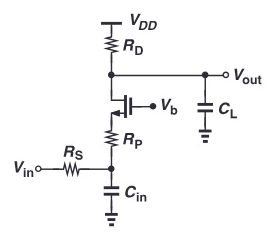

# 장말문제 11.12 — 소스에 기생 저항 R_p가 붙은 CG 단(Fig 11.67)의 입력·출력 극점

## 원문
Due to a manufacturing error, a parasitic resistance $R_p$ has appeared in series with the source of $M_1$ in Fig. 11.67. Assuming $\lambda = 0$ and neglecting other capacitances, determine the input and output poles of the circuit.

## 조건
- 회로: Fig 11.67 (CG 단, 입력 쪽 $R_S$와 $C_{in}$, 출력 쪽 $R_D$와 $C_L$)
- 제조 오류로 기생 저항 $R_p$가 $M_1$의 소스와 직렬로 생김 (그림 라벨은 $R_P$, 그림에 $M_1$ 라벨은 인쇄되지 않음)
- $\lambda = 0$, 다른 커패시턴스는 무시

## 구할 것
- 회로의 입력 극점과 출력 극점

## 회로 — Fig 11.67
```spice
RD   VDD   Vout  {R_D}
M1   Vout  Vb    n2  nmos   ; 좌우 반전 (게이트 오른쪽). 그림에 M1 라벨 없음
RP   n2    n1    {R_P}      ; 기생 저항, M1 소스와 직렬
RS   Vin   n1    {R_S}
Cin  n1    0     {C_in}
CL   Vout  0     {C_L}
```
- 단자: VDD = 전원, 값 미지정 (T 전원 기호) / Vb = 이상적 DC 바이어스 (점 단자) / Vin = 입력 (개방 원) / Vout = 출력 (개방 원)
- 표시: 노드 라벨 V_DD (T 기호 오른쪽), V_b (점 단자 오른쪽), V_in (입력 원 왼쪽), V_out (출력 원 오른쪽) / 소자 라벨 R_D (저항 오른쪽), R_P (저항 오른쪽, 첨자 대문자 P), R_S (저항 위), C_in (커패시터 오른쪽), C_L (커패시터 오른쪽), M1 (라벨 없음) / 부호 없음 / 화살표 없음 / 수치·면적 라벨 없음
- 배치: 왼쪽 세로줄 위→아래 V_DD T 기호, R_D, 출력 접속점, M1, R_P, 입력 접속점, C_in, 접지 / M1 NMOS 좌우 반전(게이트 오른쪽 → 가로선 → V_b 점 단자, 드레인은 위에서 세로줄로, 소스는 아래 왼쪽으로 나와 세로줄로, 소스 화살표는 왼쪽 바깥을 향함) / 출력 접속점에서 가로선이 오른쪽으로 C_L 접속점을 지나 V_out 원에서 끝남. C_L은 V_b보다 오른쪽에서 세로로 내려가 접지 / V_in 원 → 가로 R_S → 입력 접속점 / 접지 기호는 C_in 아래, C_L 아래에 따로 / 접속점 (세 갈래 이상, 3곳): ① 출력 = 위 R_D + 아래 M1 드레인 + 오른쪽 가로선 (점) ② C_L 위 = 왼쪽 가로선 + 오른쪽 V_out 선 + 아래 C_L (점) ③ 입력 = 위 R_P + 왼쪽 R_S + 아래 C_in (점) / 교차: 없음



## 풀이
### 입력 노드에서 본 저항
- $R_S$, $R_P$, $C_{in}$이 만나는 노드를 입력 노드라 하면, 커패시턴스는 $C_{in}$뿐이다
- 게이트가 $V_b$(AC 접지)라 $M_1$ 소스로 들여다본 저항은 $1/g_m$ ($M_1$의 트랜스컨덕턴스 $g_m$, $\lambda = 0$, 몸체 효과 무시). $R_P$가 이와 직렬
- 입력 노드에서 본 저항: $R_S \parallel \left(R_P + \dfrac{1}{g_m}\right)$
### 입력 극점
- $|\omega_{p,in}| = \dfrac{1}{\left[R_S \parallel \left(R_P + 1/g_m\right)\right]C_{in}}$
- $R_P$ 때문에 입력 노드 저항이 커져 입력 극점이 낮아진다
### 출력 극점
- $\lambda = 0$이라 $M_1$ 드레인은 소스 쪽 $R_P$와 관계없이 무한대 저항이다. 출력 노드에서 본 저항은 $R_D$
- $|\omega_{p,out}| = \dfrac{1}{R_D C_L}$ ($R_P$의 영향 없음)
### 답
- 입력 극점 $|\omega_{p,in}| = \dfrac{1}{\left[R_S \parallel \left(R_P + 1/g_m\right)\right]C_{in}}$
- 출력 극점 $|\omega_{p,out}| = \dfrac{1}{R_D C_L}$
