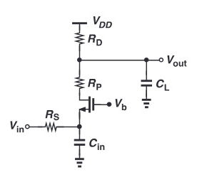

# 장말문제 11.13 — 드레인 쪽에 R_p가 붙은 CG 단(Fig 11.68)의 입력·출력 극점

## 조건
- 회로: Fig 11.68 (CG 단, $R_P$가 $M_1$ 드레인과 출력 노드 사이에 직렬)
- 원문은 "Repeat Problem 11.13 for the circuit shown in Fig. 11.68."로 인쇄됨 (자기 자신을 참조)
- 문맥과 맞지 않음(오식으로 보임). 바로 앞 문제 11.12(같은 모양의 CG 단, $R_p$ 문제)를 반복하는 것으로 읽음. 다음 문제 11.14도 "Repeat Problem 11.12"임 (원문에 없음)
- 문제 11.12의 가정을 이어받음: $\lambda = 0$, 다른 커패시턴스는 무시 (원문에 없음, 위 해석에 따름)

## 구할 것
- 이 회로에 대해 문제 11.12를 다시 풂: 입력 극점과 출력 극점 (원문에 없음, 위 해석에 따름)

## 상속·참조
- 문제 11.12 (P11.12): 제조 오류로 기생 저항 $R_p$가 $M_1$의 소스와 직렬로 생긴 Fig 11.67 회로에서, $\lambda = 0$으로 가정하고 다른 커패시턴스를 무시하여 입력 극점과 출력 극점을 구함

## 회로 — Fig 11.68
```spice
RD   VDD   Vout  {R_D}
RP   Vout  n2    {R_P}      ; R_P가 M1 드레인 쪽에 직렬
M1   n2    Vb    n1  nmos   ; 좌우 반전 (게이트 오른쪽). 그림에 M1 라벨 없음
RS   Vin   n1    {R_S}
Cin  n1    0     {C_in}
CL   Vout  0     {C_L}
```
- 단자: VDD = 전원, 값 미지정 (T 전원 기호) / Vb = 이상적 DC 바이어스 (점 단자) / Vin = 입력 (개방 원) / Vout = 출력 (개방 원)
- 표시: 노드 라벨 V_DD (T 기호 오른쪽), V_b (점 단자 오른쪽), V_in (입력 원 왼쪽), V_out (출력 원 오른쪽) / 소자 라벨 R_D (저항 오른쪽), R_P (저항 오른쪽, 첨자 대문자 P), R_S (저항 위), C_in (커패시터 오른쪽), C_L (커패시터 오른쪽), M1 (라벨 없음) / 부호 없음 / 화살표 없음 / 수치·면적 라벨 없음
- 배치: 왼쪽 세로줄 위→아래 V_DD T 기호, R_D, 출력 접속점, R_P, M1, 입력 접속점, C_in, 접지 (Fig 11.67에서 R_P를 M1 위, 드레인 쪽으로 옮긴 모양) / M1 NMOS 좌우 반전(게이트 오른쪽 → 가로선 → V_b 점 단자, 소스는 아래 왼쪽으로 나와 세로줄로, 소스 화살표는 왼쪽 바깥을 향함) / 출력 접속점에서 가로선이 오른쪽으로 C_L 접속점을 지나 V_out 원에서 끝남. C_L은 세로로 내려가 접지 / V_in 원 → 가로 R_S → 입력 접속점 / 접지 기호는 C_in 아래, C_L 아래에 따로 / 접속점 (세 갈래 이상, 3곳): ① 출력 = 위 R_D + 아래 R_P + 오른쪽 가로선 (점) ② C_L 위 = 왼쪽 가로선 + 오른쪽 V_out 선 + 아래 C_L (점) ③ 입력 = 위 M1 소스 + 왼쪽 R_S + 아래 C_in (점) / 교차: 없음


