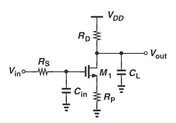

# 장말문제 11.14 — 소스에 R_P가 붙은 CS 단(Fig 11.69)의 입력·출력 극점

## 원문
Repeat Problem 11.12 for the CS stage depicted in Fig. 11.69.

## 조건
- 회로: Fig 11.69 (CS 단, 게이트 쪽 $R_S$와 $C_{in}$, 소스에 $R_P$, 출력 쪽 $R_D$와 $C_L$)
- 문제 11.12의 가정을 이어받음: $\lambda = 0$, 다른 커패시턴스는 무시

## 구할 것
- 이 CS 단에 대해 문제 11.12를 다시 풂: 입력 극점과 출력 극점

## 상속·참조
- 문제 11.12 (P11.12): 제조 오류로 기생 저항 $R_p$가 $M_1$의 소스와 직렬로 생긴 Fig 11.67 회로(CG 단)에서, $\lambda = 0$으로 가정하고 다른 커패시턴스를 무시하여 입력 극점과 출력 극점을 구함

## 회로 — Fig 11.69
```spice
RD   VDD   Vout  {R_D}
M1   Vout  n1    n2  nmos
RP   n2    0     {R_P}      ; 기생 저항, M1 소스와 직렬
RS   Vin   n1    {R_S}
Cin  n1    0     {C_in}
CL   Vout  0     {C_L}
```
- 단자: VDD = 전원, 값 미지정 (T 전원 기호) / Vin = 입력 (개방 원) / Vout = 출력 (개방 원)
- 표시: 노드 라벨 V_DD (T 기호 오른쪽), V_in (입력 원 왼쪽), V_out (출력 원 오른쪽) / 소자 라벨 R_D (저항 왼쪽), R_S (저항 위), C_in (커패시터 오른쪽), M1 (트랜지스터 오른쪽, 소스 옆), R_P (저항 오른쪽, 첨자 대문자 P), C_L (커패시터 오른쪽) / 부호 없음 / 화살표 없음 / 수치·면적 라벨 없음
- 배치: M1 세로줄 위→아래 V_DD T 기호, R_D, 출력 접속점, M1, R_P, 접지 / M1 NMOS 보통 방향(게이트 왼쪽) / V_in 원 → 가로 R_S → 게이트 접속점 → 가로선 → M1 게이트. C_in은 게이트 접속점에서 세로로 내려가 접지 / 출력 접속점에서 가로선이 오른쪽으로 C_L 접속점을 지나 V_out 원에서 끝남. C_L은 세로로 내려가 접지 / 접지 기호는 C_in 아래, R_P 아래, C_L 아래에 따로 / 접속점 (세 갈래 이상, 3곳): ① 게이트 = 왼쪽 R_S + 아래 C_in + 오른쪽 게이트선 (점) ② 출력 = 위 R_D + 아래 M1 드레인 + 오른쪽 가로선 (점) ③ C_L 위 = 왼쪽 가로선 + 오른쪽 V_out 선 + 아래 C_L (점) / 교차: 없음


