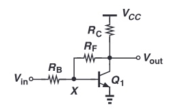

# 장말문제 11.16 — 귀환 저항 R_F가 있는 CE 단(Fig 11.70)에 밀러 이론 적용

## 원문
Apply Miller's theorem to resistor $R_F$ in Fig. 11.70 and estimate the voltage gain of the circuit. Assume $V_A = \infty$ and $R_F$ is large enough to allow the approximation $v_{out}/v_X = -g_m R_C$.

## 조건
- 회로: Fig 11.70 — $V_{in}$이 $R_B$를 거쳐 $Q_1$ 베이스(노드 $X$)로 들어가는 CE 단, 컬렉터 부하 $R_C$, 베이스($X$)와 컬렉터($V_{out}$) 사이에 저항 $R_F$
- $V_A = \infty$
- $R_F$가 충분히 커서 $v_{out}/v_X = -g_m R_C$로 근사할 수 있음

## 구할 것
- 저항 $R_F$에 밀러 이론을 적용해 회로의 전압 이득을 추정

## 회로 — Fig 11.70
```spice
RC  VCC   Vout  {R_C}
RF  X     Vout  {R_F}
RB  Vin   X     {R_B}
Q1  Vout  X     0     npn
```
- 단자: VCC = 전원, 값 미지정 (T 전원 기호) / Vin = 입력 (개방 원) / Vout = 출력 (개방 원)
- 표시: 노드 라벨 V_CC (T 기호 오른쪽), V_in (입력 원 왼쪽), X (X 접속점 아래), V_out (출력 원 오른쪽) / 소자 라벨 R_C (저항 왼쪽), R_F (저항 위), R_B (저항 위), Q1 (트랜지스터 오른쪽, 이미터 옆) / 부호 없음 / 화살표 없음 / 수치·면적 라벨 없음
- 배치: 오른쪽 세로줄 위→아래 V_CC T 기호, R_C, 컬렉터 접속점, Q1, 접지 / Q1 npn 보통 방향(베이스 왼쪽, 컬렉터 위, 이미터 아래 → 접지) / V_in 원 → 가로 R_B → X 접속점 → 가로선 → Q1 베이스 / X 접속점에서 선이 위로 올라가 컬렉터 접속점 높이에서 오른쪽으로 꺾여 가로 R_F를 지나 컬렉터 접속점 / 컬렉터 접속점에서 가로선이 오른쪽으로 V_out 원에서 끝남 / 접속점 (세 갈래 이상, 2곳): ① 컬렉터 = 위 R_C + 왼쪽 R_F + 아래 Q1 컬렉터 + 오른쪽 V_out 선 (점) ② X = 왼쪽 R_B + 위 R_F로 가는 선 + 오른쪽 베이스 선 (점) / 교차: 없음



## 풀이
### $R_F$를 밀러로 나누기
- $X$에서 $V_{out}$까지 이득을 $A = -g_m R_C$로 두면 ($g_m$: $Q_1$의 트랜스컨덕턴스), $X$ 쪽 저항 $R_{F,X} = \dfrac{R_F}{1 - A} = \dfrac{R_F}{1 + g_m R_C}$
- 출력 쪽 저항 $\dfrac{R_F}{1 - 1/A} \approx R_F$는 $R_F$가 크다는 가정대로 $R_C$에 비해 무시한다 ($v_{out}/v_X = -g_m R_C$ 근사와 같은 뜻)
### $X$ 노드의 전압 분배
- $X$에서 접지로 가는 저항은 $Q_1$의 베이스 입력 저항 $r_\pi$와 $R_{F,X}$의 병렬: $R_X = r_\pi \parallel \dfrac{R_F}{1 + g_m R_C}$
- $\dfrac{v_X}{v_{in}} = \dfrac{R_X}{R_B + R_X}$
### 전압 이득
- $\dfrac{v_{out}}{v_{in}} = -g_m R_C \dfrac{R_X}{R_B + R_X} = \dfrac{-g_m R_C\, r_\pi R_F}{R_F r_\pi + R_B(R_F + r_\pi + g_m R_C r_\pi)}$
- 이득 $g_m R_C$가 클수록 $X$ 쪽 저항이 $(1 + g_m R_C)$배 작아져 입력 신호를 더 많이 깎는다
### 답
- $\dfrac{v_{out}}{v_{in}} \approx -g_m R_C \cdot \dfrac{r_\pi \parallel \dfrac{R_F}{1 + g_m R_C}}{R_B + r_\pi \parallel \dfrac{R_F}{1 + g_m R_C}}$
