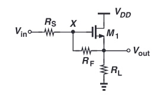

# 장말문제 11.17 — 귀환 저항 R_F가 있는 소스 폴로어(Fig 11.71)에 밀러 이론 적용

## 원문
Repeat Problem 11.16 for the source follower in Fig. 11.71. Assume $\lambda = 0$ and $R_F$ is large enough to allow the approximation $v_{out}/v_X = R_L/(R_L + g_m^{-1})$.

## 조건
- 회로: Fig 11.71 — $V_{in}$이 $R_S$를 거쳐 $M_1$ 게이트(노드 $X$)로 들어가는 소스 폴로어, 소스($V_{out}$)에서 접지로 $R_L$, $X$와 $V_{out}$ 사이에 저항 $R_F$
- $\lambda = 0$
- $R_F$가 충분히 커서 $v_{out}/v_X = R_L/(R_L + g_m^{-1})$로 근사할 수 있음

## 구할 것
- 이 소스 폴로어에 대해 문제 11.16을 다시 풂: 저항 $R_F$에 밀러 이론을 적용해 회로의 전압 이득을 추정

## 상속·참조
- 문제 11.16 (P11.16): Fig 11.70의 CE 단에서 베이스–컬렉터 사이 저항 $R_F$에 밀러 이론을 적용해 전압 이득을 추정 ($V_A = \infty$, $v_{out}/v_X = -g_m R_C$ 근사)

## 회로 — Fig 11.71
```spice
RS  Vin   X     {R_S}
M1  VDD   X     Vout  nmos
RF  X     Vout  {R_F}
RL  Vout  0     {R_L}
```
- 단자: VDD = 전원, 값 미지정 (T 전원 기호) / Vin = 입력 (개방 원) / Vout = 출력 (개방 원)
- 표시: 노드 라벨 V_DD (T 기호 오른쪽), V_in (입력 원 왼쪽), X (X 접속점 위), V_out (출력 원 오른쪽) / 소자 라벨 R_S (저항 위), M1 (트랜지스터 오른쪽, 소스 옆), R_F (저항 아래), R_L (저항 오른쪽) / 부호 없음 / 화살표 없음 / 수치·면적 라벨 없음
- 배치: 오른쪽 세로줄 위→아래 V_DD T 기호, M1, 소스 접속점, R_L, 접지 / M1 NMOS 보통 방향(게이트 왼쪽, 드레인 위 → V_DD, 소스 아래) / V_in 원 → 가로 R_S → X 접속점 → 가로선 → M1 게이트 / X 접속점에서 선이 아래로 내려가 소스 접속점 높이에서 오른쪽으로 꺾여 가로 R_F를 지나 소스 접속점 / 소스 접속점에서 가로선이 오른쪽으로 V_out 원에서 끝남 / 접속점 (세 갈래 이상, 2곳): ① X = 왼쪽 R_S + 오른쪽 게이트 선 + 아래 R_F로 가는 선 (점) ② 소스 = 위 M1 소스 + 왼쪽 R_F + 오른쪽 V_out 선 + 아래 R_L (점) / 교차: 없음



## 풀이
### $R_F$를 밀러로 나누기
- $X$에서 $V_{out}$까지 이득 $A = \dfrac{R_L}{R_L + g_m^{-1}} = \dfrac{g_m R_L}{1 + g_m R_L}$ ($g_m$: $M_1$의 트랜스컨덕턴스, 몸체 효과 무시)
- $X$ 쪽 저항 $\dfrac{R_F}{1 - A} = (1 + g_m R_L) R_F$: 폴로어라 $R_F$ 양 끝 전압이 거의 같이 움직여 저항이 커 보인다
- 출력 쪽 저항 $\dfrac{R_F}{1 - 1/A} = -g_m R_L R_F$는 $R_F$가 크다는 가정대로 $R_L$에 비해 무시한다
### $X$ 노드의 전압 분배
- $M_1$ 게이트로는 전류가 들어가지 않으므로 $X$에서 접지로 가는 것은 $(1 + g_m R_L) R_F$뿐이다
- $\dfrac{v_X}{v_{in}} = \dfrac{(1 + g_m R_L) R_F}{R_S + (1 + g_m R_L) R_F}$
### 전압 이득
- $\dfrac{v_{out}}{v_{in}} = \dfrac{g_m R_L}{1 + g_m R_L} \cdot \dfrac{(1 + g_m R_L) R_F}{R_S + (1 + g_m R_L) R_F} = \dfrac{g_m R_L R_F}{R_S + (1 + g_m R_L) R_F}$
### 답
- $\dfrac{v_{out}}{v_{in}} \approx \dfrac{R_L}{R_L + g_m^{-1}} \cdot \dfrac{(1 + g_m R_L) R_F}{R_S + (1 + g_m R_L) R_F} = \dfrac{g_m R_L R_F}{R_S + (1 + g_m R_L) R_F}$
