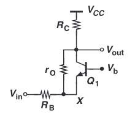

# 장말문제 11.18 — 출력 저항 r_O를 드러낸 CB 단(Fig 11.72)의 이득을 밀러 이론으로 추정

## 원문
Consider the common-base stage illustrated in Fig. 11.72, where the output resistance of $Q_1$ is drawn explicitly. Utilize Miller's theorem to estimate the gain. Assume $r_O$ is large enough to allow the approximation $v_{out}/v_X = g_m R_C$.

## 조건
- 회로: Fig 11.72 — 공통 베이스 단. $Q_1$의 출력 저항 $r_O$를 컬렉터($V_{out}$)와 이미터(노드 $X$) 사이에 명시적으로 그림. $V_{in}$은 $R_B$를 거쳐 $X$로 들어가고, 베이스는 $V_b$, 컬렉터 부하 $R_C$
- $r_O$가 충분히 커서 $v_{out}/v_X = g_m R_C$로 근사할 수 있음

## 구할 것
- 밀러 이론을 이용해 이득을 추정

## 회로 — Fig 11.72
```spice
RC  VCC   Vout  {R_C}
Q1  Vout  Vb    X     npn   ; 좌우 반전 (베이스 오른쪽)
RO  Vout  X     {r_O}       ; Q1의 출력 저항을 따로 그림
RB  Vin   X     {R_B}
```
- 단자: VCC = 전원, 값 미지정 (T 전원 기호) / Vb = 이상적 DC 바이어스 (점 단자) / Vin = 입력 (개방 원) / Vout = 출력 (개방 원)
- 표시: 노드 라벨 V_CC (T 기호 오른쪽), V_out (출력 원 오른쪽), V_b (점 단자 오른쪽), V_in (입력 원 왼쪽), X (이미터 선 아래 꺾인 곳 아래) / 소자 라벨 R_C (저항 왼쪽), r_O (저항 왼쪽), Q1 (트랜지스터 오른쪽 아래), R_B (저항 아래) / 부호 없음 / 화살표 없음 / 수치·면적 라벨 없음
- 배치: 가운데 세로줄 위→아래 V_CC T 기호, R_C, 컬렉터 접속점, Q1 / Q1 npn 좌우 반전(베이스 막대 오른쪽 → 가로선 → V_b 점 단자, 컬렉터 왼쪽 위, 이미터 왼쪽 아래·화살표 바깥) / 이미터에서 선이 아래로 내려가 맨 아래 가로선 높이에서 왼쪽으로 꺾여 아래 접속점 / 컬렉터 접속점에서 가로선이 오른쪽으로 V_out 원에서 끝남 / 컬렉터 접속점에서 가로선이 왼쪽으로 가 아래로 꺾여 세로 r_O를 지나 아래 접속점 / V_in 원 → 가로 R_B → 아래 접속점 / 접속점 (세 갈래 이상, 2곳): ① 컬렉터 = 위 R_C + 왼쪽 r_O로 가는 선 + 아래 Q1 컬렉터 + 오른쪽 V_out 선 (점) ② 아래(X) = 왼쪽 R_B + 위 r_O + 오른쪽 이미터로 가는 선 (점) / 교차: 없음



## 힌트
### $X$ 쪽 밀러 저항은 음수
- CB 단의 $v_{out}/v_X$는 양수이고 1보다 크므로, $r_O$를 밀러로 옮기면 $X$ 쪽에는 음의 저항이 생긴다
- 이 음저항은 $X$에서 $Q_1$ 이미터를 들여다본 저항과 병렬이고, 그 병렬 합성이 $R_B$와 전압 분배를 이룬다
- $r_O$가 충분히 크면 음저항의 영향은 작아서 병렬 합성은 양수로 남는다
