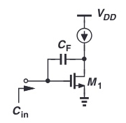

# 장말문제 11.19 — 게이트–드레인 커패시터 C_F가 있는 CS 단(Fig 11.73)의 입력 커패시턴스

## 원문
Using Miller's theorem, estimate the input capacitance of the circuit depicted in Fig. 11.73. Assume $\lambda > 0$ but neglect other capacitances. What happens if $\lambda \to 0$?

## 조건
- 회로: Fig 11.73 — 전류원 부하 CS 단, $M_1$ 게이트(입력)와 드레인 사이에 $C_F$. 입력 단자에서 들여다본 커패시턴스가 $C_{in}$
- $\lambda > 0$
- 다른 커패시턴스는 무시

## 구할 것
- 밀러 이론을 이용해 회로의 입력 커패시턴스 $C_{in}$을 추정
- $\lambda \to 0$이면 어떻게 되는가?

## 회로 — Fig 11.73
```spice
* 입력 단자는 라벨 없이 C_in 화살표만 붙은 개방 원 → 측정 단자 out (원문에 없음)
I1  VDD   n1               ; 라벨·값 없는 전류원, 화살표 아래
M1  n1    out   0     nmos
CF  out   n1    {C_F}
```
- 단자: VDD = 전원, 값 미지정 (T 전원 기호) / out = 입력, C_in 측정 단자 (개방 원)
- 표시: 노드 라벨 V_DD (T 기호 오른쪽) / 소자 라벨 I1 (라벨 없음), C_F (커패시터 위), M1 (트랜지스터 오른쪽, 소스 옆) / 부호 없음 / 화살표 "C_in": 입력 단자에서 회로 쪽(오른쪽)을 들여다봄, 오른쪽 방향, 도선 옆 별도 화살표 (┌ 꺾임: 입력 원 아래 왼쪽에 세로선, 위 끝에서 가로선이 입력 가로선 아래로 오른쪽으로 뻗고 화살촉은 오른쪽 끝, 글자 C_in은 세로선 아래 끝) / 수치·면적 라벨 없음
- 배치: 오른쪽 세로줄 위→아래 V_DD T 기호, 전류원(원 안 화살표 아래), 드레인 접속점, M1, 접지 / M1 NMOS 보통 방향(게이트 왼쪽, 드레인 위, 소스 아래 → 접지) / 왼쪽 입력 원 → 가로선 → 게이트 접속점 → 가로선 → M1 게이트 / 게이트 접속점에서 선이 위로 올라가 드레인 접속점 높이에서 오른쪽으로 꺾여 가로 C_F를 지나 드레인 접속점 / 접속점 (세 갈래 이상, 2곳): ① 드레인 = 위 전류원 + 왼쪽 C_F + 아래 M1 드레인 (점) ② 게이트 = 왼쪽 입력 선 + 위 C_F로 가는 선 + 오른쪽 게이트 선 (점) / 교차: 없음


> 참고: 문제 문장은 633쪽(PDF 34) 오른쪽 단 끝에 있고, Fig 11.73은 다음 쪽 634쪽(PDF 35) 왼쪽 단 위에 인쇄됨

## 풀이
### $C_F$ 양 끝 사이 이득
- 전류원 부하가 이상적이면 드레인에서 접지로 가는 저항은 $M_1$의 출력 저항 $r_O$뿐이다 ($\lambda > 0$이라 유한)
- 게이트에서 드레인까지 이득 $A = -g_m r_O$ ($g_m$: $M_1$의 트랜스컨덕턴스)
### 입력 커패시턴스
- 밀러 이론으로 입력 쪽 성분: $C_{in} = (1 - A) C_F = (1 + g_m r_O) C_F$
- 다른 커패시턴스는 무시하므로 이것이 입력 커패시턴스 전부다
### $\lambda \to 0$일 때
- $r_O \to \infty$라 이득 $g_m r_O$가 무한히 커지고 $C_{in} \to \infty$
- 드레인에 전류가 빠져나갈 저항이 없어 입력이 조금만 변해도 드레인이 무한히 크게 반대로 움직이므로, $C_F$로 흐르는 전류가 무한대가 된다
### 답
- $C_{in} = (1 + g_m r_O) C_F$
- $\lambda \to 0$이면 $r_O \to \infty$라 $C_{in} \to \infty$ (이득이 무한대라 밀러 배수도 무한대)
