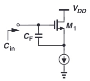

# 장말문제 11.20 — 게이트–소스 커패시터 C_F가 있는 소스 폴로어(Fig 11.74)의 입력 커패시턴스

## 원문
Repeat Problem 11.19 for the source follower shown in Fig. 11.74.

## 조건
- 회로: Fig 11.74 — 전류원 바이어스 소스 폴로어, $M_1$ 게이트(입력)와 소스 사이에 $C_F$. 입력 단자에서 들여다본 커패시턴스가 $C_{in}$
- 문제 11.19의 가정을 이어받음: $\lambda > 0$, 다른 커패시턴스는 무시

## 구할 것
- 이 소스 폴로어에 대해 문제 11.19를 다시 풂: 밀러 이론으로 입력 커패시턴스 $C_{in}$을 추정, $\lambda \to 0$이면 어떻게 되는가?

## 상속·참조
- 문제 11.19 (P11.19): Fig 11.73의 전류원 부하 CS 단(게이트–드레인 사이 $C_F$)에서 $\lambda > 0$으로 가정하고 다른 커패시턴스를 무시하여 밀러 이론으로 입력 커패시턴스를 추정하고, $\lambda \to 0$일 때 어떻게 되는지 답함

## 회로 — Fig 11.74
```spice
* 입력 단자는 라벨 없이 C_in 화살표만 붙은 개방 원 → 측정 단자 out (원문에 없음)
M1  VDD   out   n1    nmos
CF  out   n1    {C_F}
I1  n1    0                ; 라벨·값 없는 전류원, 화살표 아래
```
- 단자: VDD = 전원, 값 미지정 (T 전원 기호) / out = 입력, C_in 측정 단자 (개방 원)
- 표시: 노드 라벨 V_DD (T 기호 오른쪽) / 소자 라벨 M1 (트랜지스터 오른쪽, 소스 옆), C_F (커패시터 왼쪽), I1 (라벨 없음) / 부호 없음 / 화살표 "C_in": 입력 단자에서 회로 쪽(오른쪽)을 들여다봄, 오른쪽 방향, 도선 옆 별도 화살표 (┌ 꺾임: 입력 원 아래 왼쪽에 세로선, 위 끝에서 가로선이 입력 가로선 아래로 오른쪽으로 뻗고 화살촉은 오른쪽 끝, 글자 C_in은 세로선 아래 끝) / 수치·면적 라벨 없음
- 배치: 오른쪽 세로줄 위→아래 V_DD T 기호, M1, 소스 접속점, 전류원(원 안 화살표 아래), 접지 / M1 NMOS 보통 방향(게이트 왼쪽, 드레인 위 → V_DD, 소스 아래) / 왼쪽 입력 원 → 가로선 → 게이트 접속점 → 가로선 → M1 게이트 / 게이트 접속점에서 세로 C_F가 아래로 매달리고, 그 아래 끝에서 선이 소스 접속점 높이로 오른쪽으로 꺾여 소스 접속점 / 접속점 (세 갈래 이상, 2곳): ① 게이트 = 왼쪽 입력 선 + 오른쪽 게이트 선 + 아래 C_F (점) ② 소스 = 위 M1 소스 + 왼쪽 C_F에서 오는 선 + 아래 전류원 (점) / 교차: 없음



## 풀이
### $C_F$ 양 끝 사이 이득
- 전류원이 이상적이면 소스에서 접지로 가는 저항은 $M_1$의 출력 저항 $r_O$뿐이다 ($\lambda > 0$, 몸체 효과 무시)
- 게이트에서 소스까지 이득 $A = \dfrac{r_O}{r_O + 1/g_m} = \dfrac{g_m r_O}{1 + g_m r_O}$ ($g_m$: $M_1$의 트랜스컨덕턴스)
### 입력 커패시턴스
- 밀러 이론으로 입력 쪽 성분: $C_{in} = (1 - A) C_F = \dfrac{C_F}{1 + g_m r_O}$
- 소스가 게이트를 거의 따라가므로 $C_F$ 양 끝 전압이 조금만 변해 커패시턴스가 작아 보인다
### $\lambda \to 0$일 때
- $r_O \to \infty$라 $A \to 1$이고 $C_{in} \to 0$
- 소스가 게이트를 정확히 따라가 $C_F$ 양 끝 전압이 변하지 않으므로 $C_F$로 전류가 흐르지 않는다
- 몸체 효과($g_{mb}$)를 넣으면 $A = g_m/(g_m + g_{mb})$라 $C_{in} \to C_F\, g_{mb}/(g_m + g_{mb})$가 남는다
### 답
- $C_{in} = \dfrac{C_F}{1 + g_m r_O}$
- $\lambda \to 0$이면 이득이 1이 되어 $C_{in} \to 0$ (몸체 효과 무시. 입력에서 $C_F$가 보이지 않음)
