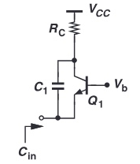

# 장말문제 11.21 — 컬렉터–이미터 커패시터 C_1이 있는 CB 단(Fig 11.75)의 음의 입력 커패시턴스

## 원문
Using Miller's theorem, explain how the common-base stage illustrated in Fig. 11.75 provides a negative input capacitance. Assume $V_A = \infty$ and neglect other capacitances.

## 조건
- 회로: Fig 11.75 — 공통 베이스 단. 입력은 $Q_1$ 이미터, 베이스는 $V_b$, 컬렉터 부하 $R_C$, 컬렉터와 이미터(입력) 사이에 $C_1$. 입력 단자에서 들여다본 커패시턴스가 $C_{in}$
- $V_A = \infty$
- 다른 커패시턴스는 무시

## 구할 것
- 밀러 이론을 이용해 이 CB 단이 어떻게 음의(negative) 입력 커패시턴스를 만드는지 설명

## 회로 — Fig 11.75
```spice
* 입력 단자는 라벨 없이 C_in 화살표만 붙은 개방 원 → 측정 단자 out (원문에 없음)
RC  VCC   n1    {R_C}
Q1  n1    Vb    out   npn   ; 좌우 반전 (베이스 오른쪽)
C1  n1    out   {C_1}
```
- 단자: VCC = 전원, 값 미지정 (T 전원 기호) / Vb = 이상적 DC 바이어스 (점 단자) / out = 입력, C_in 측정 단자 (개방 원)
- 표시: 노드 라벨 V_CC (T 기호 오른쪽), V_b (점 단자 오른쪽) / 소자 라벨 R_C (저항 왼쪽), C_1 (커패시터 왼쪽), Q1 (트랜지스터 오른쪽 아래) / 부호 없음 / 화살표 "C_in": 입력 단자에서 회로 쪽(오른쪽)을 들여다봄, 오른쪽 방향, 도선 옆 별도 화살표 (┌ 꺾임: 입력 원 아래 왼쪽에 세로선, 위 끝에서 가로선이 입력 가로선 아래로 오른쪽으로 뻗고 화살촉은 오른쪽 끝, 글자 C_in은 세로선 아래 끝) / 수치·면적 라벨 없음
- 배치: 가운데 세로줄 위→아래 V_CC T 기호, R_C, 컬렉터 접속점, Q1 / Q1 npn 좌우 반전(베이스 막대 오른쪽 → 가로선 → V_b 점 단자, 컬렉터 왼쪽 위, 이미터 왼쪽 아래·화살표 바깥) / 이미터에서 선이 아래로 내려가 입력 가로선 높이에서 왼쪽으로 꺾여 입력 접속점 / 컬렉터 접속점에서 가로선이 왼쪽으로 가 아래로 꺾여 세로 C_1을 지나 입력 접속점 / 왼쪽 입력 원 → 짧은 가로선 → 입력 접속점 / 접속점 (세 갈래 이상, 2곳): ① 컬렉터 = 위 R_C + 왼쪽 C_1로 가는 선 + 아래 Q1 컬렉터 (점) ② 입력 = 왼쪽 입력 원 선 + 위 C_1 + 오른쪽 이미터로 가는 선 (점) / 교차: 없음



## 풀이
### $C_1$ 양 끝 사이 이득
- 입력(이미터)에서 컬렉터까지 이득: 베이스가 $V_b$(AC 접지)인 CB 단이라 $A = g_m R_C$ ($g_m$: $Q_1$의 트랜스컨덕턴스, $V_A = \infty$)
- 이득은 양수이고 보통 $g_m R_C > 1$이다
### 밀러로 옮긴 입력 커패시턴스
- $C_{in} = (1 - A) C_1 = (1 - g_m R_C) C_1$
- $g_m R_C > 1$이면 $C_{in} < 0$, 곧 음의 커패시턴스다 (출력 쪽 성분 $(1 - 1/(g_m R_C)) C_1$은 양수)
### 물리적 의미
- 입력이 $\Delta V$ 오르면 컬렉터는 같은 방향으로 $g_m R_C \Delta V$만큼 더 크게 오른다. 그래서 $C_1$ 양 끝 전압 $V_C - V_{in}$이 오히려 커진다
- $C_1$의 전류는 컬렉터에서 입력 쪽으로 흘러 들어오므로, 입력 전원이 전류를 넣는 보통 커패시터와 방향이 반대다. 이것이 음의 커패시턴스로 보인다
### 답
- 밀러 이론으로 $C_{in} = (1 - g_m R_C) C_1$이고, CB 단은 이득 $g_m R_C$가 양수이며 1보다 크므로 $C_{in}$이 음수다
- 입력보다 컬렉터가 같은 방향으로 더 크게 움직여 $C_1$ 전류가 입력 노드로 거꾸로 들어오기 때문이다
