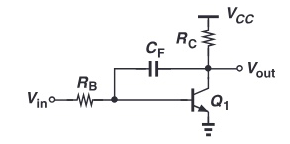

# 장말문제 11.22 — 베이스–컬렉터 커패시터 C_F가 있는 CE 단(Fig 11.76)의 입력·출력 극점

## 원문
Use Miller's theorem to estimate the input and output poles of the circuit shown in Fig. 11.76. Assume $V_A = \infty$ and neglect other capacitances. Note that the circuit in fact has only one pole.

## 조건
- 회로: Fig 11.76 — $V_{in}$이 $R_B$를 거쳐 $Q_1$ 베이스로 들어가는 CE 단, 컬렉터 부하 $R_C$, 베이스와 컬렉터($V_{out}$) 사이에 $C_F$
- $V_A = \infty$
- 다른 커패시턴스는 무시
- 이 회로는 실제로는 극점이 하나뿐임에 유의 (원문의 메모)

## 구할 것
- 밀러 이론을 이용해 회로의 입력 극점과 출력 극점을 추정

## 회로 — Fig 11.76
```spice
RC  VCC   Vout  {R_C}
CF  n1    Vout  {C_F}
RB  Vin   n1    {R_B}
Q1  Vout  n1    0     npn
```
- 단자: VCC = 전원, 값 미지정 (T 전원 기호) / Vin = 입력 (개방 원) / Vout = 출력 (개방 원)
- 표시: 노드 라벨 V_CC (T 기호 오른쪽), V_in (입력 원 왼쪽), V_out (출력 원 오른쪽) / 소자 라벨 C_F (커패시터 위), R_C (저항 왼쪽), R_B (저항 위), Q1 (트랜지스터 오른쪽, 이미터 옆) / 부호 없음 / 화살표 없음 / 수치·면적 라벨 없음
- 배치: 오른쪽 세로줄 위→아래 V_CC T 기호, R_C, 컬렉터 접속점, Q1, 접지 / Q1 npn 보통 방향(베이스 왼쪽, 컬렉터 위, 이미터 아래 → 접지) / V_in 원 → 가로 R_B → 베이스 접속점 → 가로선 → Q1 베이스 / 베이스 접속점에서 선이 위로 올라가 컬렉터 접속점 높이에서 오른쪽으로 꺾여 가로 C_F를 지나 컬렉터 접속점 / 컬렉터 접속점에서 가로선이 오른쪽으로 V_out 원에서 끝남 / 접속점 (세 갈래 이상, 2곳): ① 컬렉터 = 위 R_C + 왼쪽 C_F + 아래 Q1 컬렉터 + 오른쪽 V_out 선 (점) ② 베이스 = 왼쪽 R_B + 위 C_F로 가는 선 + 오른쪽 베이스 선 (점) / 교차: 없음


