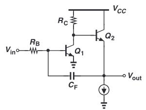

# 장말문제 11.23 — CE 단 + 이미터 폴로어에 걸친 C_F(Fig 11.77)의 입력·출력 극점

## 원문
Repeat Problem 11.22 for the circuit in Fig. 11.77.

## 조건
- 회로: Fig 11.77 — $V_{in}$이 $R_B$를 거쳐 $Q_1$ 베이스로 들어가는 CE 단($R_C$ 부하) 뒤에 이미터 폴로어 $Q_2$(전류원 바이어스)가 이어지고, $Q_1$ 베이스와 출력 $V_{out}$($Q_2$ 이미터) 사이에 $C_F$
- 문제 11.22의 가정을 이어받음: $V_A = \infty$, 다른 커패시턴스는 무시

## 구할 것
- 이 회로에 대해 문제 11.22를 다시 풂: 밀러 이론을 이용해 입력 극점과 출력 극점을 추정

## 상속·참조
- 문제 11.22 (P11.22): Fig 11.76의 CE 단(베이스–컬렉터 사이 $C_F$)에서 $V_A = \infty$로 가정하고 다른 커패시턴스를 무시하여 밀러 이론으로 입력 극점과 출력 극점을 추정. 그 회로는 실제로는 극점이 하나뿐임을 메모로 적음

## 회로 — Fig 11.77
```spice
RC  VCC   n2    {R_C}
Q1  n2    n1    0     npn
Q2  VCC   n2    Vout  npn
RB  Vin   n1    {R_B}
CF  n1    Vout  {C_F}
I1  Vout  0                ; 라벨·값 없는 전류원, 화살표 아래
```
- 단자: VCC = 전원, 값 미지정 (가로 레일) / Vin = 입력 (개방 원) / Vout = 출력 (개방 원)
- 표시: 노드 라벨 V_CC (레일 오른쪽 끝), V_in (입력 원 왼쪽), V_out (출력 원 오른쪽) / 소자 라벨 R_C (저항 왼쪽), Q2 (트랜지스터 오른쪽), R_B (저항 위), Q1 (트랜지스터 오른쪽, 이미터 옆), C_F (커패시터 아래), I1 (라벨 없음) / 부호 없음 / 화살표 없음 / 수치·면적 라벨 없음
- 배치: 맨 위 굵은 가로 레일 V_CC / 왼쪽 세로줄 위→아래 레일, R_C, Q1 컬렉터 접속점, Q1, 접지 / 오른쪽 세로줄 위→아래 레일(오른쪽 끝 근처에서 내려옴), Q2, 긴 세로선, 출력 접속점, 전류원(원 안 화살표 아래), 접지 / Q1, Q2 모두 npn 보통 방향(베이스 왼쪽, 컬렉터 위, 이미터 아래) / Q1 컬렉터 접속점에서 가로선이 오른쪽으로 Q2 베이스 / V_in 원 → 가로 R_B → 베이스 접속점 → 가로선 → Q1 베이스 / 베이스 접속점에서 선이 아래로 내려가 Q1 접지보다 아래(출력 높이)에서 오른쪽으로 꺾여 가로 C_F를 지나 출력 접속점 / 출력 접속점에서 가로선이 오른쪽으로 V_out 원에서 끝남 / 접속점 (세 갈래 이상, 3곳): ① Q1 컬렉터 = 위 R_C + 아래 Q1 컬렉터 + 오른쪽 Q2 베이스 선 (점) ② 베이스 = 왼쪽 R_B + 오른쪽 Q1 베이스 선 + 아래 C_F로 가는 선 (점) ③ 출력 = 위 Q2 이미터 + 왼쪽 C_F + 아래 전류원 + 오른쪽 V_out 선 (점) / 교차: 없음



## 힌트
### $V_{out}$은 $Q_1$ 컬렉터를 그대로 따른다
- $C_F$를 밀러로 떼어 내고 보면, $V_A = \infty$인 전류원이 $Q_2$ 이미터 전류를 고정하므로 소신호로는 $Q_2$에 전류가 흐르지 않아 $v_{BE2} = 0$이고 $R_C$에도 부하가 걸리지 않는다
- 그래서 $C_F$ 양 끝 사이의 이득은 문제 11.22의 CE 단 이득과 같고, 출력 노드 저항은 $Q_2$를 이미터에서 들여다본 값이다

## 풀이
### $C_F$ 양 끝 사이 이득
- $C_F$를 떼어 내면, 이상적인 전류원이 $Q_2$ 이미터 전류를 고정하므로 소신호로 $Q_2$에는 전류가 흐르지 않는다. 그래서 $v_{BE2} = 0$이고 $R_C$에도 부하가 없다
- $V_{out}$은 $Q_1$ 컬렉터를 그대로 따르므로 $A = -g_{m1} R_C$ ($g_{m1}$: $Q_1$의 트랜스컨덕턴스, $V_A = \infty$)
- 밀러로: 입력 쪽 $(1 + g_{m1} R_C) C_F$, 출력 쪽 $\left(1 + \dfrac{1}{g_{m1} R_C}\right) C_F$
### 입력 극점
- $Q_1$ 베이스 노드에서 본 저항은 $R_B \parallel r_{\pi 1}$ ($r_{\pi 1}$: $Q_1$의 베이스 입력 저항)
- $|\omega_{p,in}| = \dfrac{1}{(R_B \parallel r_{\pi 1})(1 + g_{m1} R_C) C_F}$
### 출력 극점
- 출력 노드에서 본 저항은 $Q_2$를 이미터에서 들여다본 값이다. 베이스 쪽 저항은 $R_C$($Q_1$ 컬렉터는 무한대)이므로 $R_{out} = \dfrac{r_{\pi 2} + R_C}{\beta + 1} \approx \dfrac{1}{g_{m2}} + \dfrac{R_C}{\beta + 1}$ ($Q_2$의 $g_{m2}$, $r_{\pi 2}$, 전류 이득 $\beta$)
- $|\omega_{p,out}| = \dfrac{1}{\left(\dfrac{1}{g_{m2}} + \dfrac{R_C}{\beta + 1}\right)\left(1 + \dfrac{1}{g_{m1} R_C}\right) C_F}$
- 폴로어 덕에 출력 저항이 $R_C$에서 약 $1/g_{m2}$로 줄어 출력 극점이 훨씬 높다
- 커패시터가 하나라 실제 극점은 $\dfrac{1}{\left[(R_B \parallel r_{\pi 1})(1 + g_{m1} R_C) + \dfrac{r_{\pi 2} + R_C}{\beta + 1}\right] C_F}$ 하나다
### 답
- 입력 극점 $|\omega_{p,in}| \approx \dfrac{1}{(R_B \parallel r_{\pi 1})(1 + g_{m1} R_C) C_F}$
- 출력 극점 $|\omega_{p,out}| \approx \dfrac{1}{\left(\dfrac{1}{g_{m2}} + \dfrac{R_C}{\beta + 1}\right)\left(1 + \dfrac{1}{g_{m1} R_C}\right) C_F}$
