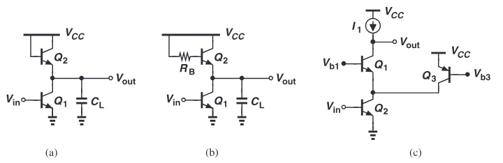

# 장말문제 11.24 — 바이폴라 회로(Fig 11.78)의 트랜지스터 커패시턴스 식별

## 조건
- 회로: Fig 11.78 (a)–(c) 바이폴라 회로 ((a) 다이오드 연결 $Q_2$ 부하 CE 단, (b) $R_B$를 거친 $Q_2$ 부하 CE 단, (c) 전류원 $I_1$ 부하 캐스코드 $Q_1$–$Q_2$와 캐스코드 노드에 컬렉터가 붙은 pnp $Q_3$) (괄호 안 회로 이름은 원문에 없음)

## 구할 것
- 각 회로에서 트랜지스터 커패시턴스를 모두 찾기
- 그중 어느 것들이 병렬이고, 어느 것들이 양 끝 모두 접지되어 있는지 판단

## 회로 — Fig 11.78(a)
```spice
Q2  VCC   VCC   Vout  npn   ; 베이스가 선으로 VCC 레일에 이어짐 (다이오드 연결)
Q1  Vout  Vin   0     npn
CL  Vout  0     {C_L}
```
- 단자: VCC = 전원, 값 미지정 (가로 레일, 짧고 굵은 가로선) / Vin = 입력 (개방 원) / Vout = 출력 (개방 원)
- 표시: 노드 라벨 V_CC (레일 오른쪽 끝), V_in (입력 원 왼쪽), V_out (출력 원 오른쪽) / 소자 라벨 Q2 (Q2 오른쪽), Q1 (Q1 오른쪽, 이미터 옆), C_L (커패시터 오른쪽) / 부호 없음 / 화살표 없음 / 수치·면적 라벨 없음
- 배치: 맨 위 짧은 굵은 가로 레일 V_CC / 한 세로줄 위→아래 Q2, 출력 접속점, Q1, 접지 / Q2 npn 보통 방향(베이스 왼쪽, 컬렉터 위 → 레일, 이미터 아래) / 레일 왼쪽 끝에서 선이 아래로 내려와 Q2 베이스 높이에서 오른쪽으로 꺾여 Q2 베이스 / Q1 npn 보통 방향, V_in 원 → 가로선 → Q1 베이스 / 출력 접속점에서 가로선이 오른쪽으로 C_L 접속점을 지나 V_out 원에서 끝남 / C_L은 세로로 내려가고 그 아래 접지 / 접지 기호는 Q1 이미터 아래, C_L 아래에 따로 / 접속점 (세 갈래 이상, 2곳): ① 출력 = 위 Q2 이미터 + 아래 Q1 컬렉터 + 오른쪽 가로선 (점) ② C_L 위 = 왼쪽 가로선 + 오른쪽 V_out 선 + 아래 C_L (점) / 교차: 없음

## 회로 — Fig 11.78(b)
```spice
RB  VCC   n1    {R_B}
Q2  VCC   n1    Vout  npn
Q1  Vout  Vin   0     npn
CL  Vout  0     {C_L}
```
- 단자: VCC = 전원, 값 미지정 (가로 레일) / Vin = 입력 (개방 원) / Vout = 출력 (개방 원)
- 표시: 노드 라벨 V_CC (레일 오른쪽 끝), V_in (입력 원 왼쪽), V_out (출력 원 오른쪽) / 소자 라벨 R_B (저항 아래), Q2 (Q2 오른쪽), Q1 (Q1 오른쪽, 이미터 옆), C_L (커패시터 오른쪽) / 부호 없음 / 화살표 없음 / 수치·면적 라벨 없음
- 배치: (a)와 같은 모양에서 Q2 베이스 연결선에 가로 R_B가 들어감 / 맨 위 굵은 가로 레일 V_CC (a보다 김) / 레일 왼쪽 끝에서 선이 아래로 내려와 Q2 베이스 높이에서 오른쪽으로 꺾여 가로 R_B를 지나 Q2 베이스 / Q2 컬렉터는 위로 레일, 이미터는 아래로 출력 접속점 / Q1 npn 보통 방향, V_in 원 → 가로선 → Q1 베이스 / 출력 접속점에서 가로선이 오른쪽으로 C_L 접속점을 지나 V_out 원에서 끝남 / 접지 기호는 Q1 이미터 아래, C_L 아래에 따로 / 접속점 (세 갈래 이상, 2곳): ① 출력 = 위 Q2 이미터 + 아래 Q1 컬렉터 + 오른쪽 가로선 (점) ② C_L 위 = 왼쪽 가로선 + 오른쪽 V_out 선 + 아래 C_L (점) / 교차: 없음

## 회로 — Fig 11.78(c)
```spice
I1  VCC   Vout             ; 화살표 아래
Q1  Vout  Vb1   n1    npn
Q2  n1    Vin   0     npn
Q3  n1    Vb3   VCC   pnp   ; 좌우 반전 (베이스 오른쪽)
```
- 단자: VCC = 전원, 값 미지정 (T 전원 기호 2개: I1 위, Q3 이미터 위) / Vb1, Vb3 = 이상적 DC 바이어스 (점 단자) / Vin = 입력 (개방 원) / Vout = 출력 (개방 원)
- 표시: 노드 라벨 V_CC (I1 위 T 기호 오른쪽), V_out (출력 원 오른쪽), V_b1 (점 단자 왼쪽), V_CC (Q3 위 T 기호 오른쪽), V_b3 (점 단자 오른쪽), V_in (입력 원 왼쪽) / 소자 라벨 I_1 (전류원 왼쪽), Q1 (트랜지스터 오른쪽), Q3 (트랜지스터 왼쪽), Q2 (트랜지스터 오른쪽) / 부호 없음 / 화살표 없음 / 수치·면적 라벨 없음
- 배치: 왼쪽 세로줄 위→아래 V_CC T 기호, 전류원 I_1(원 안 화살표 아래), 출력 접속점, Q1, 가운데 접속점, Q2, 접지 / Q1, Q2 npn 보통 방향(베이스 왼쪽, 컬렉터 위, 이미터 아래) / V_b1 점 단자 → 가로선 → Q1 베이스, V_in 원 → 가로선 → Q2 베이스 / 출력 접속점에서 가로선이 오른쪽으로 V_out 원에서 끝남 / 오른쪽에 Q3 pnp 좌우 반전(베이스 막대 오른쪽 → 가로선 → V_b3 점 단자, 이미터 왼쪽 위·화살표 안쪽 → 위로 V_CC T 기호, 컬렉터 왼쪽 아래) / Q3 컬렉터에서 선이 아래로 내려가 가운데 접속점 높이에서 왼쪽으로 꺾인 긴 가로선이 가운데 접속점 / 접속점 (세 갈래 이상, 2곳): ① 출력 = 위 전류원 + 아래 Q1 컬렉터 + 오른쪽 V_out 선 (점) ② 가운데 = 위 Q1 이미터 + 아래 Q2 컬렉터 + 오른쪽 Q3 컬렉터로 가는 선 (점) / 교차: 없음


> 참고: Fig 11.78 (a)(b)는 Fig 11.64 (a)(b)(P11.3)와 같은 회로 모양이다
