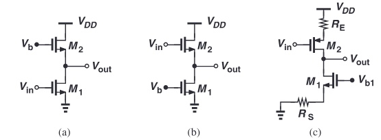

# 장말문제 11.25 — MOS 회로(Fig 11.79)의 트랜지스터 커패시턴스 식별

## 원문
For the MOS circuits shown in Fig. 11.79, identify all of the transistor capacitances and determine which ones are in parallel and which ones are grounded on both ends.

## 조건
- 회로: Fig 11.79 (a)–(c) MOS 회로 ((a) $V_b$ 게이트 NMOS $M_2$가 위에 있는 NMOS CS 단, (b) $M_2$가 입력을 받는 소스 폴로어와 $V_b$ 게이트 $M_1$ 전류원, (c) 소스에 $R_E$가 달린 PMOS CS 단 $M_2$와 소스에 $R_S$가 달린 NMOS 전류원 $M_1$) (괄호 안 회로 이름은 원문에 없음)

## 구할 것
- 각 회로에서 트랜지스터 커패시턴스를 모두 찾기
- 그중 어느 것들이 병렬이고, 어느 것들이 양 끝 모두 접지되어 있는지 판단

## 회로 — Fig 11.79(a)
```spice
M2  VDD   Vb    Vout  nmos
M1  Vout  Vin   0     nmos
```
- 단자: VDD = 전원, 값 미지정 (T 전원 기호) / Vb = 이상적 DC 바이어스 (점 단자) / Vin = 입력 (개방 원) / Vout = 출력 (개방 원)
- 표시: 노드 라벨 V_DD (T 기호 오른쪽), V_b (점 단자 왼쪽), V_out (출력 원 오른쪽), V_in (입력 원 왼쪽) / 소자 라벨 M2 (트랜지스터 오른쪽, 소스 옆), M1 (트랜지스터 오른쪽, 소스 옆) / 부호 없음 / 화살표 없음 / 수치·면적 라벨 없음
- 배치: 한 세로줄 위→아래 V_DD T 기호, M2, 출력 접속점, M1, 접지 / M2, M1 모두 NMOS 보통 방향(게이트 왼쪽, 드레인 위, 소스 아래) / V_b 점 단자 → 가로선 → M2 게이트, V_in 원 → 가로선 → M1 게이트 / 출력 접속점에서 가로선이 오른쪽으로 V_out 원에서 끝남 / 접속점 (세 갈래 이상, 1곳): ① 출력 = 위 M2 소스 + 아래 M1 드레인 + 오른쪽 V_out 선 (점) / 교차: 없음

## 회로 — Fig 11.79(b)
```spice
M2  VDD   Vin   Vout  nmos
M1  Vout  Vb    0     nmos
```
- 단자: VDD = 전원, 값 미지정 (T 전원 기호) / Vin = 입력 (개방 원) / Vb = 이상적 DC 바이어스 (점 단자) / Vout = 출력 (개방 원)
- 표시: 노드 라벨 V_DD (T 기호 오른쪽), V_in (입력 원 왼쪽), V_out (출력 원 오른쪽), V_b (점 단자 왼쪽) / 소자 라벨 M2 (트랜지스터 오른쪽, 소스 옆), M1 (트랜지스터 오른쪽, 소스 옆) / 부호 없음 / 화살표 없음 / 수치·면적 라벨 없음
- 배치: (a)와 같은 모양에서 두 게이트 입력이 바뀜 / 한 세로줄 위→아래 V_DD T 기호, M2, 출력 접속점, M1, 접지 / M2, M1 모두 NMOS 보통 방향 / V_in 원 → 가로선 → M2 게이트, V_b 점 단자 → 가로선 → M1 게이트 / 출력 접속점에서 가로선이 오른쪽으로 V_out 원에서 끝남 / 접속점 (세 갈래 이상, 1곳): ① 출력 = 위 M2 소스 + 아래 M1 드레인 + 오른쪽 V_out 선 (점) / 교차: 없음

## 회로 — Fig 11.79(c)
```spice
RE  VDD   n1    {R_E}       ; 그림 라벨 R_E (MOS 회로지만 인쇄된 대로)
M2  Vout  Vin   n1    pmos
M1  Vout  Vb1   n2    nmos  ; 좌우 반전 (게이트 오른쪽)
RS  n2    0     {R_S}
```
- 단자: VDD = 전원, 값 미지정 (T 전원 기호) / Vin = 입력 (개방 원) / Vb1 = 이상적 DC 바이어스 (점 단자) / Vout = 출력 (개방 원)
- 표시: 노드 라벨 V_DD (T 기호 오른쪽), V_in (입력 원 왼쪽), V_out (출력 원 오른쪽), V_b1 (점 단자 오른쪽) / 소자 라벨 R_E (저항 오른쪽), M2 (트랜지스터 오른쪽), M1 (트랜지스터 왼쪽), R_S (저항 아래) / 부호 없음 / 화살표 없음 / 수치·면적 라벨 없음
- 배치: 한 세로줄 위→아래 V_DD T 기호, R_E, M2, 출력 접속점, M1 / M2 PMOS(게이트 왼쪽, 소스 위 → R_E, 드레인 아래, 소스 화살표는 게이트 쪽을 향함), V_in 원 → 가로선 → M2 게이트 / 출력 접속점에서 가로선이 오른쪽으로 V_out 원에서 끝남 / 출력 접속점에서 선이 아래로 내려가 오른쪽으로 짧게 꺾여 M1 드레인 / M1 NMOS 좌우 반전(게이트 오른쪽 → 가로선 → V_b1 점 단자, 드레인 위, 소스 아래, 소스 화살표는 왼쪽 바깥을 향함) / M1 소스에서 선이 아래로 내려가 왼쪽으로 꺾여 가로 R_S를 지나 왼쪽 끝 접지 기호 / 접속점 (세 갈래 이상, 1곳): ① 출력 = 위 M2 드레인 + 아래 M1 드레인으로 가는 선 + 오른쪽 V_out 선 (점) / 교차: 없음


> 참고: Fig 11.79는 635쪽 위(오른쪽 단 위)에 문제 11.25 문장보다 먼저 인쇄됨
