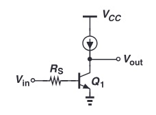

# 장말문제 11.36 — 전류원 부하 CE 단(Fig 11.80)의 입력·출력 극점과 전달 함수 (밀러 이론)

## 원문
The common-emitter stage of Fig. 11.80 employs a current-source load to achieve a high gain (at low frequencies). Assuming $V_A < \infty$ and using Miller's theorem, determine the input and output poles and hence the transfer function of the circuit.

## 조건
- 회로: Fig 11.80 — 저주파수에서 높은 이득을 얻기 위해 전류원 부하를 쓴 CE 단, 입력에 $R_S$
- $V_A < \infty$로 가정

## 구할 것
- 밀러 이론을 이용해 입력 극점과 출력 극점을 구하고, 이로부터 회로의 전달 함수 구하기

## 회로 — Fig 11.80
```spice
I1  VCC   Vout             ; 라벨·값 없는 전류원, 화살표 아래
RS  Vin   n1    {R_S}
Q1  Vout  n1    0     npn
```
- 단자: VCC = 전원, 값 미지정 (T 전원 기호) / Vin = 입력 (개방 원) / Vout = 출력 (개방 원)
- 표시: 노드 라벨 V_CC (T 기호 오른쪽), V_in (입력 원 왼쪽), V_out (출력 원 오른쪽) / 소자 라벨 I1 (라벨 없음), R_S (저항 위), Q1 (트랜지스터 오른쪽, 이미터 옆) / 부호 없음 / 화살표 없음 / 수치·면적 라벨 없음
- 배치: 한 세로줄 위→아래 V_CC T 기호, 전류원(원 안 화살표 아래), 컬렉터 접속점, Q1, 접지 / Q1 npn 보통 방향(베이스 왼쪽, 컬렉터 위, 이미터 아래 → 접지) / V_in 원 → 가로 R_S → Q1 베이스 / 컬렉터 접속점에서 가로선이 오른쪽 V_out 원에서 끝남 / 접속점 (세 갈래 이상, 1곳): ① 컬렉터 = 위 전류원 + 아래 Q1 컬렉터 + 오른쪽 V_out 선 (점) / 교차: 없음



## 풀이
### 출력 노드 저항과 이득
- 전류원을 이상적(출력 저항 무한대, 커패시턴스 없음)으로 보면 $V_A < \infty$라 컬렉터에서 접지로 가는 저항은 $Q_1$의 출력 저항 $r_O = V_A/I_C$뿐이다
- 베이스에서 컬렉터까지 이득 $A = -g_m r_O$ ($g_m$: $Q_1$의 트랜스컨덕턴스)
### 입력·출력 극점
- $Q_1$의 $C_\pi$(베이스–이미터), $C_\mu$(베이스–컬렉터), $C_{CS}$(컬렉터–기판)를 넣고, $C_\mu$를 밀러로 입력 쪽 $(1 + g_m r_O)C_\mu$, 출력 쪽 $(1 + 1/(g_m r_O))C_\mu$로 나눈다
- 베이스에서 본 저항은 $R_S \parallel r_\pi$ ($r_\pi$: $Q_1$의 베이스 입력 저항), 출력에서 본 저항은 $r_O$
### 전달 함수
- 저주파수 이득은 입력 분배 $r_\pi/(r_\pi + R_S)$와 $-g_m r_O$의 곱이고, 여기에 두 극점을 붙인다
### 답
- 입력 극점 $|\omega_{p,in}| = \dfrac{1}{(R_S \parallel r_\pi)[C_\pi + (1 + g_m r_O)C_\mu]}$
- 출력 극점 $|\omega_{p,out}| = \dfrac{1}{r_O[C_{CS} + (1 + 1/(g_m r_O))C_\mu]}$
- $\dfrac{V_{out}}{V_{in}}(s) = \dfrac{-g_m r_O\, r_\pi/(r_\pi + R_S)}{(1 + s/|\omega_{p,in}|)(1 + s/|\omega_{p,out}|)}$
